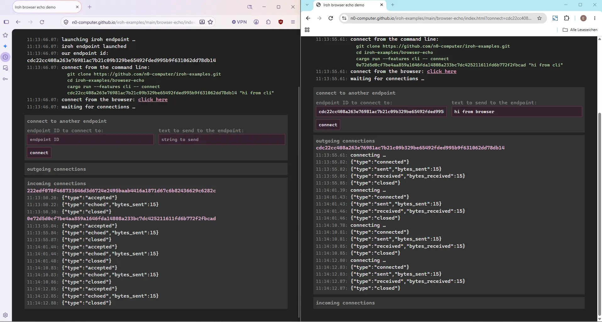
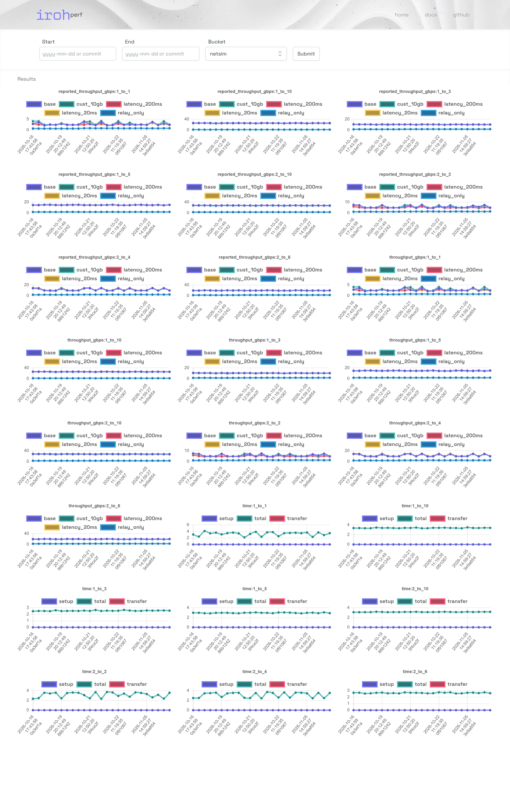

# Iroh 1.0 macht aus dem Internet einen sicheren Localhost

Der modulare Networking-Stack Iroh erreicht Version 1.0. Er setzt auf kryptografische Schlüssel statt IP-Adressen für die Vernetzung.

Mit der Veröffentlichung von Version 1.0 hat das Entwicklerteam von n0 seinen modularen Networking-Stack Iroh als stabil freigegeben. Das Projekt zielt auf einen grundlegenden Paradigmenwechsel bei der Vernetzung von Geräten ab: Anstatt IP-Adressen als primäres Adressierungsschema zu nutzen, setzt Iroh auf kryptografische Schlüssel.

https://www.heise.de/news/Iroh-1-0-macht-aus-dem-Internet-einen-sicheren-Localhost-11336633.html

https://github.com/n0-computer/iroh

https://perf.iroh.computer/

