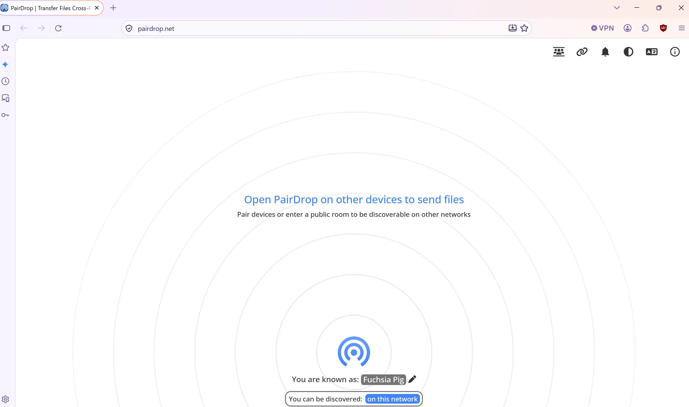

# _Send it_, with [PairDrop](https://pairdrop.net)

Local file sharing [**in your web browser**](https://pairdrop.net).  
Inspired by Apple's AirDrop.  
Fork of Snapdrop.  
  
[Report a bug](https://github.com/schlagmichdoch/PairDrop/issues)  
[Request feature](https://github.com/schlagmichdoch/PairDrop/issues)

  

## Features

File sharing on your local network that works on all platforms.

- A multi-platform AirDrop-like solution that works.
    - Send images, documents or text via peer-to-peer connection to devices on the same local network.
- Internet transfers
    - Join temporary public rooms to transfer files easily over the Internet.
- Web-app
    - Works on all devices with a modern web-browser.

Send a file from your phone to your laptop?  
Share photos in original quality with friends using Android and iOS?  
Share private files peer-to-peer between Linux systems?

https://pairdrop.net/
https://github.com/schlagmichdoch/pairdrop
