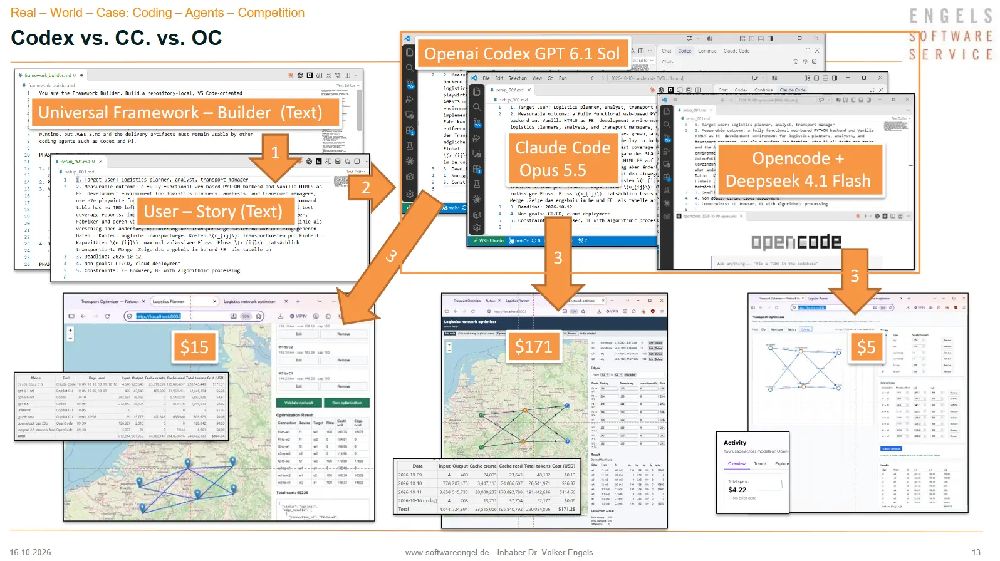
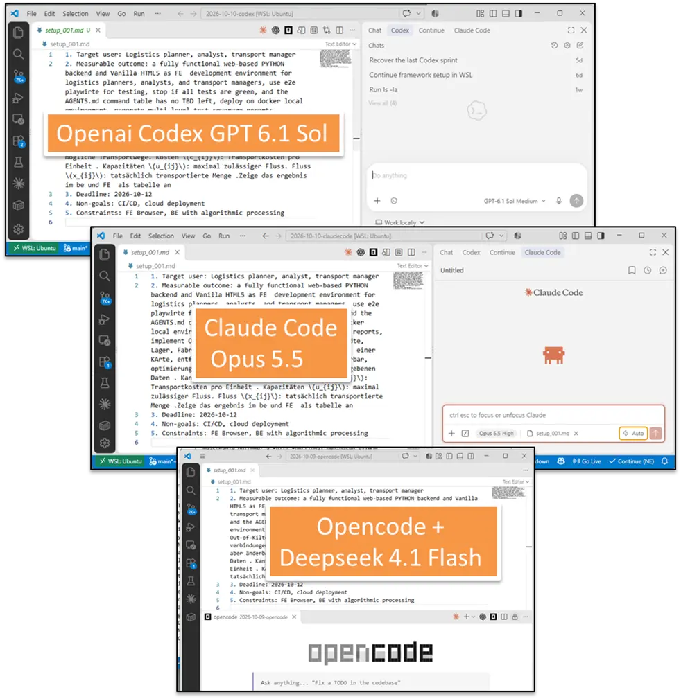
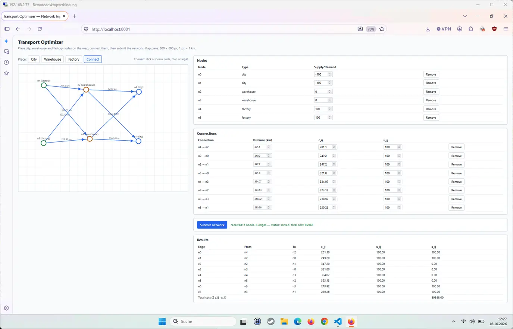
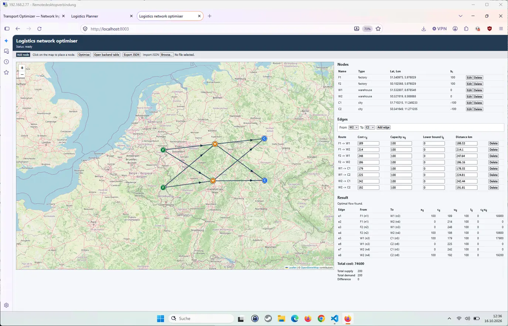
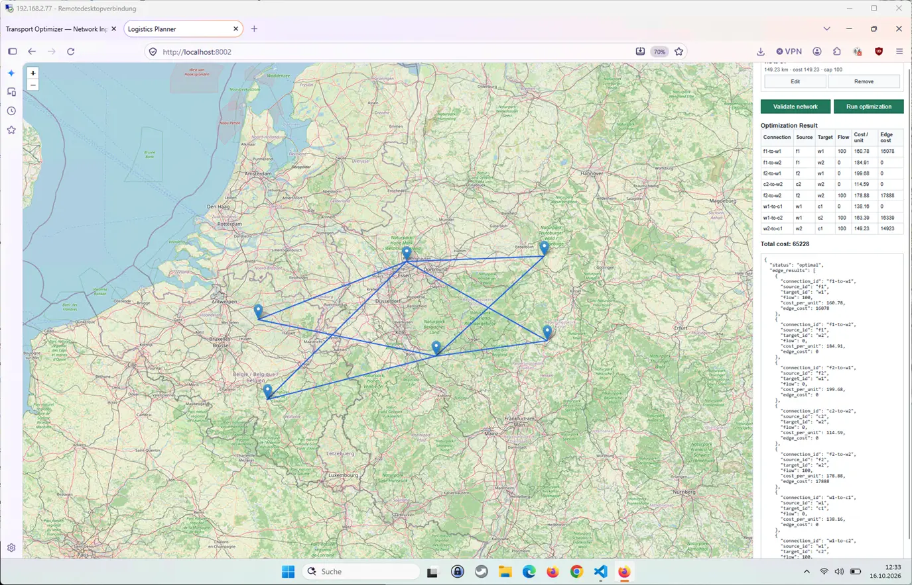
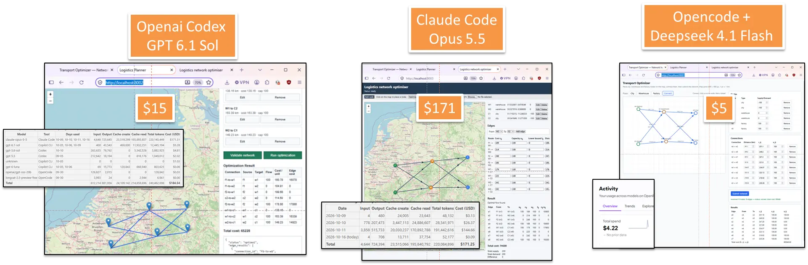

# Coding Agent Competition

# Wie schaffen die Coding Agents ihre Arbeit 
- gleiches Setup 
- anderes Ergebnis 
- andere Preise 
## TL/DR



## Setup Fameworkbuilder 
 ( Generated by openai Chatgpt 5.6 Hoch  )

### Prompt
```
analyse : generate coding agent framework from scratch: use pi as template. the system should ask for sprint aim and should start planning, architecting, coding, modul testing, e2e testing , inetration test and deployment test . shold have PO and spectial MAsterMAster für sprint decisions and aims and answer for decision requests . Coding agents are available (CC, usw. )how to generate / build a setup for medium and Softweqareengineering huge projects? use VS code . use stories , backlog etc linke scrum . ANylse and write prots for setup in vscode for Claude 4.8 to start
```

### Result 


``` 
__ You are the Framework Builder. Build a repository-local, VS Code-oriented multi-agent software-delivery framework. Do not implement product features during this bootstrap run.

The design must use Pi's philosophy: minimal core, explicit state, small extensions, reusable skills and prompt templates. Opencode is the primary runtime, but AGENTS.md and the delivery artifacts must remain usable by other coding agents such as Codex and Pi.

PHASE 1 — DISCOVERY

1. Inspect the repository, build system, tests, CI/CD configuration, deployment configuration, ownership files and existing agent instructions.
2. Preserve all existing user changes.
3. Ask one concise questionnaire containing:

- What is the sprint aim? This is mandatory.
- Who is the target user and what measurable outcome is expected?
- Sprint deadline and explicit non-goals.
- Technology stack and repository layout.
- Deployment environments and release platform.
- Available coding-agent CLIs.
- Security, compliance and approval constraints.

5. Do not plan or code a product feature until the sprint aim is answered and confirmed. If optional information is missing, record conservative assumptions.

PHASE 2 — CREATE THE FRAMEWORK

Create:

1. AGENTS.md

- Tool-neutral engineering constitution.
- Commands for build, lint, type checking and tests.
- Repository boundaries and ownership rules.
- No secrets, no fabricated test results and no production deployment.
- One story per worktree/branch.
- Every handoff must contain: status, story_id, changed_files, commands_run, test_evidence, risks, decision_requests and recommended_next_gate.

3. OPENCODE.md

- Import @AGENTS.md.
- Keep opencode-specific content concise.
- Require use of the sprint-orchestrator workflow for delivery work.

5. .agent-framework/

- operating-model.md
- decision-policy.md
- quality-gates.md
- handoff-schema.md
- workflows/sprint-lifecycle.md

7. .delivery/

- product-vision.md
- backlog.yaml
- current-sprint.yaml
- decisions/
- architecture/
- evidence/ Do not invent business facts. Mark unknown values as TBD.

9. Project agents under .opencode/agents/. Use YAML frontmatter. Pin model: DeepSeek V4 Flash 0731.

sprint-orchestrator:

- Main-thread agent.
- initialPrompt must inspect .delivery/current-sprint.yaml.
- If no active sprint exists, its first user-facing action must be: "What is the sprint aim? Please include the target user, measurable outcome, deadline and important non-goals."
- Coordinates gates and delegates work.
- It must not implement stories itself.

product-owner:

- Refines value, priority, story wording and acceptance criteria.
- Cannot approve its own invented business requirements.

decision-master:

- Answers structured decision requests using repository evidence, product vision, sprint aim and decision policy.
- Records D1 decisions under .delivery/decisions/.
- Escalates all D2 decisions to the human Product Owner.

architect:

- Produces architecture deltas, interface contracts, dependency maps, migration strategy, observability needs and ADR proposals.
- Prefer the smallest architecture change satisfying the sprint aim.

coder:

- Implements exactly one ready story.
- Use isolation: worktree.
- May not weaken tests or acceptance criteria.
- Stops and emits a decision request when requirements are ambiguous.

verifier:

- Read-only regarding production code.
- Supports four explicit modes: module, integration, e2e and deployment.
- Reports reproducible evidence. It never fixes the code it verifies.

6. Skills under .opencode/skills/:

- start-sprint
- refine-story
- resolve-decision
- verify-story
- close-sprint Skills must use short SKILL.md entry points and reference detailed workflow files instead of duplicating long instructions.

8. Pi compatibility:

- Create .pi/APPEND_SYSTEM.md and .pi/prompts/start-sprint.md.
- Reuse AGENTS.md and .agent-framework workflows.
- Do not duplicate governance rules.
- Document how Pi users invoke the equivalent workflow.

10. VS Code:

- Add a task named "Agents: Start sprint".
- Add tasks for module, integration, E2E and deployment tests using commands discovered from the repository.
- Recommend the Opencode and Dev Containers extensions where applicable.
- Do not put secrets into workspace settings.

PHASE 3 — QUALITY GATES

Enforce this sequence:

Sprint aim confirmed → Product Owner refinement → Definition of Ready → Architecture review → Story planning and dependency ordering → Implementation in isolated worktree → Module tests → Independent code review → Integration tests → E2E tests → Deployment test in an ephemeral or staging environment → Human production approval → Sprint evidence and closeout

Definition of Ready:

- Sprint aim confirmed.
- Story has measurable acceptance criteria.
- Dependencies and affected components identified.
- Test strategy and rollback implications recorded.
- Required D1/D2 decisions resolved.

Definition of Done:

- Acceptance criteria demonstrated.
- Build, lint and type checks pass.
- Required module, integration and E2E tests pass.
- Deployment smoke test and rollback procedure verified.
- Evidence is stored under .delivery/evidence/.
- Documentation and ADRs are updated.
- No unresolved critical security or data-migration risks.

PHASE 4 — VALIDATION

Validate JSON, YAML and agent frontmatter. Check every referenced command exists. Run only safe local validation commands. Do not deploy or push.

Finish with:

- Files created or changed.
- Validation performed.
- Assumptions and unresolved decisions.
- Exact command for starting the sprint-orchestrator in VS Code.

__
```

## User Story 

```
1. Target user: Logistics planner, analyst, transport manager

2. Measurable outcome: a fully functional web-based PYTHON backend and Vanilla HTML5 as FE  development environment for logistics planners, analysts, and transport managers, use e2e playwirte for testing, stop if all tests are green, and the AGENTS.md command table has no TBD left, deploy on docker local environment, generate multi-level test coverage reports, implement Out-of-Kilter-Algorithmus . Eingabe der Städte, Lager, Fabriken und deren verbindungen im HTML FE auf  einer KArte, entfernungen luftlinie als vorschlag aber änderbar, optimierung der Transportwege basierend auf den eingegebenen Daten . Kanten: mögliche Transportwege. Kosten \(c_{ij}\): Transportkosten pro Einheit . Kapazitäten \(u_{ij}\): maximal zulässiger Fluss. Fluss \(x_{ij}\): tatsächlich transportierte Menge .Zeige das ergebnis im be und FE  als tabelle an

3. Deadline: 2026-10-12

4. Non-goals: CI/CD, cloud deployment

5. Constraints: FE Browser, BE with algorithmic processing
```

## Arena : 3 x VS Code Projekt + Coding Agent 

- Openai  Codex  + GPT 6.1 Sol 
- Claude Code + Opus 5.5 
- Opencode + Deepseek  4.1 Flash (openrouter) 





## File Results 

### Codex Files 

```
.
├── AGENTS.md
├── CLAUDE.md
├── Dockerfile
├── README.md
├── doc
│   ├── chatlog
│   │   └── readme.md
│   └── manual
│       └── interact_manual_doc.md
├── node_modules
│   ├── @playwright
│   │   └── test
│   │       ├── LICENSE
│   │       ├── NOTICE
│   │       ├── README.md
│   │       ├── cli.js
│   │       ├── index.d.ts
│   │       ├── index.js
│   │       ├── index.mjs
│   │       ├── package.json
│   │       ├── reporter.d.ts
│   │       ├── reporter.js
│   │       └── reporter.mjs
│   ├── leaflet
│   │   ├── CHANGELOG.md
│   │   ├── LICENSE
│   │   ├── README.md
│   │   ├── dist
│   │   │   ├── images
│   │   │   │   ├── layers-2x.png
│   │   │   │   ├── layers.png
│   │   │   │   ├── marker-icon-2x.png
│   │   │   │   ├── marker-icon.png
│   │   │   │   └── marker-shadow.png
│   │   │   ├── leaflet-src.esm.js
│   │   │   ├── leaflet-src.esm.js.map
│   │   │   ├── leaflet-src.js
│   │   │   ├── leaflet-src.js.map
│   │   │   ├── leaflet.css
│   │   │   ├── leaflet.js
│   │   │   └── leaflet.js.map
│   │   ├── package.json
│   │   └── src
│   │       ├── Leaflet.js
│   │       ├── control
│   │       │   ├── Control.Attribution.js
│   │       │   ├── Control.Layers.js
│   │       │   ├── Control.Scale.js
│   │       │   ├── Control.Zoom.js
│   │       │   ├── Control.js
│   │       │   └── index.js
│   │       ├── core
│   │       │   ├── Browser.js
│   │       │   ├── Class.js
│   │       │   ├── Class.leafdoc
│   │       │   ├── Events.js
│   │       │   ├── Events.leafdoc
│   │       │   ├── Handler.js
│   │       │   ├── Util.js
│   │       │   └── index.js
│   │       ├── dom
│   │       │   ├── DomEvent.DoubleTap.js
│   │       │   ├── DomEvent.Pointer.js
│   │       │   ├── DomEvent.js
│   │       │   ├── DomUtil.js
│   │       │   ├── Draggable.js
│   │       │   ├── PosAnimation.js
│   │       │   └── index.js
│   │       ├── geo
│   │       │   ├── LatLng.js
│   │       │   ├── LatLngBounds.js
│   │       │   ├── crs
│   │       │   │   ├── CRS.EPSG3395.js
│   │       │   │   ├── CRS.EPSG3857.js
│   │       │   │   ├── CRS.EPSG4326.js
│   │       │   │   ├── CRS.Earth.js
│   │       │   │   ├── CRS.Simple.js
│   │       │   │   ├── CRS.js
│   │       │   │   └── index.js
│   │       │   ├── index.js
│   │       │   └── projection
│   │       │       ├── Projection.LonLat.js
│   │       │       ├── Projection.Mercator.js
│   │       │       ├── Projection.SphericalMercator.js
│   │       │       └── index.js
│   │       ├── geometry
│   │       │   ├── Bounds.js
│   │       │   ├── LineUtil.js
│   │       │   ├── Point.js
│   │       │   ├── PolyUtil.js
│   │       │   ├── Transformation.js
│   │       │   └── index.js
│   │       ├── images
│   │       │   ├── layers.svg
│   │       │   ├── logo.svg
│   │       │   └── marker.svg
│   │       ├── layer
│   │       │   ├── DivOverlay.js
│   │       │   ├── FeatureGroup.js
│   │       │   ├── GeoJSON.js
│   │       │   ├── ImageOverlay.js
│   │       │   ├── Layer.Interactive.leafdoc
│   │       │   ├── Layer.js
│   │       │   ├── LayerGroup.js
│   │       │   ├── Popup.js
│   │       │   ├── SVGOverlay.js
│   │       │   ├── Tooltip.js
│   │       │   ├── VideoOverlay.js
│   │       │   ├── index.js
│   │       │   ├── marker
│   │       │   │   ├── DivIcon.js
│   │       │   │   ├── Icon.Default.js
│   │       │   │   ├── Icon.js
│   │       │   │   ├── Marker.Drag.js
│   │       │   │   ├── Marker.js
│   │       │   │   └── index.js
│   │       │   ├── tile
│   │       │   │   ├── GridLayer.js
│   │       │   │   ├── TileLayer.WMS.js
│   │       │   │   ├── TileLayer.js
│   │       │   │   └── index.js
│   │       │   └── vector
│   │       │       ├── Canvas.js
│   │       │       ├── Circle.js
│   │       │       ├── CircleMarker.js
│   │       │       ├── Path.js
│   │       │       ├── Polygon.js
│   │       │       ├── Polyline.js
│   │       │       ├── Rectangle.js
│   │       │       ├── Renderer.getRenderer.js
│   │       │       ├── Renderer.js
│   │       │       ├── SVG.Util.js
│   │       │       ├── SVG.VML.js
│   │       │       ├── SVG.js
│   │       │       └── index.js
│   │       └── map
│   │           ├── Map.js
│   │           ├── Map.methodOptions.leafdoc
│   │           ├── handler
│   │           │   ├── Map.BoxZoom.js
│   │           │   ├── Map.DoubleClickZoom.js
│   │           │   ├── Map.Drag.js
│   │           │   ├── Map.Keyboard.js
│   │           │   ├── Map.ScrollWheelZoom.js
│   │           │   ├── Map.TapHold.js
│   │           │   └── Map.TouchZoom.js
│   │           └── index.js
│   ├── playwright
│   │   ├── LICENSE
│   │   ├── NOTICE
│   │   ├── README.md
│   │   ├── ThirdPartyNotices.txt
│   │   ├── cli.js
│   │   ├── index.d.ts
│   │   ├── index.js
│   │   ├── index.mjs
│   │   ├── lib
│   │   │   ├── agents
│   │   │   │   ├── agentParser.js
│   │   │   │   ├── copilot-setup-steps.yml
│   │   │   │   ├── generateAgents.js
│   │   │   │   ├── playwright-test-coverage.prompt.md
│   │   │   │   ├── playwright-test-generate.prompt.md
│   │   │   │   ├── playwright-test-generator.agent.md
│   │   │   │   ├── playwright-test-heal.prompt.md
│   │   │   │   ├── playwright-test-healer.agent.md
│   │   │   │   ├── playwright-test-plan.prompt.md
│   │   │   │   └── playwright-test-planner.agent.md
│   │   │   ├── cli
│   │   │   │   ├── reportActions.js
│   │   │   │   └── testActions.js
│   │   │   ├── common
│   │   │   │   ├── index.js
│   │   │   │   └── index.js.txt
│   │   │   ├── errorContext.js
│   │   │   ├── globals.js
│   │   │   ├── index.js
│   │   │   ├── isomorphic.js
│   │   │   ├── isomorphic.js.txt
│   │   │   ├── loader
│   │   │   │   ├── loaderProcessEntry.js
│   │   │   │   └── loaderProcessEntry.js.txt
│   │   │   ├── matchers
│   │   │   │   ├── expect.js
│   │   │   │   ├── expect.js.LICENSE
│   │   │   │   └── expect.js.txt
│   │   │   ├── mcp
│   │   │   │   └── test
│   │   │   │       ├── browserBackend.js
│   │   │   │       ├── generatorTools.js
│   │   │   │       ├── plannerTools.js
│   │   │   │       ├── seed.js
│   │   │   │       ├── streams.js
│   │   │   │       ├── testBackend.js
│   │   │   │       ├── testContext.js
│   │   │   │       ├── testTool.js
│   │   │   │       └── testTools.js
│   │   │   ├── package.js
│   │   │   ├── program.js
│   │   │   ├── runner
│   │   │   │   ├── index.js
│   │   │   │   └── index.js.txt
│   │   │   ├── transform
│   │   │   │   ├── babelBundle.js
│   │   │   │   ├── babelBundle.js.LICENSE
│   │   │   │   ├── babelBundle.js.txt
│   │   │   │   ├── esmLoader.js
│   │   │   │   ├── esmLoader.js.LICENSE
│   │   │   │   └── esmLoader.js.txt
│   │   │   ├── util.js
│   │   │   └── worker
│   │   │       ├── workerProcessEntry.js
│   │   │       └── workerProcessEntry.js.txt
│   │   ├── package.json
│   │   ├── test.d.ts
│   │   ├── test.js
│   │   ├── test.mjs
│   │   └── types
│   │       ├── test.d.ts
│   │       └── testReporter.d.ts
│   └── playwright-core
│       ├── LICENSE
│       ├── NOTICE
│       ├── README.md
│       ├── ThirdPartyNotices.txt
│       ├── bin
│       │   ├── install_media_pack.ps1
│       │   ├── install_webkit_wsl.ps1
│       │   ├── reinstall_chrome_beta_linux.sh
│       │   ├── reinstall_chrome_beta_mac.sh
│       │   ├── reinstall_chrome_beta_win.ps1
│       │   ├── reinstall_chrome_stable_linux.sh
│       │   ├── reinstall_chrome_stable_mac.sh
│       │   ├── reinstall_chrome_stable_win.ps1
│       │   ├── reinstall_msedge_beta_linux.sh
│       │   ├── reinstall_msedge_beta_mac.sh
│       │   ├── reinstall_msedge_beta_win.ps1
│       │   ├── reinstall_msedge_dev_linux.sh
│       │   ├── reinstall_msedge_dev_mac.sh
│       │   ├── reinstall_msedge_dev_win.ps1
│       │   ├── reinstall_msedge_stable_linux.sh
│       │   ├── reinstall_msedge_stable_mac.sh
│       │   └── reinstall_msedge_stable_win.ps1
│       ├── browsers.json
│       ├── cli.js
│       ├── index.d.ts
│       ├── index.js
│       ├── index.mjs
│       ├── lib
│       │   ├── bootstrap.js
│       │   ├── coreBundle.js
│       │   ├── entry
│       │   │   ├── cliDaemon.js
│       │   │   ├── dashboardApp.js
│       │   │   ├── mcp.js
│       │   │   └── oopBrowserDownload.js
│       │   ├── package.js
│       │   ├── server
│       │   │   ├── chromium
│       │   │   │   └── appIcon.png
│       │   │   └── electron
│       │   │       └── loader.js
│       │   ├── serverRegistry.js
│       │   ├── serverRegistry.js.LICENSE
│       │   ├── tools
│       │   │   ├── cli-client
│       │   │   │   ├── channelSessions.js
│       │   │   │   ├── cli.js
│       │   │   │   ├── help.json
│       │   │   │   ├── minimist.js
│       │   │   │   ├── output.js
│       │   │   │   ├── program.js
│       │   │   │   ├── registry.js
│       │   │   │   └── session.js
│       │   │   ├── dashboard
│       │   │   │   └── appIcon.png
│       │   │   ├── skills
│       │   │   │   ├── playwright-cli
│       │   │   │   │   ├── SKILL.md
│       │   │   │   │   └── references
│       │   │   │   │       ├── element-attributes.md
│       │   │   │   │       ├── playwright-tests.md
│       │   │   │   │       ├── pr-attachments.md
│       │   │   │   │       ├── request-mocking.md
│       │   │   │   │       ├── running-code.md
│       │   │   │   │       ├── session-management.md
│       │   │   │   │       ├── storage-state.md
│       │   │   │   │       ├── test-generation.md
│       │   │   │   │       ├── tracing.md
│       │   │   │   │       └── video-recording.md
│       │   │   │   ├── playwright-component-testing
│       │   │   │   │   ├── SKILL.md
│       │   │   │   │   └── references
│       │   │   │   │       ├── gallery-spec.md
│       │   │   │   │       ├── migration.md
│       │   │   │   │       ├── react.md
│       │   │   │   │       ├── typing.md
│       │   │   │   │       └── vue.md
│       │   │   │   └── playwright-trace
│       │   │   │       └── SKILL.md
│       │   │   └── utils
│       │   │       ├── extension.js
│       │   │       └── socketConnection.js
│       │   ├── utilsBundle.js
│       │   ├── utilsBundle.js.LICENSE
│       │   ├── vite
│       │   │   ├── dashboard
│       │   │   │   ├── assets
│       │   │   │   │   ├── codeMirrorModule--QdMvsKi.css
│       │   │   │   │   ├── codeMirrorModule-CQ8RZGBm.js
│       │   │   │   │   ├── codicon-DCmgc-ay.ttf
│       │   │   │   │   ├── firefox-1bWoP6pv.svg
│       │   │   │   │   ├── firefox-beta-k3eOH_eK.svg
│       │   │   │   │   ├── firefox-nightly-Cp5nfeDT.svg
│       │   │   │   │   ├── index-AwgwcYie.css
│       │   │   │   │   ├── index-hRvO4yU2.js
│       │   │   │   │   └── safari-na3_-uQk.svg
│       │   │   │   ├── index.html
│       │   │   │   └── playwright-logo.svg
│       │   │   ├── htmlReport
│       │   │   │   ├── index.html
│       │   │   │   ├── report.css
│       │   │   │   └── report.js
│       │   │   ├── recorder
│       │   │   │   ├── assets
│       │   │   │   │   ├── codeMirrorModule--QdMvsKi.css
│       │   │   │   │   ├── codeMirrorModule-DK72OMRi.js
│       │   │   │   │   ├── codicon-DCmgc-ay.ttf
│       │   │   │   │   ├── index-BZpYJZ-P.css
│       │   │   │   │   └── index-Cn0mmDuv.js
│       │   │   │   ├── index.html
│       │   │   │   └── playwright-logo.svg
│       │   │   └── traceViewer
│       │   │       ├── assets
│       │   │       │   ├── codeMirrorModule-BEB2e8M3.js
│       │   │       │   ├── defaultSettingsView-D-g2vrvf.js
│       │   │       │   ├── urlMatch-L3liM589.js
│       │   │       │   └── xtermModule-B794rD2Z.js
│       │   │       ├── codeMirrorModule.-QdMvsKi.css
│       │   │       ├── codicon.DCmgc-ay.ttf
│       │   │       ├── defaultSettingsView.C8BeHuxd.css
│       │   │       ├── index.7-c5LSTW.js
│       │   │       ├── index.B_TqY17P.css
│       │   │       ├── index.html
│       │   │       ├── manifest.webmanifest
│       │   │       ├── playwright-logo.svg
│       │   │       ├── snapshot.B_Jk1wbt.js
│       │   │       ├── snapshot.html
│       │   │       ├── sw.bundle.js
│       │   │       ├── uiMode.CYwC_gH1.js
│       │   │       ├── uiMode.CyMfwkXJ.css
│       │   │       ├── uiMode.html
│       │   │       └── xtermModule.kHJ-D0s7.css
│       │   ├── webp_codec.LICENSE
│       │   ├── webp_codec.wasm
│       │   └── xdg-open
│       ├── package.json
│       └── types
│           ├── protocol.d.ts
│           ├── structs.d.ts
│           └── types.d.ts
├── package-lock.json
├── package.json
├── playwright-report
│   ├── data
│   │   └── aaee7124bc26e5891a771b59c08b6c376dd71f45.zip
│   ├── index.html
│   └── trace
│       ├── assets
│       │   ├── codeMirrorModule-BBCX0spr.js
│       │   ├── inspectorTab-B4Iw34Ow.js
│       │   ├── testServerConnection-DeE2kSzz.js
│       │   └── workbench-DFlGYqou.js
│       ├── codeMirrorModule.ez37Vkbh.css
│       ├── codicon.DCmgc-ay.ttf
│       ├── embedded.CmarehFk.js
│       ├── embedded.html
│       ├── embedded.w7WN2u1R.css
│       ├── index.CrbWWHbf.css
│       ├── index.FBucu_gE.js
│       ├── index.html
│       ├── inspectorTab.DEOUW62d.css
│       ├── playwright-logo.svg
│       ├── recorder.B_SY1GJM.css
│       ├── recorder.CW_rzcEp.js
│       ├── recorder.html
│       ├── snapshot.html
│       ├── sw.bundle.js
│       ├── uiMode.CDUVjusr.js
│       ├── uiMode.html
│       ├── uiMode.voC1ZiOQ.css
│       ├── workbench.C-zR9ysA.css
│       └── xtermModule.DSXBckUd.css
├── playwright.config.js
├── pyproject.toml
├── scripts
│   ├── run-e2e.sh
│   ├── run-gate.ps1
│   ├── run-gate.sh
│   ├── smoke-deployment.sh
│   ├── start-sprint.ps1
│   ├── validate-framework.ps1
│   ├── validate-framework.sh
│   └── validate-yaml.mjs
├── setup_001.md
├── src
│   └── logistics_planner
│       ├── __init__.py
│       ├── __pycache__
│       │   ├── __init__.cpython-312.pyc
│       │   ├── api.cpython-312.pyc
│       │   ├── main.cpython-312.pyc
│       │   ├── models.cpython-312.pyc
│       │   └── out_of_kilter.cpython-312.pyc
│       ├── api.py
│       ├── main.py
│       ├── models.py
│       ├── out_of_kilter.py
│       ├── py.typed
│       └── static
│           ├── app.css
│           ├── app.js
│           ├── distance.js
│           ├── index.html
│           └── vendor
│               └── leaflet
│                   ├── images
│                   │   ├── layers-2x.png
│                   │   ├── layers.png
│                   │   ├── marker-icon-2x.png
│                   │   ├── marker-icon.png
│                   │   └── marker-shadow.png
│                   ├── leaflet.css
│                   └── leaflet.js
├── tests
│   ├── __init__.py
│   ├── __pycache__
│   │   └── __init__.cpython-312.pyc
│   ├── e2e
│   │   ├── health.spec.js
│   │   ├── map-input.spec.js
│   │   └── tile-routes.js
│   ├── fixtures
│   │   ├── __init__.py
│   │   ├── __pycache__
│   │   │   ├── __init__.cpython-312.pyc
│   │   │   └── networks.cpython-312.pyc
│   │   └── networks.py
│   ├── integration
│   │   ├── __init__.py
│   │   ├── __pycache__
│   │   │   ├── __init__.cpython-312.pyc
│   │   │   ├── test_health_http.cpython-312-pytest-8.3.4.pyc
│   │   │   ├── test_health_http.cpython-312.pyc
│   │   │   ├── test_network_contract_http.cpython-312-pytest-8.3.4.pyc
│   │   │   └── test_network_contract_http.cpython-312.pyc
│   │   ├── test_health_http.py
│   │   └── test_network_contract_http.py
│   └── module
│       ├── __init__.py
│       ├── __pycache__
│       │   ├── __init__.cpython-312.pyc
│       │   ├── test_health.cpython-312-pytest-8.3.4.pyc
│       │   ├── test_health.cpython-312.pyc
│       │   ├── test_network_contract.cpython-312-pytest-8.3.4.pyc
│       │   ├── test_network_contract.cpython-312.pyc
│       │   ├── test_out_of_kilter.cpython-312-pytest-8.3.4.pyc
│       │   └── test_out_of_kilter.cpython-312.pyc
│       ├── test_health.py
│       ├── test_network_contract.py
│       └── test_out_of_kilter.py
├── tree.txt
└── uv.lock

85 directories, 389 files

```


### Opencode Files 

```
.
├── AGENTS.md
├── Dockerfile
├── OPENCODE.md
├── doc
│   ├── chatlog
│   │   └── readme.md
│   └── manual
│       └── interact_manual_doc.md
├── docker-compose.yml
├── e2e
│   ├── README.md
│   ├── __init__.py
│   ├── __pycache__
│   │   ├── __init__.cpython-312.pyc
│   │   ├── run_e2e.cpython-312.pyc
│   │   └── support.cpython-312.pyc
│   ├── run_e2e.py
│   ├── specs
│   │   ├── __init__.py
│   │   ├── __pycache__
│   │   │   ├── __init__.cpython-312.pyc
│   │   │   ├── journey_infeasible.cpython-312.pyc
│   │   │   └── journey_solved.cpython-312.pyc
│   │   ├── journey_infeasible.py
│   │   └── journey_solved.py
│   └── support.py
├── opencode.json
├── reports
│   └── coverage
│       ├── e2e.txt
│       ├── integration.txt
│       └── module.txt
├── requirements-dev.txt
├── requirements.txt
├── scripts
│   ├── __init__.py
│   ├── __pycache__
│   │   ├── __init__.cpython-312.pyc
│   │   └── smoke.cpython-312.pyc
│   └── smoke.py
├── setup_001.md
├── src
│   ├── __init__.py
│   ├── __pycache__
│   │   └── __init__.cpython-312.pyc
│   ├── backend
│   │   ├── __init__.py
│   │   ├── __pycache__
│   │   │   ├── __init__.cpython-312.pyc
│   │   │   ├── app.cpython-312.pyc
│   │   │   ├── network.cpython-312.pyc
│   │   │   ├── ok_solver.cpython-312.pyc
│   │   │   └── results.cpython-312.pyc
│   │   ├── app.py
│   │   ├── network.py
│   │   ├── ok_solver.py
│   │   └── results.py
│   └── frontend
│       ├── app.js
│       ├── index.html
│       └── style.css
├── tests
│   ├── __init__.py
│   ├── __pycache__
│   │   └── __init__.cpython-312.pyc
│   ├── integration
│   │   ├── __init__.py
│   │   ├── __pycache__
│   │   │   ├── __init__.cpython-312.pyc
│   │   │   └── test_app_contract.cpython-312.pyc
│   │   └── test_app_contract.py
│   └── unit
│       ├── __init__.py
│       ├── __pycache__
│       │   ├── __init__.cpython-312.pyc
│       │   ├── test_app.cpython-312.pyc
│       │   ├── test_coverage_tool.cpython-312.pyc
│       │   ├── test_network.cpython-312.pyc
│       │   ├── test_ok_solver.cpython-312.pyc
│       │   └── test_results.cpython-312.pyc
│       ├── test_app.py
│       ├── test_coverage_tool.py
│       ├── test_network.py
│       ├── test_ok_solver.py
│       └── test_results.py
├── tools
│   ├── __init__.py
│   ├── __pycache__
│   │   ├── __init__.cpython-312.pyc
│   │   └── coverage_reports.cpython-312.pyc
│   └── coverage_reports.py
└── tree.txt

25 directories, 68 files

```


### Claude Code Files 

```

.
├── AGENTS.md
├── CLAUDE.md
├── Dockerfile
├── dist
│   └── docker
│       ├── kilter-0.1.0-py3-none-any.whl
│       └── requirements.txt
├── doc
│   ├── chatlog
│   │   ├── 2026-10-10-framework-bootstrap.md
│   │   └── readme.md
│   └── manual
│       └── interact_manual_doc.md
├── pyproject.toml
├── scripts
│   ├── coverage.sh
│   ├── deploy_test.sh
│   ├── rollback.sh
│   ├── rollback_smoke.py
│   └── smoke.py
├── setup_001.md
├── src
│   └── kilter
│       ├── __init__.py
│       ├── __pycache__
│       │   ├── __init__.cpython-312.pyc
│       │   ├── app.cpython-312.pyc
│       │   ├── limits.cpython-312.pyc
│       │   ├── network.cpython-312.pyc
│       │   └── obs.cpython-312.pyc
│       ├── app.py
│       ├── limits.py
│       ├── network.py
│       ├── obs.py
│       ├── optimise.py
│       ├── render_html.py
│       ├── solver
│       │   ├── __init__.py
│       │   └── out_of_kilter.py
│       └── static
│           ├── css
│           │   └── app.css
│           ├── index.html
│           ├── js
│           │   ├── geo.js
│           │   ├── io.js
│           │   ├── main.js
│           │   ├── map-view.js
│           │   ├── network-state.js
│           │   └── result-view.js
│           └── vendor
│               └── leaflet
│                   ├── LICENSE
│                   ├── SOURCE.txt
│                   ├── images
│                   │   ├── layers-2x.png
│                   │   ├── layers.png
│                   │   ├── marker-icon-2x.png
│                   │   ├── marker-icon.png
│                   │   └── marker-shadow.png
│                   ├── leaflet.css
│                   └── leaflet.js
├── tests
│   ├── __init__.py
│   ├── __pycache__
│   │   ├── __init__.cpython-312.pyc
│   │   └── conftest.cpython-312-pytest-9.1.1.pyc
│   ├── conftest.py
│   ├── e2e
│   │   ├── __init__.py
│   │   ├── conftest.py
│   │   ├── test_distance_cost_editor.py
│   │   ├── test_harness.py
│   │   ├── test_import_export.py
│   │   ├── test_js_distance_cost.py
│   │   ├── test_js_io.py
│   │   ├── test_js_network_state.py
│   │   ├── test_js_result_view.py
│   │   ├── test_map_editor.py
│   │   ├── test_optimise_flow.py
│   │   ├── test_start_page.py
│   │   └── test_unbalanced_flow.py
│   ├── fixtures
│   │   ├── distance
│   │   │   ├── ac9-flags-absent.json
│   │   │   ├── great-circle-pairs.json
│   │   │   └── over-limit-distance.json
│   │   ├── networks
│   │   │   ├── ac02-lower-bound-omitted.json
│   │   │   ├── ac03-balance-any-sign-any-type.json
│   │   │   ├── ac04-lower-bound-exceeds-capacity.json
│   │   │   ├── ac05-duplicate-edge-id.json
│   │   │   ├── ac05-duplicate-node-id.json
│   │   │   ├── ac05-edge-from-unknown-node.json
│   │   │   ├── ac05-edge-to-unknown-node.json
│   │   │   ├── ac06-missing-edge-capacity.json
│   │   │   ├── ac06-missing-format-version.json
│   │   │   ├── ac06-missing-node-balance.json
│   │   │   ├── ac06-non-numeric-balance.json
│   │   │   ├── ac06-non-numeric-capacity.json
│   │   │   ├── ac06-non-numeric-cost.json
│   │   │   ├── ac06-non-numeric-lower-bound.json
│   │   │   ├── ac06-unsupported-format-version.json
│   │   │   ├── ac08-boolean-cost.json
│   │   │   ├── ac08-integral-float-balance.json
│   │   │   ├── ac08-non-integer-balance.json
│   │   │   ├── ac08-non-integer-capacity.json
│   │   │   ├── ac08-non-integer-cost.json
│   │   │   ├── ac08-non-integer-lower-bound.json
│   │   │   ├── ac09-negative-lower-bound.json
│   │   │   ├── ac10-negative-cost.json
│   │   │   ├── ac11-antiparallel-edges.json
│   │   │   ├── ac12-decimal-distance.json
│   │   │   ├── ac14-balance-above-max.json
│   │   │   ├── ac14-balance-below-min.json
│   │   │   ├── ac14-balance-cost-limits-accepted.json
│   │   │   ├── ac14-cost-above-max.json
│   │   │   ├── ac14-cost-below-min.json
│   │   │   ├── ac15-capacity-above-max.json
│   │   │   ├── ac15-capacity-limit-accepted.json
│   │   │   ├── ac15-lower-bound-above-max.json
│   │   │   ├── ac16-self-loop.json
│   │   │   ├── ac17-lat-above-max.json
│   │   │   ├── ac17-lat-below-min.json
│   │   │   ├── ac17-lat-lon-limits-accepted.json
│   │   │   ├── ac17-lon-above-max.json
│   │   │   ├── ac17-lon-below-min.json
│   │   │   ├── ac18-name-1-and-100-chars-accepted.json
│   │   │   ├── ac18-name-101-chars.json
│   │   │   ├── ac18-name-empty.json
│   │   │   ├── ac19-negative-distance.json
│   │   │   ├── ac20-cost-edited-not-boolean.json
│   │   │   ├── ac20-distance-edited-not-boolean.json
│   │   │   ├── ac20-edit-flags-true-and-false.json
│   │   │   ├── ac21-edit-flags-absent.json
│   │   │   └── valid-minimal.json
│   │   ├── solver
│   │   │   ├── h00-contract-example.json
│   │   │   ├── h01-two-routes.json
│   │   │   ├── h02-transportation-2x2.json
│   │   │   ├── h03-lower-bound-forces-expensive-edge.json
│   │   │   ├── h04-negative-cost-route.json
│   │   │   ├── h05-negative-cycle-zero-balances.json
│   │   │   ├── h06-transshipment-antiparallel-lower-bound.json
│   │   │   ├── i01-capacity-too-small.json
│   │   │   ├── i02-edge-against-direction.json
│   │   │   ├── i03-lower-bound-exceeds-demand.json
│   │   │   ├── i04-lower-bound-into-dead-end.json
│   │   │   └── i05-isolated-supplier.json
│   │   └── unbalanced
│   │       ├── ac1-supply-exceeds-demand.json
│   │       └── ac2-demand-exceeds-supply.json
│   ├── integration
│   │   ├── __init__.py
│   │   ├── test_health_http.py
│   │   ├── test_optimise_http.py
│   │   ├── test_smoke_health_only_http.py
│   │   ├── test_unbalanced_http.py
│   │   └── test_validate_http.py
│   ├── module
│   │   ├── __init__.py
│   │   ├── __pycache__
│   │   │   ├── __init__.cpython-312.pyc
│   │   │   ├── test_app.cpython-312-pytest-9.1.1.pyc
│   │   │   ├── test_network.cpython-312-pytest-9.1.1.pyc
│   │   │   └── test_obs.cpython-312-pytest-9.1.1.pyc
│   │   ├── test_api_routes.py
│   │   ├── test_app.py
│   │   ├── test_balance_check.py
│   │   ├── test_network.py
│   │   ├── test_obs.py
│   │   ├── test_optimise.py
│   │   ├── test_render_html.py
│   │   ├── test_rollback_smoke.py
│   │   ├── test_smoke_health_only.py
│   │   ├── test_solver.py
│   │   ├── test_solver_oracle.py
│   │   └── test_validate_route.py
│   └── support
│       ├── __init__.py
│       ├── __pycache__
│       │   ├── __init__.cpython-312.pyc
│       │   └── server.cpython-312.pyc
│       ├── api.py
│       ├── browser.py
│       ├── http_stub.py
│       ├── random_networks.py
│       ├── scripts.py
│       └── server.py
├── tree.txt
└── uv.lock

30 directories, 162 files

```


## Results App 

### Result Opencode 



### Result Claude Code 




### Result Codex 




## Preise 





