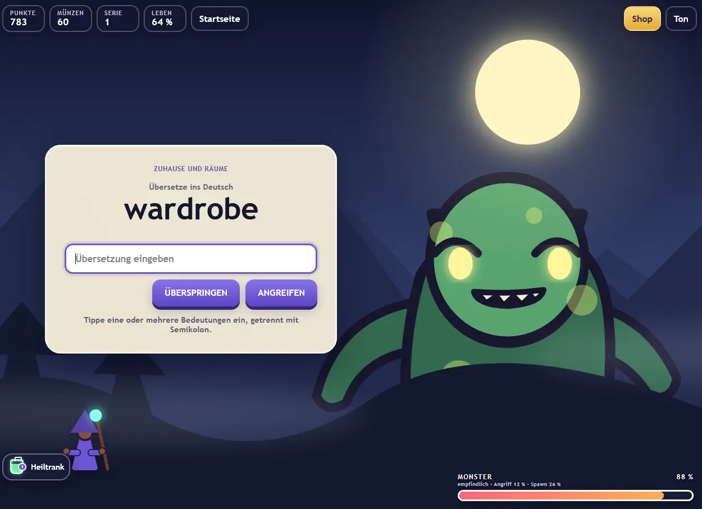

# Vom Vokabelfoto zum Monsterkampf: Wie Wort-Attacke mit GitHub Copilot entstand

TL;DR: https://softwareengel.github.io/Arno-Lernspiel/


*Eine Projektgeschichte aus sieben Chat-Sitzungen vom 7. bis 9. November 2026.*

  

Am Anfang steht kein fertiges Spielekonzept. Kein ausgearbeitetes Pflichtenheft, keine große Architektur. Am Anfang stehen neun Bilder mit Vokabeln und ein ziemlich praktischer Auftrag:

  

> „lese alle bilder aus den ordner A und erstelle eine tabelle in md für alle vokabeln“

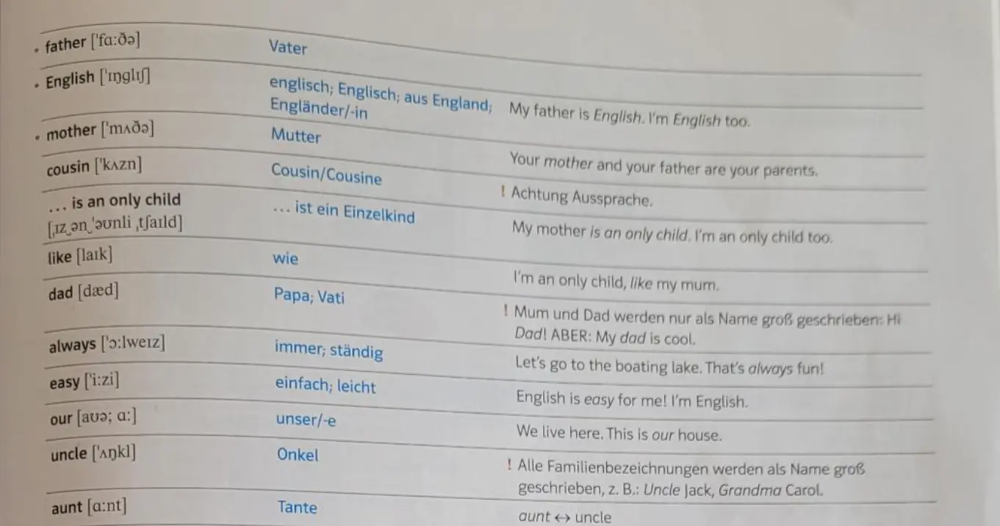


Aus diesen Bildern wird eine Markdown-Tabelle. Aus der Tabelle wird eine Idee. Und aus vielen kleinen Gesprächen mit GitHub Copilot in VS Code entsteht **Wort-Attacke**: ein Vokabelspiel, in dem richtige Antworten Zauber auslösen, Monster Energie verlieren und aus Lernfortschritt neue Ausrüstung wird.

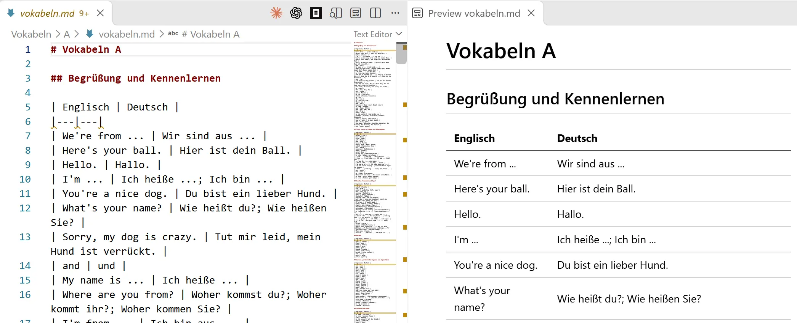


Die eigentliche Geschichte steckt dabei nicht nur im fertigen Spiel. Sie steckt in den Korrekturen: Das Monster soll größer sein. Das Handy muss auch hochkant funktionieren. Eine richtige Übersetzung reicht. Und warum kommen eigentlich noch keine Logs an?

  

## Erst die Wörter, dann die Welt

  

Nach dem Übertragen der Fotos folgt die entscheidende Frage: Wie wird daraus ein Lernspiel, das Spaß macht?

  

Die Vorgabe ist eine Zielgruppe ungefähr auf dem Niveau der fünften Klasse. Ein bisschen gruselig darf es werden, aber unterhaltsam statt abschreckend. Copilot schlägt zunächst eine Geisterschule mit benannten Figuren und unterschiedlichen Aktivitäten vor.

  

Doch die Richtung wird im Gespräch konkreter: Oben steht ein Wort, darunter wird die Übersetzung eingegeben. Eine richtige Antwort bringt Punkte und löst eine möglichst coole Attacke gegen einen Boss aus.

  

Auch die erste Bildwelt bleibt nicht unangetastet. Ein „Kühlschrankgeist“ passt nicht zur Vorstellung. Gewünscht ist stattdessen ein großes, namenloses Monster draußen in einer Landschaft.

  

Damit bekommt das Projekt seinen Kern: **Die Vokabel ist nicht vom Spiel getrennt. Ihre richtige Übersetzung ist die Spielhandlung.**

  

Zwischenzeitlich fällt die Frage nach einem „gemini notebook“ fürs Handy. Das tatsächlich entstandene Ergebnis ist eine installierbare Web-App mit Offline-Unterstützung. Für das Spielen auf dem Telefon braucht es damit kein Notebook als Bedienoberfläche.

  

## Aus einer Wissenslücke wird ein Heiltrank

  

Ein Spiel, das nur richtige Antworten feiert, wäre schnell frustrierend. Deshalb kommt früh eine zweite Mechanik hinzu: **Überspringen**.

  

Wer ein Wort nicht weiß, kann sich die Lösung anzeigen lassen. Das Monster greift an, die Spielerenergie sinkt, und die Frage kommt später wieder. Wird sie dann richtig beantwortet, gibt es einen Heiltrank.

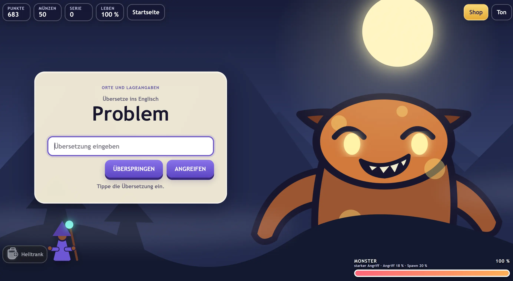

Das ist mehr als ein zusätzlicher Button. Es verbindet Wiederholung mit einer sichtbaren Belohnung: Gerade das Wort, das zunächst nicht geklappt hat, kann später helfen, weiterzuspielen.

  

Auch diese Regel entwickelt sich weiter. Zunächst ist ein einzelner Trank pro Kampf vorgesehen. In einer späteren Sitzung wird daraus ein Vorrat: Mehrere zunächst falsch und danach richtig beantwortete Fragen können mehrere Tränke einbringen. Die Anzahl erscheint direkt am Symbol, Tränke werden einzeln verbraucht und bleiben gespeichert.

  

Die Spielidee entsteht hier nicht in einem einzigen perfekten Prompt. Sie wird beim Ausprobieren genauer.

  

## Das Handy ist kein kleiner Desktop

  

Eine der hartnäckigsten Aufgaben ist die Darstellung.

  

Das Monster soll gut sichtbar sein, aber die Fragekarte darf es nicht verdecken. Gleichzeitig müssen Eingabefeld, Angriff, Überspringen, Punkte, Leben und Heiltrank erreichbar bleiben.

  

Eine frühe Browserprüfung im Querformat zeigt das Problem sehr konkret: Bei einem Sichtbereich von **844 × 390 Pixeln** ist das Dokument zunächst **560 Pixel hoch**. Heiltrank und Monsterenergie liegen außerhalb des sichtbaren Bereichs. Keine Fehlermeldung in der Konsole – und trotzdem kein brauchbares Ergebnis.

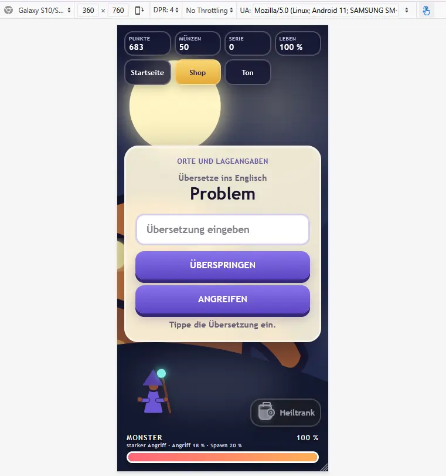


Nach der Korrektur entspricht die Dokumenthöhe den 390 Pixeln des Displays. Die Bedienelemente sind erreichbar und das Monster bleibt prominent sichtbar.

  

Zunächst wird auf dem Handy-Hochformat noch zum Drehen aufgefordert. Die nächste Sitzung trägt schon im Titel den Änderungswunsch: „hochant mobile display test“. Nun soll das Spiel auch ohne Drehen funktionieren. Laut damaligem Testbericht gelingen Laden, Eingabe und Angriff bei **390 × 844** und **360 × 800 Pixeln** ohne horizontalen Überlauf.

  

Später folgen weitere Details: Buttons dürfen nicht aus der Fragekarte ragen. Punkte, Münzen, Serie und Leben müssen auch auf schmalen Displays sichtbar bleiben.

  

Die Lektion daraus ist angenehm handfest: „Responsiv“ ist erst dann etwas wert, wenn die wichtigen Handlungen auf dem tatsächlichen Bildschirm funktionieren.

  

## Ein Magier, der nicht von der Stange kommt

  

Mit dem Shop erhält das Lernen eine zweite Belohnungsebene. Richtige Antworten bringen Münzen, besiegte Monster einen Bonus. Davon lassen sich Gewänder und Hüte kaufen; die Hautfarbe bleibt kostenlos wählbar.

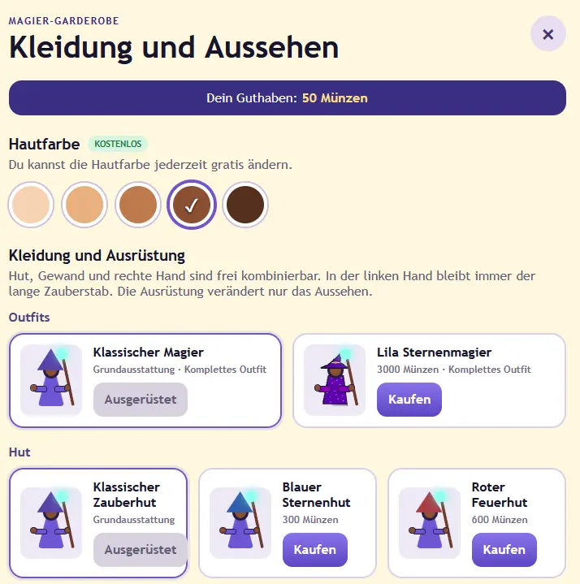


Dann kommen eigene Bildvorlagen ins Spiel. Ein Magier aus einem vorhandenen Bild wird freigestellt und als **Lila Sternenmagier** angeboten. Sein Preis wird im nächsten Schritt auf **3.000 Münzen** festgelegt. Auch die Grafik wird nachgebessert: weichere Kanten, keine störende weiße Fläche zwischen Körper und Stab.


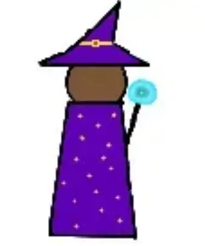


Besonders greifbar wird die Gestaltung beim Schwert aus der Vorlage „Schwert Arnos Spiel“. Es wird für die Spielfigur vorbereitet und als **Arnos Wort-Attacke-Schwert** in den Shop aufgenommen.

 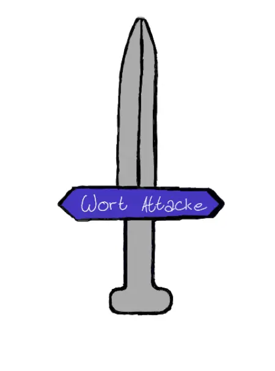
  

Dafür muss die Figur mehr können als nur ein komplettes Bild austauschen. Der Magier bekommt getrennte Bereiche für Kopf, Hut, Gewand und beide Hände. Seine linke Hand trägt immer den langen Zauberstab; rechts kann ein zusätzlicher Gegenstand ausgerüstet werden. Hut und Gewand des Sternenmagiers werden kombinierbar.

  

Die Gegenstände bleiben rein optisch. Sie verändern den Auftritt, nicht die Kampfstärke.

  

Auch das Monster bekommt Aufmerksamkeit: unterschiedliche Erscheinungsbilder, wechselnde Münder und Ohren, passend sitzende Zähne. Selbst die Reihenfolge eines Treffers wird präzisiert:

  

**Der Magier schießt. Der Zauber trifft. Erst dann sinkt die Monsterenergie und die Prozentanzeige leuchtet auf.**

  

Solche Details lassen eine richtige Antwort nicht nur korrekt, sondern wirksam erscheinen.

  

## Latein braucht andere Fragen

  

Am 8. November erweitert sich der Horizont: Neben Englisch soll Latein auswählbar sein. Eine Startseite mit zwei Sprachbuttons kommt hinzu; der Shop bleibt an vertrauter Position.

  

Latein lässt sich allerdings nicht einfach als zweite Wortliste behandeln. Die Vorgabe ist ausdrücklich anders: Das lateinische Wort wird angezeigt, die Formen müssen vollständig eingegeben werden, und bei der deutschen Bedeutung genügt eine gültige Übersetzung.

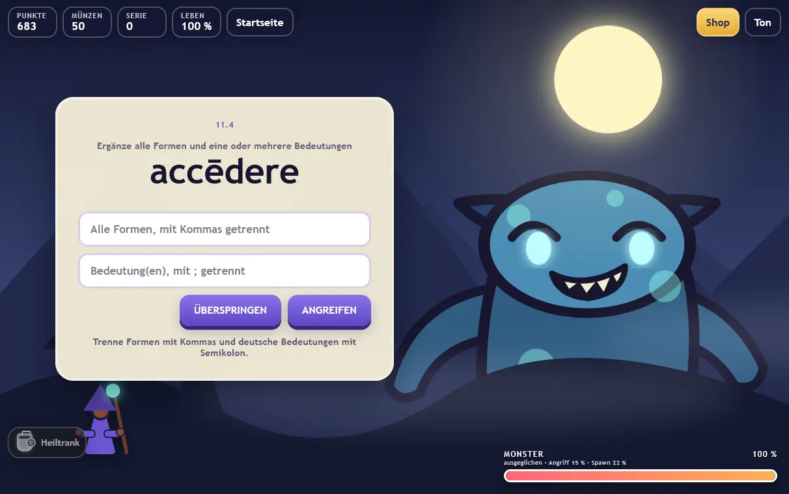

  

Die gemeinsame Spielwelt bleibt erhalten. Punkte, Münzen und Ausrüstung werden gemeinsam verwendet, die Lernstände der Sprachen getrennt geführt. Lateinische Längenzeichen sind bei der Eingabe optional.

  

Am 9. November folgen weitere Fotos mit **48 Vokabeln für die Abschnitte 11.1 bis 11.4**. Anschließend wird die Eingabe selbst zum Thema: Klammerzusätze und Auslassungspunkte aus einer Buchvorlage eignen sich schlecht als erwartete Antwort.

  

Ein wiederverwendbares Python-Skript bereinigt deshalb die deutsche Tabellenspalte. Ausgeführt wird es auf ausdrücklichen Wunsch mit `uv`. Die anderen Spalten bleiben unverändert.

  

Danach kommt die Lektionsauswahl hinzu: Nach der Sprache können einzelne, mehrere oder alle Lektionen gewählt werden. Ihre Namen stammen aus den Überschriften der Markdown-Dateien.

  

Aus Fotos werden so nicht nur digitale Wörter, sondern auswählbare Lernportionen.

  

## Das Spiel soll sich erinnern

  

Mit wachsendem Umfang entsteht ein neues Bedürfnis: Nicht jedes Mal von vorn anfangen.

  

Eine einfache Spitznameneingabe wird zum lokalen Spielerprofil. Punkte, Münzen, Ausrüstung und Lernfortschritt werden pro Profil gespeichert, ebenso die letzte Sprache und die Lektionsauswahl.

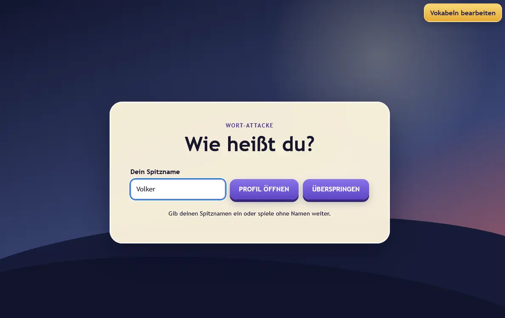


Aber auch eine gut gemeinte Eingabe kann im Weg stehen. Deshalb folgt gleich die nächste Verfeinerung: Der Spitzname soll nur beim ersten Einstieg abgefragt werden. Wer keinen angeben möchte, kann überspringen und als Gast spielen. Später lässt sich das Profil bewusst wechseln.

  

Dabei bleibt die Grenze klar: Es handelt sich um lokale Browserprofile, nicht um Benutzerkonten mit Passwort oder geräteübergreifender Synchronisierung.

  

## Wenn „rufen; nennen“ trotzdem nicht funktioniert

  

Eine besonders aufschlussreiche Schleife entsteht bei mehreren deutschen Bedeutungen.

  

Für einen Eintrag wie `alle; alle zusammen` soll eine einzelne Bedeutung genauso richtig sein wie beide zusammen – unabhängig von ihrer Reihenfolge. Jede eingegebene Bedeutung muss allerdings gültig sein.

  

Die Anpassung wird umgesetzt und getestet. Dann kommt die Rückmeldung:

  

> „klapp noch nicht“

  

Das konkrete Beispiel lautet `vocāre` mit den Bedeutungen `rufen; nennen; bezeichnen als`.

  

Nun reicht die Aussage „Die Tests sind grün“ nicht mehr. Die Eingaben werden im tatsächlichen Browserformular geprüft. Zwei Bedeutungen funktionieren, drei ebenfalls, auch in umgekehrter Reihenfolge. Für das Beispiel werden zusätzlich alle **15 nichtleeren, geordneten Kombinationen ohne Wiederholung** als Regressionstest abgedeckt.

  

Bei der Untersuchung zeigt sich außerdem eine alte Cache-Version im bisherigen lokalen Testbrowser: **v10 statt v29**.

  

Das macht den Fall so lehrreich. Richtiger Quellcode, laufender Server und die tatsächlich geladene App sind nicht automatisch derselbe Stand. Gerade bei einer offlinefähigen Web-App gehört der Cache zur Fehlersuche dazu.

  

## Der letzte Gegner heißt Deployment

  

Die jüngste Entwicklungssitzung ergänzt Ereignisprotokolle für Loki. Profilöffnung, Kampfstarts, Siege und Antwortergebnisse sollen sichtbar werden. Eingegebene Antworten werden nicht mitgesendet; ein Hinweis auf der Startseite informiert über die Übertragung.

  

Die Tests bestehen. Die CORS-Vorprüfung funktioniert. Dann folgt wieder eine Rückmeldung aus der Praxis: Es seien noch keine Daten angekommen.

  

Die Untersuchung trennt diesmal zwei Fragen: Kann Loki Daten annehmen? Und enthält die veröffentlichte App überhaupt schon den Logger?

  

Ein Push mit synthetischen Testdaten wird mit **HTTP 204** angenommen. Der Endpunkt ist erreichbar. Die veröffentlichte App enthält zu diesem Zeitpunkt aber noch nicht die lokale Logger-Erweiterung.

  

Der Fehler liegt also nicht dort, wo man zuerst suchen könnte. Und die Diagnose führt nicht automatisch zu einem ungefragten Commit oder Push.

  

Auch das gehört zur Zusammenarbeit mit einem Coding-Assistenten: Änderungen schreiben, Tests ausführen, Daten senden und veröffentlichen sind unterschiedliche Schritte.

  

## Was aus sieben Chats bleibt

  

Wort-Attacke ist nicht durch einen einzigen Auftrag „Baue mir ein Spiel“ entstanden. Das Projekt wächst durch kurze, konkrete Rückmeldungen:

  

Das Monster gehört in die Landschaft. Das Eingabefeld muss in der Karte bleiben. Eine Bedeutung reicht. Der Heiltrank braucht einen Zähler. Die letzte Auswahl soll erhalten bleiben.

  

Copilot überträgt Inhalte, entwirft, implementiert und prüft. Die Richtung entsteht im Dialog – und wird immer wieder an der tatsächlichen Nutzung korrigiert.

  

Aus neun Vokabelfotos wird eine kleine Spielwelt mit Zaubern, Ausrüstung, zwei Sprachen und lokalen Profilen. Ihr schönster Gedanke steckt noch immer in der frühen Heiltrank-Regel:

  

**Was zuerst nicht gelingt, ist nicht verloren. Es kommt wieder – und kann beim nächsten Mal neue Energie geben.**

  

---

  

## Quellen und Einordnung

  

Diese Story verdichtet alle sieben im Screenshot genannten Projektsitzungen. Die vier älteren Verläufe wurden aus den zugehörigen lokalen Copilot-SDK-Sitzungsdateien gelesen, die drei jüngeren über die Sitzungsschnittstelle. Der aktuelle Projektstand und die [README](../README.md) dienten zum Abgleich. Diese achte Sitzung erstellt die Story selbst.

  

| Sitzung                            | Beginn     | Beitrag zur Geschichte                                                           |
| ---------------------------------- | ---------- | -------------------------------------------------------------------------------- |
| Bilder aus Ordner A in md-Tabelle  | 07.11.2026 | Neun Fotos, Spielidee, Monsterkampf, Überspringen, erste mobile Prüfungen        |
| hochant mobile display test        | 07.11.2026 | Hochformat, alternative Antworten, Trankzähler und mehrere Heiltränke            |
| Shop für magische Anziehsachen     | 07.11.2026 | Shop, Bildvorlagen, Ausrüstung, Monsterdetails und weitere Eingabeverbesserungen |
| Startseite für Lernspiel erstellen | 08.11.2026 | Sprachwahl, Lateinmodus und gemeinsame Spielwelt                                 |
| Latein Vokabeln aus Bildern        | 09.11.2026 | Weitere Vokabeln, Bereinigungsskript, Lektionsauswahl und Profile                |
| deutsche Eingaben für md Eintrag   | 09.11.2026 | Mehrere Bedeutungen, konkreter Browsernachtest und Cache-Diagnose                |
| log data to Loki endpoint          | 09.11.2026 | Ereignisprotokollierung, synthetischer Test-Push und Veröffentlichungsdiagnose   |


___

## Weiteres 


  
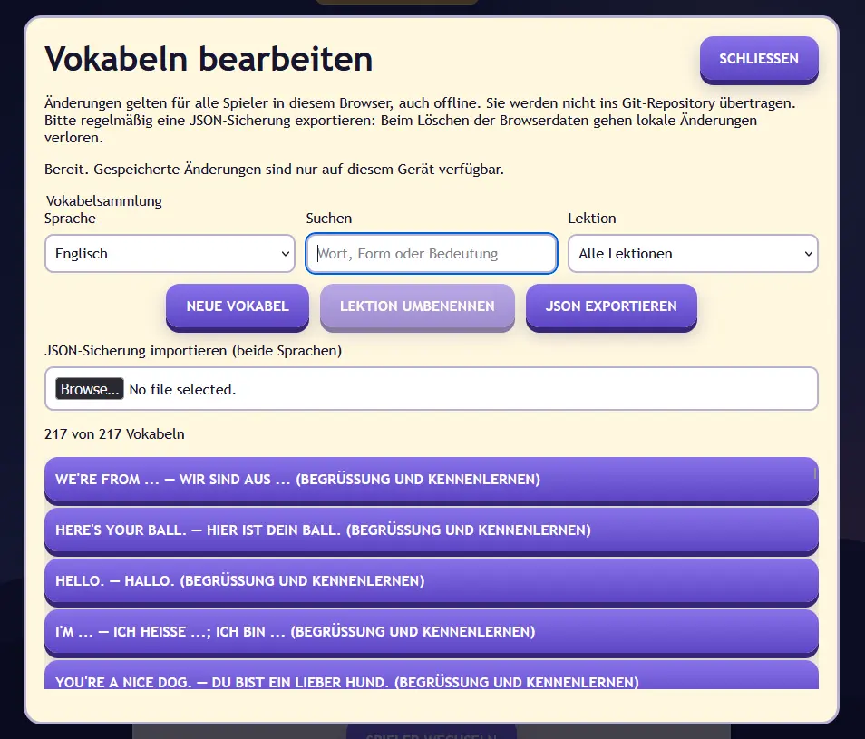

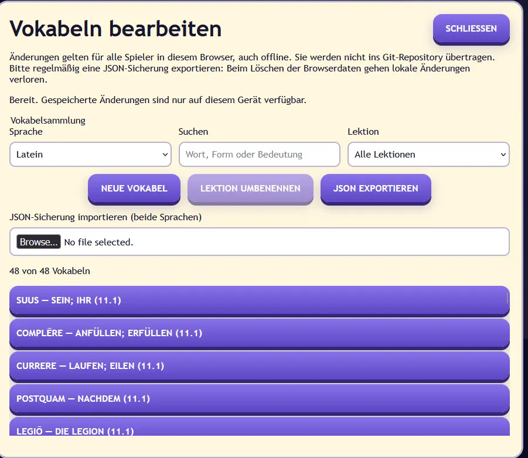


# vokabeltabellen-und-lernspiel

  

- Session-ID: `26c77a4f-4f5d-4eae-bf90-ed22f8639de9`

- Beginn: 2026-11-07T11:42:58+01:00

- Projekt: softwareengel/Arno-Lernspiel

- Quelle: lokal verfuegbare Session-Ereignisse; Benutzerprompts und sichtbare Antworten.

- Ohne interne Anweisungen, Denkprozesse, Tool-Ausgaben und Unteragenten-Dialoge.

  

## 1. Benutzer - 2026-11-07T10:43:06.924Z

  

<!-- message: 6d772c89-ef9a-4055-a0b7-b66b1a179c6a -->

  

lese alle bilder aus den ordner A und erstelle eine tabelle in md für alle vokabeln

  

---

  

## 2. Assistent - 2026-11-07T10:43:13.310Z

  

<!-- message: 75e8f82e-2e8b-43a4-9195-b9ce110e9a44 -->

  

Ich lese die neun Bilder aus dem Ordner `A` aus, gleiche doppelte Einträge ab und schreibe anschließend eine Markdown-Tabelle direkt in diesen Ordner.

  

---

  

## 3. Assistent - 2026-11-07T10:43:39.001Z

  

<!-- message: f118b0f5-c34c-4478-a56b-248e023e2c38 -->

  

Die Bilder enthalten neben den normalen Wortlisten auch Themenkästen (Zahlen, Tiere, Räume, Farben sowie Redemittel). Ich nehme diese ebenfalls auf, fasse doppelte Einträge zusammen und ordne alles nach Themen.

  

---

  

## 4. Assistent - 2026-11-07T10:43:45.483Z

  

<!-- message: 0e6e6a0a-99d0-480d-aa7c-151f69a860a9 -->

  

Erledigt. Ich habe alle **9 Bilder** aus dem Ordner `A` ausgewertet und die Vokabeln thematisch in Markdown-Tabellen übertragen. Doppelte Einträge wurden zusammengefasst.

  

Datei: [vokabeln.md](C:/src/github/Arno-Lernspiel/Vokabeln/A/vokabeln.md)

  

---

  

## 5. Benutzer - 2026-11-07T10:46:52.417Z

  

<!-- message: 3e5985a9-98a7-4d8f-b669-b553101ba917 -->

  

mache einen plan für ein lernspiel : zum vokabeln lerenen, es sollö spass machen. für kinder 5. klasse (10 Jahre ), kann auch mal etwas gruselig(nicht schwer sondern unterhaltsam ) sein.  man sollte viel machen können

  

---

  

## 6. Assistent - 2026-11-07T10:47:31.629Z

  

<!-- message: 1067726b-d5c3-4d81-bc2f-fd52696d6828 -->

  

# Plan für das Lernspiel „Arnos Geisterschule“

  

## 1. Grundidee

  

Ein unterhaltsames Lern-Abenteuer für Kinder der 5. Klasse. Die Spielwelt ist eine alte, geheimnisvolle Schule, in der freundliche Geister englische Wörter durcheinandergebracht haben.

  

Die Kinder erkunden Räume, lösen Aufgaben, sammeln Gegenstände und lernen dabei die Vokabeln aus [vokabeln.md](C:/src/github/Arno-Lernspiel/Vokabeln/A/vokabeln.md).

  

**Wichtig:**

  

- geeignet für etwa 10-Jährige

- leicht verständlich und schnell spielbar

- lustig statt wirklich gruselig

- viele unterschiedliche Aktivitäten

- Fehler dürfen passieren und werden freundlich erklärt

- kurze Spielrunden von 5 bis 15 Minuten

- Fortschritt wird automatisch gespeichert

  

---

  

## 2. Geschichte

  

In der Geisterschule ist das große Wörterbuch explodiert. Seitdem schweben englische und deutsche Wörter durch das Gebäude.

  

Die Spielerin oder der Spieler hilft dem freundlichen Schulgeist **Arno**, die Wörter wieder einzusammeln. In jedem Raum wartet eine andere Aufgabe.

  

### Figuren

  

- **Arno:** freundlicher Geist und Begleiter

- **Professor Flatterzahn:** etwas verrückter Englischlehrer

- **Minka:** freche Geisterkatze, die Hinweise gibt

- **Sir Spukalot:** lustiger Ritter, der ständig Wörter verwechselt

- **Der Schatten:** geheimnisvolle Figur für besondere Herausforderungen

  

Der Schatten sieht gruselig aus, ist aber nicht böse. Am Ende stellt sich heraus, dass er selbst Englisch lernen möchte.

  

---

  

## 3. Zentrale Spielschleife

  

1. Einen Raum oder ein Thema auswählen.

2. Eine kurze Lernrunde spielen.

3. Sterne, Münzen oder Geisterenergie erhalten.

4. Neue Gegenstände und Räume freischalten.

5. Schwierige Wörter automatisch wiederholen.

6. Einen kleinen Abschluss oder Bosskampf spielen.

  

Eine Runde sollte ungefähr **zehn Vokabeln** enthalten.

  

---

  

## 4. Spielwelt

  

Die Themen aus der Vokabelliste werden zu Bereichen der Geisterschule:

  

| Bereich | Vokabelthema | Beispiel |

|---|---|---|

| Eingangshalle | Begrüßung und Kennenlernen | Hello, friend, name |

| Geisterzoo | Tiere | cat, mouse, horse |

| Sportplatz | Freizeit und Sport | football, cycling, hobby |

| Farblabor | Farben | red, blue, green |

| Zahlenkeller | Zahlen | one bis twelve |

| Spukhaus | Zuhause und Räume | kitchen, bedroom, chair |

| Familiengalerie | Familie | mother, brother, cousin |

| Irrgarten | Orte und Lageangaben | behind, under, next to |

| Dachboden | weitere Wörter | toy, cheese, fridge |

  

Nach und nach werden alle Bereiche freigeschaltet.

  

---

  

## 5. Spielmodi

  

### 5.1 Geisterjagd

  

Mehrere Geister tragen englische Wörter. Arno nennt die deutsche Übersetzung und das richtige Gespenst muss angeklickt werden.

  

**Beispiel:**  

„Klicke auf das Gespenst mit dem Wort *rabbit*.“

  

---

  

### 5.2 Wörter-Memory

  

Kartenpaare aus englischem und deutschem Wort finden:

  

- `mouse`

- `Maus`

  

Später können Bilder statt deutscher Wörter verwendet werden.

  

---

  

### 5.3 Fledermaus-Fänger

  

Fledermäuse fliegen über den Bildschirm und tragen Wörter. Nur die richtige Fledermaus darf gefangen werden.

  

Für Fehlversuche gibt es keinen harten Abzug. Arno erklärt stattdessen die richtige Lösung.

  

---

  

### 5.4 Das sprechende Bild

  

Ein Raum oder eine Szene wird gezeigt. Die Kinder ordnen Wörter den Gegenständen zu.

  

**Beispiele:**

  

- `bed` zum Bett ziehen

- `chair` zum Stuhl ziehen

- `door` zur Tür ziehen

  

---

  

### 5.5 Geisterküche

  

Die Geister bestellen Gegenstände oder Lebensmittel auf Englisch.

  

> „Please give me the cheese.“

  

Das Kind muss den richtigen Gegenstand auswählen.

  

---

  

### 5.6 Satz-Zauber

  

Wörter werden in die richtige Reihenfolge gezogen.

  

**Beispiel:**

  

```text

name / My / Luke / is

```

  

Richtige Lösung:

  

```text

My name is Luke.

```

  

Für den Anfang werden nur kurze Sätze verwendet.

  

---

  

### 5.7 Der dunkle Gang

  

Eine leicht gruselige Herausforderung: Eine Taschenlampe beleuchtet jeweils nur einen Teil des Bildschirms. Um weiterzukommen, müssen Vokabelfragen beantwortet werden.

  

Es gibt:

  

- lustige Geräusche

- wackelnde Bilder

- kleine freundliche Geister

- überraschende, aber harmlose Animationen

  

Keine lauten Schreckmomente und keine gefährlichen oder verstörenden Figuren.

  

---

  

### 5.8 Geister-Quiz

  

Klassisches Quiz mit vier Antworten. Möglich sind:

  

- Englisch → Deutsch

- Deutsch → Englisch

- Bild → Wort

- Lückensatz → Wort

- Hörbeispiel → Wort

  

---

  

### 5.9 Schreibmaschine des Grauens

  

Ein deutsches Wort wird angezeigt und das englische Wort muss eingetippt werden.

  

Hilfen:

  

1. Anzahl der Buchstaben

2. erster Buchstabe

3. einzelne Buchstaben aufdecken

4. vollständige Lösung anzeigen

  

Ein Tippfehler soll nicht sofort als komplett falsch gelten.

  

---

  

### 5.10 Hörlabor

  

Ein englisches Wort wird vorgelesen. Anschließend wird die passende Übersetzung oder das passende Bild ausgewählt.

  

Optional kann das Kind das Wort selbst nachsprechen. Spracherkennung sollte jedoch nur ein Bonus und keine Pflicht sein.

  

---

  

### 5.11 Bosskämpfe

  

Am Ende eines Themenbereichs erscheint ein lustiger Boss.

  

**Beispiele:**

  

- der Farbenfresser

- die Zahlenmumie

- der Kühlschrankgeist

- Graf Wortverdreher

  

Richtige Antworten laden einen Zauber auf. Nach mehreren richtigen Lösungen ist der Boss besiegt. Fehler verursachen keinen Spielverlust, sondern eine zusätzliche Übungsfrage.

  

---

  

## 6. Belohnungen und Motivation

  

Für Lernrunden erhalten die Kinder:

  

- Sterne

- Geistermünzen

- neue Kleidung für Arno

- Möbel für ein eigenes Geisterzimmer

- Haustiere

- Sticker

- neue Taschenlampen

- Sammelkarten

- lustige Geräusche und Animationen

  

Belohnungen dürfen **nicht von echtem Geld** abhängen.

  

### Eigener Raum

  

Mit erspielten Gegenständen kann ein eigenes Geisterzimmer gestaltet werden:

  

- Tapeten

- Betten

- Schränke

- Bilder

- Lampen

- Haustiere

- Pokale

  

Dadurch gibt es auch außerhalb der Übungen viel zu tun.

  

---

  

## 7. Lernsystem

  

### Drei Lernstufen pro Vokabel

  

1. **Neu:** Wort ansehen und kennenlernen

2. **Üben:** Wort erkennen und zuordnen

3. **Können:** Wort ohne Hilfe schreiben oder übersetzen

  

### Intelligente Wiederholung

  

Jede Vokabel erhält intern einen Lernstand:

  

- unbekannt

- unsicher

- fast gelernt

- gelernt

- muss wiederholt werden

  

Falsch beantwortete Wörter erscheinen häufiger. Sicher beherrschte Wörter kommen erst später wieder.

  

### Gute Wiederholungsabstände

  

- direkt nach einem Fehler

- am Ende der Runde

- am nächsten Tag

- nach einigen Tagen

- nach einer Woche

  

---

  

## 8. Schwierigkeitsgrade

  

### Leicht

  

- Auswahl aus zwei Antworten

- Bilder und Hinweise

- kein Zeitlimit

- Wörter werden vorgelesen

  

### Normal

  

- vier mögliche Antworten

- weniger Hinweise

- kurze Lückensätze

- freiwilliger Zeitbonus

  

### Mutig

  

- Wörter selbst schreiben

- gemischte Themen

- weniger Hilfen

- längere Sätze

  

Die Schwierigkeit soll jederzeit geändert werden können.

  

---

  

## 9. Umgang mit Fehlern

  

Fehler sollen sich nicht wie eine Strafe anfühlen.

  

Statt „Falsch!“ sagt Arno beispielsweise:

  

- „Fast! Schau noch einmal.“

- „Das war ein listiges Wort.“

- „Die Geister haben dich reingelegt!“

- „Die richtige Antwort ist *mouse*. Versuch es gleich noch einmal.“

  

Anschließend wird die Lösung kurz gezeigt und später erneut abgefragt.

  

---

  

## 10. Fortschritt

  

Ein übersichtliches Buch zeigt:

  

- gelernte Wörter

- noch schwierige Wörter

- Sterne je Themengebiet

- tägliche Lernserie

- absolvierte Spiele

- freigeschaltete Belohnungen

  

### Tagesaufgaben

  

Beispiele:

  

- Übe zehn Wörter.

- Spiele zwei verschiedene Spielmodi.

- Beantworte fünf Tierwörter richtig.

- Wiederhole drei unsichere Wörter.

  

Die Aufgaben sollen klein und erreichbar bleiben.

  

---

  

## 11. Kindgerechte Gestaltung

  

- große Schaltflächen

- wenig Text pro Bildschirm

- klare Symbole

- gut lesbare Schrift

- freundliche Farben

- kurze Anweisungen

- Bedienung mit Maus, Touchscreen und Tastatur

- Ton und Musik getrennt einstellbar

- Animationen abschaltbar

- kein Zwang zu Zeitlimits

- keine Werbung

- keine Chats oder Kontakte zu fremden Personen

  

---

  

## 12. Technischer Aufbau

  

Für eine erste Version bietet sich ein Spiel als Webanwendung an. Es funktioniert dann im Browser auf Computer und Tablet.

  

### Benötigte Bereiche

  

1. Startbildschirm

2. Spielerauswahl

3. Themenkarte

4. Lernansicht

5. verschiedene Minispiele

6. Belohnungsraum

7. Vokabelbuch

8. Fortschrittsanzeige

9. Einstellungen

10. Eltern- oder Lehrkraftbereich

  

Die Vokabeln sollten aus einer strukturierten Datei geladen werden, beispielsweise JSON. Die vorhandene [vokabeln.md](C:/src/github/Arno-Lernspiel/Vokabeln/A/vokabeln.md) kann dafür später automatisch umgewandelt werden.

  

---

  

## 13. Entwicklungsphasen

  

### Phase 1: Spielbarer Prototyp

  

- Startbildschirm

- Auswahl eines Namens

- drei Vokabelthemen

- Geisterjagd

- Memory

- Quiz

- Punkte und Sterne

- Speicherung des Fortschritts

  

### Phase 2: Lernsystem

  

- alle Vokabelthemen

- Lernstände pro Wort

- automatische Wiederholung

- Aussprache der Wörter

- Vokabelbuch

- Tagesaufgaben

  

### Phase 3: Abenteuer

  

- begehbare Geisterschule

- Figuren und Geschichte

- Bosskämpfe

- dunkler Gang

- freischaltbare Räume

  

### Phase 4: Mehr Beschäftigung

  

- eigenes Geisterzimmer

- Kleidung und Haustiere

- Sammelkarten

- weitere Minispiele

- Wochenaufgaben

- Statistiken für Eltern oder Lehrkräfte

  

---

  

## 14. Sinnvolle erste Version

  

Die erste Version sollte bewusst überschaubar bleiben:

  

- **3 Themen:** Tiere, Farben und Zuhause

- **30 bis 50 Vokabeln**

- **3 Minispiele:** Quiz, Memory und Geisterjagd

- **1 kleiner Bosskampf**

- **1 Belohnungsraum**

- automatische Speicherung

- intelligente Wiederholung falscher Antworten

  

Damit lässt sich früh prüfen, ob das Spiel wirklich Spaß macht und die Kinder die Wörter besser behalten.

  

---

  

## 7. Benutzer - 2026-11-07T10:49:23.594Z

  

<!-- message: 57e4a3f1-98e1-412b-ba9f-1819d970d1fa -->

  

erweitere: oben steht ein wort , unten übersetzung  eingeben und punkte sammeln, wenn man etwas richtig hat besiegt man den boss mit einer atacke , was cool aussehen nuss

  

---

  

## 8. Assistent - 2026-11-07T10:49:50.896Z

  

<!-- message: 3d3933b5-8043-46af-8dba-e2942dce79eb -->

  

## Erweiterung: Der große Vokabel-Bosskampf

  

Der **Vokabel-Bosskampf** wird zum wichtigsten Spielmodus. Das Kind übersetzt Wörter und führt mit jeder richtigen Antwort eine spektakuläre Attacke aus.

  

---

  

### 1. Aufbau des Bildschirms

  

```text

┌──────────────────────────────────────────┐

│ Punkte: 1.250       Serie: 6       ❤️❤️❤️ │

├──────────────────────────────────────────┤

│                                          │

│          ENGLISCHES WORT                 │

│                                          │

│              rabbit                      │

│                                          │

│        Übersetzung eingeben:             │

│        [ Kaninchen________ ]             │

│                                          │

│             [ ANGREIFEN ]                │

│                                          │

├──────────────────────────────────────────┤

│ Arno  ██████████       ███████░░░  Boss  │

└──────────────────────────────────────────┘

```

  

Oben steht ein englisches oder deutsches Wort. Darunter gibt das Kind die Übersetzung ein.

  

**Beispiele:**

  

- `rabbit` → `Kaninchen`

- `Kühlschrank` → `fridge`

- `behind` → `hinter`

- `Schwester` → `sister`

  

Mit der Eingabetaste oder der Schaltfläche **„Angreifen“** wird die Antwort bestätigt.

  

---

  

## 2. Ablauf einer Antwort

  

### Richtige Antwort

  

1. Das Eingabefeld leuchtet grün.

2. Die richtige Übersetzung wird kurz angezeigt.

3. Das Kind erhält Punkte.

4. Arnos Angriffsleiste lädt sich auf.

5. Arno greift den Boss mit einer coolen Attacke an.

6. Der Boss verliert Energie.

7. Das nächste Wort erscheint.

  

### Falsche Antwort

  

1. Das Eingabefeld wackelt leicht.

2. Es erscheint ein freundlicher Hinweis.

3. Der Boss macht eine lustige Bewegung.

4. Das Kind erhält einen zweiten Versuch.

5. Bei Bedarf wird der erste Buchstabe angezeigt.

6. Das Wort erscheint später erneut.

  

Der Boss greift bei Fehlern nicht brutal an. Er kann beispielsweise Arno mit Schleim bespritzen, ihn kurz in eine Fledermaus verwandeln oder ihm einen Eimer auf den Kopf zaubern.

  

---

  

## 3. Spektakuläre Attacken

  

Die Angriffe sollen besonders cool aussehen, aber nicht gewalttätig wirken.

  

### Normale Attacken

  

| Attacke | Animation |

|---|---|

| Wörterblitz | Ein leuchtender Blitz aus Buchstaben trifft den Boss. |

| Buchstaben-Komet | Ein Komet aus englischen Wörtern fliegt über den Bildschirm. |

| Geisterfaust | Eine große, durchsichtige Faust stößt den Boss zurück. |

| Wörter-Wirbel | Buchstaben bilden einen Tornado um den Boss. |

| Schleimkugel | Eine grüne Kugel trifft den Boss und lässt ihn herumrutschen. |

| Fledermaus-Schwarm | Kleine lustige Fledermäuse verscheuchen den Boss. |

| Bücherkanone | Ein magisches Buch schießt leuchtende Wörter ab. |

| Käse-Meteor | Ein riesiger Käse fällt neben den Boss und erschreckt ihn. |

  

Die Attacke kann zufällig ausgewählt oder vom Kind freigeschaltet werden.

  

---

  

## 4. Kombos

  

Mehrere richtige Antworten hintereinander erzeugen eine **Wörterserie**:

  

| Richtige Antworten | Belohnung |

|---:|---|

| 1 | normale Attacke |

| 3 | Doppel-Attacke |

| 5 | Super-Attacke |

| 8 | Mega-Attacke |

| 10 | Spezialattacke mit kurzer Zwischensequenz |

  

### Beispiel für eine Zehner-Kombo

  

Der Bildschirm wird kurz dunkel. Arnos Augen leuchten, ein riesiges Wörterbuch öffnet sich und erzeugt einen Buchstaben-Drachen. Der Drache fliegt einmal durch den Raum und pustet einen bunten Wörterstrahl auf den Boss.

  

Danach fällt der Boss benommen um und kleine Sterne kreisen um seinen Kopf.

  

Die Animation sollte eindrucksvoll, aber kurz sein. Sie kann übersprungen oder in den Einstellungen reduziert werden.

  

---

  

## 5. Energie für Spezialattacken

  

Richtige Antworten füllen eine **Zauberleiste**.

  

```text

SPEZIALATTACKE  ████████░░

```

  

Wenn sie voll ist, kann das Kind eine von drei Attacken auswählen:

  

- **Geistersturm:** verursacht besonders viel Schaden

- **Zeitzauber:** die nächsten Aufgaben haben kein Zeitlimit

- **Doppelzauber:** die nächsten drei richtigen Antworten geben doppelte Punkte

  

So muss das Kind nicht nur Wörter übersetzen, sondern kann auch ein wenig taktisch spielen.

  

---

  

## 6. Punktesystem

  

| Aktion | Punkte |

|---|---:|

| richtige Antwort beim ersten Versuch | 100 |

| richtige Antwort beim zweiten Versuch | 60 |

| richtige Antwort mit Hinweis | 30 |

| drei richtige Antworten in Folge | 100 Bonus |

| fünf richtige Antworten in Folge | 250 Bonus |

| zehn richtige Antworten in Folge | 750 Bonus |

| schwieriges Wort richtig beantwortet | 50 Bonus |

| Boss besiegt | 1.000 Bonus |

  

Ein freiwilliger Zeitbonus kann zusätzliche Punkte geben. Ohne Zeitlimit erhält das Kind aber trotzdem alle normalen Punkte.

  

---

  

## 7. Faire Texteingabe

  

Das Spiel sollte verschiedene richtige Antworten akzeptieren.

  

**Beispiel:**

  

Für `happy` gelten als richtig:

  

- glücklich

- froh

- fröhlich

  

Für `bag` gelten als richtig:

  

- Tasche

- Tüte

  

Außerdem sollte das Spiel:

  

- Groß- und Kleinschreibung ignorieren

- Leerzeichen am Anfang und Ende ignorieren

- kleine Tippfehler erkennen

- Umlaute möglichst tolerant behandeln

- mehrere Übersetzungen akzeptieren

- alternative Schreibweisen berücksichtigen

  

Bei einem kleinen Tippfehler kann Arno sagen:

  

> „Fast richtig! Meintest du **kitchen**?“

  

Das Kind kann die vorgeschlagene Antwort bestätigen oder noch einmal schreiben.

  

---

  

## 8. Verschiedene Bosse

  

Jeder Boss gehört zu einem Vokabelthema.

  

### Der Farbenfresser

  

- Thema: Farben

- sieht aus wie ein schwarzes Schleimmonster

- wird mit jeder richtigen Antwort bunter

- Endanimation: Er verwandelt sich in ein freundliches Regenbogenmonster

  

### Graf Wortverdreher

  

- Thema: Begrüßung und Kennenlernen

- vertauscht englische und deutsche Wörter

- trägt einen viel zu großen Umhang

- erschrickt bei jeder Attacke vor seinem eigenen Schatten

  

### Die Zahlenmumie

  

- Thema: Zahlen

- ihre Bandagen bestehen aus Zahlen

- richtige Antworten lösen einzelne Bandagen

- am Ende kommt ein kleiner freundlicher Geist zum Vorschein

  

### Der Kühlschrankgeist

  

- Thema: Zuhause

- wirft Eiswürfel und Käse

- kann den Bildschirm kurz einfrieren

- wird durch Haus- und Raumvokabeln besiegt

  

### Der Tiermeister

  

- Thema: Tiere

- ruft Geistertiere zur Hilfe

- richtige Antworten befreien die Tiere

- am Ende feiern alle Tiere gemeinsam

  

### Der Schatten

  

- gemischte Vokabeln

- letzter Boss eines Kapitels

- sieht geheimnisvoll und leicht gruselig aus

- kopiert einige Attacken von Arno

- möchte am Ende selbst Englisch lernen

  

---

  

## 9. Bossphasen

  

Ein Bosskampf besteht aus ungefähr **15 bis 20 Wörtern**.

  

### Phase 1: Kennenlernen

  

- einfache Wörter

- der Boss bewegt sich langsam

- normale Attacken

  

### Phase 2: Der Boss wird stärker

  

- mittelschwere Wörter

- lustige Hindernisse erscheinen

- stärkere Attacken werden freigeschaltet

  

### Phase 3: Finale

  

- schwierige oder zuvor falsch beantwortete Wörter

- spannendere Musik

- besondere Hintergrundanimation

- die letzte richtige Antwort löst den finalen Angriff aus

  

Ein Kampf darf nicht verloren gehen. Wenn die Herzen aufgebraucht sind, startet eine kurze Trainingsrunde. Danach kehrt das Kind mit voller Energie zurück.

  

---

  

## 10. Lernhilfen im Bosskampf

  

Für jedes Wort können Hilfen verwendet werden:

  

1. **Erster Buchstabe**

2. **Anzahl der Buchstaben**

3. **Bild anzeigen**

4. **Wort vorlesen**

5. **Buchstaben mischen und richtig anordnen**

6. **Aus mehreren Antworten auswählen**

  

Hilfen reduzieren lediglich den Punktebonus. Der Spielfortschritt bleibt erhalten.

  

---

  

## 11. Belohnung nach dem Kampf

  

Nach einem gewonnenen Kampf erhält das Kind:

  

- Sterne

- Geistermünzen

- eine Bewertung der gelernten Wörter

- eine neue Attacke

- Kleidung oder Ausrüstung für Arno

- einen Gegenstand für das eigene Geisterzimmer

- gelegentlich ein Ei mit einem kleinen Geisterhaustier

  

Anschließend werden drei Listen gezeigt:

  

- **Sicher gelernt**

- **Noch etwas üben**

- **Neu entdeckt**

  

---

  

## 12. Endangriff

  

Der letzte Treffer gegen einen Boss sollte besonders eindrucksvoll sein:

  

1. Die Musik wird kurz leiser.

2. Das letzte Wort erscheint groß.

3. Das Kind gibt die Übersetzung ein.

4. Bei richtiger Antwort zerbricht das Wort in leuchtende Buchstaben.

5. Die Buchstaben fliegen zu Arno und bilden eine riesige Energiekugel.

6. Das Kind drückt die Schaltfläche **„FINALE ATTACKE!“**

7. Die Energiekugel verwandelt sich passend zum Thema:

   - Tierdrache

   - Regenbogenstrahl

   - Zahlenrakete

   - Geisterzug

   - Büchersturm

8. Der Boss wird getroffen und verwandelt sich in eine freundliche Version.

9. Punkte, Sterne und Belohnungen fliegen über den Bildschirm.

  

So verbindet das Spiel das aktive Schreiben der Übersetzungen mit einem sichtbaren Erfolg: **Jede gelernte Vokabel macht Arno stärker.**

  

---

  

## 9. Benutzer - 2026-11-07T10:50:19.426Z

  

<!-- message: 30835fc6-9dc8-4056-9aed-8cfe2f69bff5 -->

  

der boss soll im hintergrund gezeichet sein

  

---

  

## 10. Assistent - 2026-11-07T10:50:33.499Z

  

<!-- message: 3d8a1892-2eff-474c-98a4-c0d822de868c -->

  

## Boss als gezeichneter Hintergrund

  

Der Boss wird **groß und gezeichnet im Hintergrund** dargestellt. Die Lernoberfläche liegt darüber, verdeckt den Boss aber möglichst wenig.

  

```text

┌─────────────────────────────────────────────┐

│ Punkte: 1.250   Serie: 6   Spezial: ███░░   │

│                                             │

│          ╭─────────────────────╮            │

│          │ Übersetze das Wort: │            │

│          │                     │            │

│          │       RABBIT        │            │

│          │                     │            │

│          │ [ Kaninchen______ ] │            │

│          │     [ ANGREIFEN ]   │            │

│          ╰─────────────────────╯            │

│                                             │

│       👻 ARNO              GEZEICHNETER      │

│                            HINTERGRUND-BOSS  │

│                                             │

│ Boss-Energie: ████████████░░░░               │

└─────────────────────────────────────────────┘

```

  

### Darstellung

  

- Der Boss nimmt etwa **40 bis 60 Prozent** des Hintergrunds ein.

- Er sieht handgezeichnet und leicht comicartig aus.

- Das Wort und das Eingabefeld befinden sich auf einer halbtransparenten Karte.

- Der Hintergrund bleibt sichtbar, aber der Text ist immer gut lesbar.

- Arno steht klein im Vordergrund gegenüber dem Boss.

- Auf Mobilgeräten steht der Boss hinter oder oberhalb der Aufgabenkarte.

  

## Reaktionen des Hintergrund-Bosses

  

Der Boss ist nicht nur ein unbewegliches Bild. Er besteht aus mehreren gezeichneten Zuständen:

  

| Situation | Reaktion des Bosses |

|---|---|

| Kampf beginnt | Boss taucht aus Rauch oder Schatten auf |

| Kind denkt nach | Boss wartet, grinst oder wackelt leicht |

| richtige Antwort | Boss wird getroffen und taumelt zurück |

| mehrere richtige Antworten | Boss wird nervös und schaut erschrocken |

| falsche Antwort | Boss lacht freundlich oder macht eine Grimasse |

| Spezialattacke bereit | Boss schaut besorgt auf die gefüllte Leiste |

| wenig Energie | Boss wirkt müde und seine Kleidung ist zerzaust |

| besiegt | Boss fällt lustig um oder wird freundlich |

| Kampf gewonnen | Boss und Arno feiern gemeinsam |

  

## Gezeichneter Stil

  

Der Stil sollte wirken wie ein farbiges Kinderbuch:

  

- dicke, klare Konturen

- freundliche Gesichter

- ausdrucksstarke Augen

- kräftige Farben

- lustige Bewegungen

- keine realistischen Verletzungen

- keine gefährlichen Waffen

- leicht gruselige Schatten, Spinnweben und leuchtende Augen

- Boss bleibt immer sympathisch und kindgerecht

  

## Angriffsanimation vor dem Hintergrund

  

Bei einer richtigen Antwort läuft die Attacke direkt über das Hintergrundbild:

  

1. Die Aufgabenkarte wird kurz kleiner oder halbtransparent.

2. Arno sammelt leuchtende Buchstaben.

3. Die Buchstaben bilden die Attacke.

4. Die Attacke fliegt über den Bildschirm zum Boss.

5. Der gezeichnete Boss reagiert sichtbar.

6. Seine Energieleiste sinkt.

7. Die Aufgabenkarte erscheint wieder vollständig.

  

Dadurch bleibt der Boss während der gesamten Attacke sichtbar.

  

## Mehrere Hintergrundbilder pro Boss

  

Jeder Boss sollte mindestens fünf gezeichnete Bilder erhalten:

  

1. **normal**

2. **lacht**

3. **wird getroffen**

4. **hat wenig Energie**

5. **ist besiegt**

  

Zusätzliche Bilder können besondere Attacken und Bossphasen darstellen.

  

## Beispiel: Der Kühlschrankgeist

  

Im Hintergrund ist eine gezeichnete, leicht gruselige Küche zu sehen. Aus einem großen Kühlschrank ragt ein blaues Gespenst heraus.

  

- Bei richtigen Antworten fliegen Wörterblitze in Richtung Kühlschrank.

- Der Geist verliert Eiswürfel und Käse.

- Bei einer Kombo friert der Bildschirmrand kurz ein.

- Bei der finalen Attacke schließt sich der Kühlschrank.

- Danach öffnet er sich wieder und der Geist hält freundlich ein Eis hoch.

  

So bleibt die zentrale Aufgabe klar: **Oben steht das Wort, darunter wird die Übersetzung eingegeben – und im Hintergrund reagiert der gezeichnete Boss auf jede Antwort.**

  

---

  

## 11. Benutzer - 2026-11-07T10:52:39.550Z

  

<!-- message: 87355af9-40cc-467a-a425-951d21a41b7d -->

  

Beispiel: Der Kühlschrankgeist  nicht so gut , sondern ohne name ein grosses monster in der landschaft ist nicht on der küche oder so

  

---

  

## 12. Assistent - 2026-11-07T10:52:59.165Z

  

<!-- message: 3631dced-7a70-450d-86f1-d7e11e448f5c -->

  

## Neues Boss-Konzept: Ein namenloses Riesenmonster

  

Der Boss bekommt **keinen Namen** und gehört nicht zu einem bestimmten Vokabelthema. Er ist einfach ein großes, geheimnisvolles Monster, das in einer weiten Landschaft im Hintergrund steht.

  

Die Vokabelaufgabe bleibt im Vordergrund:

  

```text

┌──────────────────────────────────────────────┐

│ Punkte: 1.250       Serie: 6       ❤️❤️❤️     │

│                                              │

│            Übersetze das Wort                │

│                                              │

│                  RABBIT                      │

│                                              │

│          [ Kaninchen____________ ]           │

│                [ ANGREIFEN ]                 │

│                                              │

│       Arno                        MONSTER     │

│        🧙                    im Hintergrund   │

│                                              │

│ Monster: ████████████░░░░                    │

└──────────────────────────────────────────────┘

```

  

## Landschaft

  

Der Kampf findet draußen in einer gezeichneten Fantasy-Landschaft statt:

  

- große Berge

- dunkle Wolken

- alte Bäume

- Felsen und Ruinen

- Nebel über dem Boden

- Mond oder untergehende Sonne

- kleine leuchtende Pflanzen

- Vögel oder Fledermäuse am Himmel

- Arno steht auf einem Hügel im Vordergrund

- das riesige Monster steht weit hinten in der Landschaft

  

Das Monster sollte so groß sein, dass es teilweise von Bergen oder Wolken verdeckt wird. Dadurch wirkt es beeindruckend, ohne wirklich gefährlich zu sein.

  

## Aussehen des Monsters

  

Das Monster ist groß und etwas gruselig, aber kindgerecht:

  

- riesiger Körper

- lange Arme

- Hörner oder große Ohren

- leuchtende Augen

- zerzaustes Fell

- dicke, gezeichnete Umrisse

- lustige Zähne

- übertriebene Gesichtsausdrücke

- keine Wunden oder realistische Gewalt

  

Es kann zunächst bedrohlich aussehen, reagiert aber lustig auf Treffer.

  

## Position der Lernaufgabe

  

Die Aufgabenkarte schwebt in der Mitte oder im oberen Bereich:

  

```text

╭──────────────────────────────╮

│ Übersetze:                   │

│                              │

│          BEHIND              │

│                              │

│ [ hinter__________________ ] │

│       [ ANGREIFEN ]          │

╰──────────────────────────────╯

```

  

Die Karte ist:

  

- leicht durchsichtig

- gut lesbar

- nicht zu groß

- während der Attacke ausblendbar

- so platziert, dass das Gesicht des Monsters sichtbar bleibt

  

## Richtige Antwort

  

Nach einer richtigen Übersetzung:

  

1. Das Eingabefeld leuchtet grün.

2. Die Aufgabenkarte wird durchsichtig.

3. Das Wort zerfällt in leuchtende Buchstaben.

4. Die Buchstaben fliegen zu Arno.

5. Arno verwandelt sie in eine Attacke.

6. Die Attacke fliegt durch die Landschaft.

7. Das Monster wird getroffen und taumelt.

8. Steine, Blätter oder Staub wirbeln auf.

9. Die Energieleiste des Monsters sinkt.

10. Das nächste Wort erscheint.

  

## Reaktionen des Monsters

  

| Situation | Reaktion |

|---|---|

| Kampf beginnt | Das Monster erhebt sich langsam hinter einem Berg |

| Kind tippt | Das Monster beobachtet neugierig die Aufgabe |

| richtige Antwort | Es taumelt, dreht sich oder setzt sich überrascht hin |

| falsche Antwort | Es grinst oder tanzt kurz |

| Dreier-Serie | Es wird nervös und schaut zu seiner Energieleiste |

| Fünfer-Serie | Es versucht, sich hinter einem kleinen Berg zu verstecken |

| Spezialattacke | Es hält erschrocken die Hände vor das Gesicht |

| wenig Energie | Es ist erschöpft und setzt sich auf einen Felsen |

| besiegt | Es fällt in einen weichen Heuhaufen oder landet im See |

| Kampfende | Es steht wieder auf und winkt freundlich |

  

## Unterschiedliche Landschaften

  

Das Monster kann in verschiedenen Landschaften erscheinen, ohne einen Namen oder ein festes Thema zu bekommen.

  

### Wald

  

- große alte Bäume

- Nebel

- leuchtende Pilze

- Fledermäuse

- Monster steht zwischen den Bäumen

  

### Berge

  

- schneebedeckte Gipfel

- dunkle Wolken

- Wasserfall

- Monster erscheint hinter einem Berg

  

### Wiese

  

- hohes Gras

- Blumen

- Windmühle

- Monster steht am Horizont

  

### Ruinen

  

- zerbrochene Türme

- alte Steinbrücke

- grüne Lichter

- Monster erhebt sich hinter einer Mauer

  

### Nachtlandschaft

  

- großer Mond

- Sterne

- Nebel

- Schatten von Bäumen

- leuchtende Augen des Monsters

  

Die Landschaft kann nach einigen Runden wechseln. Dadurch bleibt das Spiel abwechslungsreich, obwohl das Lernprinzip gleich bleibt.

  

## Coole Attacken

  

Die Angriffe sollten zur Landschaft passen:

  

- **Buchstabenblitz:** Ein Blitz aus leuchtenden Buchstaben schlägt neben dem Monster ein.

- **Wörterstrahl:** Arno schießt einen bunten Energiestrahl ab.

- **Felsenwirbel:** Magische Felsen kreisen um das Monster.

- **Geisterdrache:** Ein Drache aus Buchstaben fliegt durch die Landschaft.

- **Sternenregen:** Leuchtende Sterne fallen auf das Monster.

- **Riesenwelle:** Eine gezeichnete Wasserwelle spült das Monster um.

- **Pflanzenzauber:** Ranken wachsen aus dem Boden und kitzeln das Monster.

- **Donnerfaust:** Eine große magische Faust stößt das Monster zurück.

  

## Finaler Angriff

  

Nach der letzten richtigen Übersetzung:

  

1. Der Himmel wird dunkler.

2. Wind zieht durch die Landschaft.

3. Alle zuvor richtig beantworteten Wörter erscheinen am Himmel.

4. Die Wörter drehen sich zu einem großen Wirbel.

5. Arno springt hoch und lenkt den Wirbel auf das Monster.

6. Ein heller Lichtblitz erscheint.

7. Das Monster fliegt rückwärts und landet weich.

8. Die Landschaft wird wieder hell.

9. Das Monster steht auf und winkt.

10. Punkte, Sterne und Münzen erscheinen.

  

Das Monster wird also nicht verletzt oder getötet. Es wird im Kampf besiegt und danach freundlich. Dadurch bleibt der Kampf aufregend und zugleich für Zehnjährige geeignet.

  

---

  

## 13. Benutzer - 2026-11-07T10:54:26.991Z

  

<!-- message: 25ad7fbd-26e9-43f3-aed8-b685ac713795 -->

  

kannst du einen gemini notebook dafür bauen, so das wir es im handy als spiel nutzen können ?

  

---

  

## 14. Assistent (Formular-Rueckfrage) - 2026-11-07T10:54:32.133Z

  

<!-- message: 8d0030ca-7c0c-4a2b-a7be-23131b77a4e0 -->

  

Mit „Gemini Notebook“ können verschiedene Dinge gemeint sein. Für ein Handy-Spiel ist eine installierbare Web-App (PWA) normalerweise am besten. Was soll ich erstellen?

  

Gewünschtes Format

Eine PWA läuft direkt im Handy-Browser und kann wie eine App zum Startbildschirm hinzugefügt werden.

- Installierbare Handy-Web-App (empfohlen)

- Google-Colab-Notebook, das das Spiel erzeugt/startet

- Notebook/Anleitung als Vorlage für Google Gemini

- Etwas anderes

  

Umfang der ersten Version

Welchen Funktionsumfang soll die erste spielbare Version besitzen?

- Worteingabe, Punkte, Monster, Attacken und Speicherung (empfohlen)

- Nur einfacher spielbarer Prototyp

- Zusätzlich mehrere Landschaften, Sounds und Spezialattacken

  

---

  

## 15. Benutzer (Formularantwort) - 2026-11-07T10:55:17.537Z

  

<!-- message: fcc84a54-207d-41e0-aa74-9e8ea1ca0060 -->

  

format: pwa

first_version: complete_core

  

---

  

## 16. Assistent - 2026-11-07T10:55:31.245Z

  

<!-- message: b56f9868-ac2e-47bc-82c0-76f4e7556539 -->

  

Ich setze jetzt eine installierbare, mobile PWA um: Sie lädt alle Vokabeln aus der vorhandenen Markdown-Datei, speichert Fortschritt lokal und zeigt den großen gezeichneten Landschafts-Boss mit sichtbaren Attacken.

  

---

  

## 17. Assistent - 2026-11-07T10:57:07.856Z

  

<!-- message: 4c425313-752a-4cdf-ac10-2b682caff704 -->

  

Die technische Richtung ist festgelegt. Ich baue die Oberfläche ohne externe Bibliotheken, damit das Spiel schnell lädt, offline funktioniert und direkt aus der bestehenden Vokabeldatei aktualisiert werden kann.

  

---

  

## 18. Assistent - 2026-11-07T10:57:15.995Z

  

<!-- message: 54a69931-eafd-4ffa-a515-2cc2ebecf7cd -->

  

Die erste spielbare Version steht. Als Nächstes prüfe ich Syntax, Vokabelimport und die mobile Darstellung im Browser; dabei teste ich auch, ob alle für den Offline-Betrieb benötigten Dateien erreichbar sind.

  

---

  

## 19. Assistent - 2026-11-07T10:58:47.678Z

  

<!-- message: e50edbb4-26a1-45d8-b7bf-ae84bd57420e -->

  

Der erste lokale Testserver konnte nicht starten, weil Python auf dem Rechner fehlt. Ich wechsle ohne zusätzliche Installation auf den bereits vorhandenen Node.js-Server und setze die Browserprüfung fort.

  

---

  

## 20. Benutzer - 2026-11-07T11:07:04.921Z

  

<!-- message: 32ae045e-7d05-45fe-a818-718af85b91ab -->

  

es soll eine tast "überspringen" geben , dann greift das mönteer dich an und die auflösung wird angezeigt. ich habe auch einen score .  bei überspringen kommt die frage nochmal später, wenn sie richtig beantwortet wurde bekomme ich einen heiltrank für ca. 10% . heiltrank kann man immer einsetzten. insgesamt nur ein mal .

  

---

  

## 21. Assistent - 2026-11-07T11:07:40.388Z

  

<!-- message: 8e090839-a15f-4945-b220-f0ca86ef3ec6 -->

  

Ich ergänze ein eigenes Spielerleben, die Taste „Überspringen“, den sichtbaren Monster-Gegenangriff und einen einmalig nutzbaren 10%-Heiltrank. Übersprungene Fragen landen gezielt in einer Wiederholungsliste.

  

---

  

## 22. Assistent - 2026-11-07T11:23:28.798Z

  

<!-- message: e0ec0279-d1ac-4b2e-986a-abb01f755c29 -->

  

Der mobile Spielablauf ist erfolgreich geprüft. Ich ergänze noch die kurze Installationsanleitung für Android und iPhone und aktualisiere den Offline-Cache, damit die neue Überspringen-/Heiltrank-Version sicher geladen wird.

  

---

  

## 23. Assistent - 2026-11-07T11:23:39.581Z

  

<!-- message: 5773b299-d849-47f0-8874-7e4d7b2721b2 -->

  

Umgesetzt. Das Spiel enthält jetzt:

  

- Taste **„Überspringen“**

- Das Monster greift danach an und zieht **15 % Leben** ab

- Die richtige Lösung wird angezeigt

- Übersprungene Fragen erscheinen später erneut

- Wird die wiederholte Frage richtig beantwortet, erhält man einen **Heiltrank**

- Der Heiltrank stellt **10 % Leben** wieder her

- Pro Kampf kann der Heiltrank **einmal** eingesetzt werden

- Der vorhandene Punktestand bleibt erhalten

- Bei 0 % Leben steht die Spielfigur mit 50 % wieder auf, damit weitergelernt werden kann

- Spielerleben, Monsterleben und Heiltrankstatus sind sichtbar

  

Der komplette Ablauf wurde in einer mobilen Auflösung von **390 × 844 Pixeln** getestet. Überspringen, Monsterangriff, Wiederholung, Heiltrank und Punkte funktionieren ohne Konsolenfehler.

  

- Spiel: [index.html](C:/src/github/Arno-Lernspiel/index.html)

- Handy-Installation: [README.md](C:/src/github/Arno-Lernspiel/README.md)

  

Für die Installation auf einem echten Handy muss das Spiel über eine HTTPS-Adresse veröffentlicht werden, beispielsweise mit GitHub Pages. Danach lässt es sich zum Startbildschirm hinzufügen und offline verwenden.

  

---

  

## 24. Benutzer - 2026-11-07T11:26:21.959Z

  

<!-- message: a2fdc6fe-aedd-4d4c-adcb-aa57e8fbf30b -->

  

für hndy quer und desktop hochkant, das monster muss besser sichtbar sein

  

---

  

## 25. Assistent - 2026-11-07T11:26:54.057Z

  

<!-- message: 74ba7dd0-22fa-4ddd-8207-73daddf4746c -->

  

Ich optimiere die Ansicht gezielt für Handy-Querformat und hochkantige Desktopfenster: Die Aufgabenkarte wird kompakter und nach links gesetzt, während das Monster rechts deutlich größer und unverdeckt bleibt. Im Handy-Hochformat erscheint ein Hinweis zum Drehen.

  

---

  

## 26. Assistent - 2026-11-07T11:27:03.553Z

  

<!-- message: dc1766f0-1a58-4c71-a2e9-10ef06799928 -->

  

Die Layoutregeln sind angepasst. Ich prüfe jetzt zwei echte Zielgrößen: ein Handy im Querformat und ein hochkantiges Desktopfenster, insbesondere ob Monster, Eingabe, Lebensanzeigen und beide Aktionsknöpfe gleichzeitig sichtbar bleiben.

  

---

  

## 27. Assistent - 2026-11-07T11:28:34.237Z

  

<!-- message: ea92ce1a-6aa4-4d6c-a301-6d047481b393 -->

  

Der erste Querformat-Test hat einen konkreten Restfehler gezeigt: Eine allgemeine Mindesthöhe von 560 px schob Heiltrank und Monsterleben unter den 390-px-Handybildschirm. Ich hebe diese Mindesthöhe nur im Handy-Querformat auf und prüfe danach erneut.

  

---

  

## 28. Assistent - 2026-11-07T11:29:32.403Z

  

<!-- message: 64e52a3b-3161-482b-9fc1-b6f05df7f7d7 -->

  

Erledigt:

  

- **Handy:** Das Spiel ist jetzt für das **Querformat** optimiert.

- Im Handy-Hochformat erscheint die Aufforderung **„Bitte Handy drehen“**.

- **Desktop:** Auch hochkantige Fenster werden unterstützt.

- Die Aufgabenkarte ist kleiner und weiter links.

- Das Monster ist deutlich größer und besser sichtbar.

- Heiltrank und Monsterleben bleiben auch auf kleinen Handybildschirmen sichtbar.

- Die installierte PWA startet auf dem Handy bevorzugt im Querformat.

  

Geprüfte Größen:

  

- Handy quer: **844 × 390 Pixel**, ohne Scrollen oder Überlauf

- Desktop hochkant: **900 × 1200 Pixel**

- Das Monster ist im Handy-Querformat zu etwa **92 % sichtbar**

- Keine Konsolenfehler festgestellt

  

Geändert wurden [index.html](C:/src/github/Arno-Lernspiel/index.html), [styles.css](C:/src/github/Arno-Lernspiel/styles.css), [manifest.webmanifest](C:/src/github/Arno-Lernspiel/manifest.webmanifest) und [sw.js](C:/src/github/Arno-Lernspiel/sw.js).

  

---

  

## 29. Benutzer - 2026-11-07T11:30:33.320Z

  

<!-- message: c0b4bab2-2f65-4ede-8408-e227352f95c6 -->

  

starte app

  

---

  

## 30. Assistent - 2026-11-07T11:30:40.810Z

  

<!-- message: fd92b2b8-11d3-41a5-ab4c-eb1408bbc53c -->

  

Ich starte die App als lokalen Webserver und prüfe anschließend, ob sie unter der lokalen Adresse erreichbar ist.

  

---

  

## 31. Assistent - 2026-11-07T11:30:58.180Z

  

<!-- message: b41ffa88-d825-4ed6-8a84-f0ae99a35c27 -->

  

Die App läuft und wurde im Standardbrowser geöffnet:

  

**http://127.0.0.1:4173**

  

Der Server antwortet erfolgreich mit Status **200** und bleibt im Hintergrund aktiv.

  

---

  

## 32. Benutzer - 2026-11-07T11:33:12.192Z

  

<!-- message: ddd2c681-c119-4422-b8c7-fa0502cefb62 -->

  

wenn z.b. | own | eigene/-r/-s | kommt, reicht ein richtiges lösungswort , also  eigener, bzw  eigenes

  

---

  

## 33. Assistent - 2026-11-07T11:33:25.334Z

  

<!-- message: 21536529-dc10-4c6b-9c7e-a82aa059d527 -->

  

Ich erweitere die Kurzschreibweisen aus der Tabelle automatisch: Aus `eigene/-r/-s` werden die gültigen Antworten `eigene`, `eigener` und `eigenes`. Dasselbe funktioniert dann auch für Formen wie `Freund/-in` oder `unser/-e`.

  

---

  

## 34. Assistent - 2026-11-07T11:33:40.580Z

  

<!-- message: 98b589bf-fe14-4954-a9d8-21def5abbc76 -->

  

Erledigt. Kurzformen werden jetzt automatisch aufgelöst.

  

Bei:

  

```text

own → eigene/-r/-s

```

  

werden alle diese Antworten akzeptiert:

  

- `eigene`

- `eigener`

- `eigenes`

  

Das funktioniert ebenfalls für ähnliche Einträge:

  

- `Freund/-in` → `Freund` oder `Freundin`

- `unser/-e` → `unser` oder `unsere`

- `sein/-e` → `sein` oder `seine`

  

Die laufende App übernimmt die Änderung nach einem Neuladen.

  

---

  

## 35. Benutzer - 2026-11-07T11:53:52.990Z

  

<!-- message: d59af754-71c1-4fe6-b7ef-f96086e394c0 -->

  

- jedes neue monster soll verschiedene aussehen haben

  

---

  

## 36. Assistent - 2026-11-07T11:54:23.888Z

  

<!-- message: be91c68a-3c0b-43cd-9add-95ab1c495ae0 -->

  

Ich mache aus jedem neuen Kampf eine neue Monster-Generation: Farbe, Kopfform, Hörner und Muster werden kombiniert, wobei direkt hintereinander nie dasselbe Aussehen verwendet wird.

  

---

  

## 37. Assistent - 2026-11-07T11:57:04.261Z

  

<!-- message: 273c425b-f882-4a12-b310-d88d1aa59cce -->

  

Erledigt. Bei jedem neuen Kampf bekommt das Monster jetzt ein anderes Aussehen.

  

Zufällig kombiniert werden:

  

- **6 Farben:** Grün, Blau, Orange, Rot, Türkis und Gold

- **3 Kopfformen:** normal, rund oder hoch

- **3 Hornformen:** normal, breit oder klein

- **3 Muster:** ohne Muster, Punkte oder Streifen

  

Direkt aufeinanderfolgende Monster können niemals dieselbe Kombination besitzen.

  

Getestet wurden fünf neue Kämpfe: Alle Monster sahen unterschiedlich aus, und es gab keine Konsolenfehler. Die laufende App muss nur neu geladen werden.

  

---

  

## 38. Benutzer - 2026-11-07T12:02:13.166Z

  

<!-- message: b7f0620e-8f9f-40da-a2e8-3607f312c254 -->

  

jedes neues monster soll je nach aussehen verschienene stärken haben, zufällige spawn Prozemtzahl haben

  

---

  

## 39. Assistent - 2026-11-07T12:02:41.432Z

  

<!-- message: 8bed95e7-0a1b-4342-abe8-b0e52868bb38 -->

  

Ich ordne jeder Monsterfarbe feste Kampfstärken und eine echte Spawn-Wahrscheinlichkeit zu. Seltene Monster werden stärker, verursachen mehr Schaden und geben dafür mehr Punkte; die Werte werden direkt an der Monsterleiste angezeigt.

  

---

  

## 40. Assistent - 2026-11-07T12:04:34.141Z

  

<!-- message: e11fbaf0-85f9-4ec1-bc66-fbc254f5e3a1 -->

  

Erledigt. Jedes Monster besitzt jetzt abhängig von seiner Farbe eigene Stärken und eine feste Spawn-Wahrscheinlichkeit:

  

| Monsterfarbe | Spawn | Angriff | Besonderheit | Punkte |

|---|---:|---:|---|---:|

| Grün | 26 % | 12 % | nimmt mehr Schaden | normal |

| Blau | 22 % | 15 % | ausgeglichen | +5 % |

| Orange | 20 % | 18 % | starker Angriff | +10 % |

| Türkis | 16 % | 14 % | Magieschutz | +20 % |

| Rot | 10 % | 22 % | starke Verteidigung | +30 % |

| Gold | 6 % | 25 % | sehr starke Verteidigung | +50 % |

  

Die aktuellen Werte stehen direkt unter **„Monster“**:

  

```text

selten und mächtig · Angriff 25 % · Spawn 6 %

```

  

Beim Überspringen verliert der Spieler genau so viel Leben wie der angezeigte Angriffswert. Seltene und starke Monster geben dafür mehr Punkte.

  

Die Spawn-Wahrscheinlichkeiten ergeben zusammen exakt **100 %** und wurden mit 100.000 zufälligen Erzeugungen getestet. Auch Angriff und Lebensabzug wurden im laufenden Spiel geprüft. Keine Konsolenfehler.

  

---

# handy-layout-und-heiltraenke

  

- Session-ID: `7b772be8-7f1e-445c-b035-f9f2ef34f1ec`

- Beginn: 2026-11-07T13:25:29+01:00

- Projekt: softwareengel/Arno-Lernspiel

- Quelle: lokal verfuegbare Session-Ereignisse; Benutzerprompts und sichtbare Antworten.

- Ohne interne Anweisungen, Denkprozesse, Tool-Ausgaben und Unteragenten-Dialoge.

  

## 1. Benutzer - 2026-11-07T12:25:34.701Z

  

<!-- message: 9de5df9f-09ba-4237-a76c-5e1070f8024b -->

  

erlaube hochant handy darstellung, testse e2e auf handy für normalem display

  

---

  

## 2. Assistent - 2026-11-07T12:25:39.483Z

  

<!-- message: 202703e3-9562-4b94-b0d3-8dc4a9128ff5 -->

  

Ich prüfe die vorhandene Darstellung und den App-Aufbau und richte danach die mobile Ansicht ein; anschließend teste ich sie im E2E-Browser bei einer typischen Handy-Auflösung.

  

---

  

## 3. Assistent - 2026-11-07T12:26:32.484Z

  

<!-- message: f2c3f839-9d47-4e06-85e7-c09d8ee4c0a1 -->

  

Die Ursache ist eindeutig: Die App blendet das Spielfeld im Hochformat auf kleinen Displays komplett aus und zeigt stattdessen eine Drehaufforderung. Ich ersetze das durch ein eigenes, platzsparendes Handy-Layout und prüfe danach Laden, Eingabe und eine Spielaktion im Browser.

  

---

  

## 4. Assistent - 2026-11-07T12:39:30.082Z

  

<!-- message: 23068b32-bda9-4f0f-83d8-513e12212376 -->

  

Die Oberfläche passt jetzt ohne Scrollen sowohl auf 390×844 als auch auf 360×800; Eingabe und Angriff wurden im kleineren Format bereits erfolgreich durchgespielt. Ich prüfe noch die Browser-Konsole und räume den temporären Screenshot auf.

  

---

  

## 5. Assistent - 2026-11-07T12:51:46.275Z

  

<!-- message: 2832888a-9dfc-43fe-b105-a72dc15055a9 -->

  

Die Handyansicht funktioniert jetzt auch im Hochformat: Statt der Aufforderung zum Drehen erscheint das Spiel mit kompakter Karte und passend angeordneten Bedienelementen. Geändert in [styles.css](</C:/src/github/Arno-Lernspiel/styles.css>) und [index.html](</C:/src/github/Arno-Lernspiel/index.html>).

  

E2E geprüft bei **390×844** und **360×800**: Vokabel geladen, richtige Antwort eingegeben und Angriff ausgeführt. Kein horizontaler Überlauf, alle Bedienelemente sichtbar; keine Browser-Konsolenfehler. `node --check app.js` ist ebenfalls erfolgreich.

  

---

  

## 6. Benutzer - 2026-11-07T12:53:53.630Z

  

<!-- message: cea9835d-c2a5-4c08-92f3-f2a8d07adfe5 -->

  

bei den  texte bei den volkabeln gibt es neherere richtige lösungen, diese sind mit ; getrennt . eine richtige lösung reocht aus

  

---

  

## 7. Assistent - 2026-11-07T12:53:58.384Z

  

<!-- message: d44098ae-1c72-4148-acef-1c24a12aaa43 -->

  

Ich prüfe, wie die Vokabeln aktuell an Semikolons aufgeteilt und bewertet werden, und passe den E2E-Testfall für eine alternative richtige Lösung an.

  

---

  

## 8. Assistent - 2026-11-07T12:54:20.983Z

  

<!-- message: 3672e861-aeb4-421c-9041-9bd0c65336d2 -->

  

Ja, genau so funktioniert es bereits: Ein Semikolon trennt die möglichen Antworten, und **eine einzelne passende Antwort reicht**. Zum Beispiel werden „großartig“, „toll“ und „super“ jeweils einzeln akzeptiert. Ich habe das im Browser geprüft; dafür war keine Codeänderung nötig.

  

Die Aufteilung steht in [splitAnswers](</C:/src/github/Arno-Lernspiel/app.js:164>), der Antwortvergleich in [evaluateAnswer](</C:/src/github/Arno-Lernspiel/app.js:262>).

  

---

  

## 9. Benutzer - 2026-11-07T13:03:16.788Z

  

<!-- message: 1ba0a174-2520-4dde-b039-ce26526d7c4f -->

  

im zeichen vom heiltrank muss die anzahl der heiltränke angezeigt werden

  

---

  

## 10. Assistent - 2026-11-07T13:03:22.508Z

  

<!-- message: 8e020984-6ec4-4197-b7f3-5a502b13e42b -->

  

Ich prüfe, wie Heiltränke derzeit gespeichert, verdient und verbraucht werden, damit die angezeigte Anzahl mit dem tatsächlichen Spielstand übereinstimmt.

  

---

  

## 11. Assistent - 2026-11-07T13:03:49.217Z

  

<!-- message: 9d55b9cf-ee9b-42e6-aa56-578494490076 -->

  

Die Trank-Anzeige ist ergänzt: Im Fläschchen erscheint jetzt die verfügbare Anzahl (0 oder 1), und der Button kündigt dieselbe Zahl auch für Screenreader an. Ich teste als Nächstes Anzeige, Verbrauch und Handy-Layout im Browser.

  

---

  

## 12. Assistent - 2026-11-07T13:06:24.958Z

  

<!-- message: c895e5d2-5e1c-4d41-b6fe-eae94686596f -->

  

Die Anzahl steht jetzt als Zähler direkt am Heiltrank: **0** ohne Trank, **1** wenn einer verfügbar ist; beim Benutzen sinkt die Anzeige wieder auf 0. Die Zahl ist auch für Screenreader im Buttonnamen enthalten.

  

Geändert in [index.html](</C:/src/github/Arno-Lernspiel/index.html>), [styles.css](</C:/src/github/Arno-Lernspiel/styles.css>) und [app.js](</C:/src/github/Arno-Lernspiel/app.js>). Außerdem habe ich den Cache in [sw.js](</C:/src/github/Arno-Lernspiel/sw.js>) aktualisiert, damit installierte Versionen die Änderung laden.

  

Im Handy-Browser getestet: Zähler wechselt beim Verbrauchen von 1 auf 0, Heilung funktioniert. Keine Konsolenfehler; Syntax- und Diff-Prüfungen erfolgreich.

  

---

  

## 13. Benutzer - 2026-11-07T13:07:37.023Z

  

<!-- message: 031ffb82-8ac8-4aca-8ef4-711a645a31d0 -->

  

start app

  

---

  

## 14. Assistent - 2026-11-07T13:07:46.966Z

  

<!-- message: 0a53246a-6f0e-4528-a3c1-8e17fbb308cd -->

  

Ich starte die App lokal und prüfe, dass sie unter der lokalen Adresse erreichbar ist.

  

---

  

## 15. Assistent - 2026-11-07T13:07:54.089Z

  

<!-- message: ea2389ec-9649-4588-b9c1-582b7034c274 -->

  

Die App läuft: [http://localhost:8765](http://localhost:8765). Der Server antwortet erfolgreich.

  

---

  

## 16. Benutzer - 2026-11-07T13:11:19.204Z

  

<!-- message: 952e3897-20ea-4e1b-8890-b9e2831af416 -->

  

man bekommt einen heiltrank , wenn man etwas richtig macht , was man zuvor falsch hatte . es sind mehrere heiltränke möglich

  

---

  

## 17. Assistent - 2026-11-07T13:11:28.182Z

  

<!-- message: 75f1edc8-a809-4551-a12d-4020d0c83ebf -->

  

Ich stelle die Tränke auf einen echten Vorrat um: Jede richtig beantwortete Wiederholungsfrage gibt einen weiteren Trank, und mehrere Tränke bleiben auch beim nächsten Kampf erhalten. Danach teste ich das Sammeln und Benutzen von mehr als einem Trank.

  

---

  

## 18. Assistent - 2026-11-07T13:14:42.877Z

  

<!-- message: bd6bd683-84dd-43ab-9c16-0908fdd11527 -->

  

Die Logik vergibt den Trank jetzt auch nach einem gewöhnlichen falschen Tipp, wenn dieselbe Frage anschließend richtig beantwortet wird. Mehrere Tränke werden gezählt, gespeichert und beim nächsten Kampf nicht zurückgesetzt; ich schließe die Prüfung mit Diff- und Konsolenchecks ab.

  

---

  

## 19. Assistent - 2026-11-07T13:16:08.022Z

  

<!-- message: eeaa6883-35f3-4f17-a343-e799fd3e38ef -->

  

Jetzt wird für jede Frage, die zunächst falsch und danach richtig beantwortet wurde, ein Heiltrank gutgeschrieben. Mehrere Tränke sammeln sich an, bleiben über Kämpfe und Neuladen hinweg erhalten und werden beim Benutzen einzeln abgezogen.

  

Im E2E-Test zwei Tränke verdient und beide benutzt; Zähler und Heilung stimmten. Syntaxprüfung erfolgreich, keine Browser-Konsolenfehler.

  

---


# magier-shop-und-monster

  

- Session-ID: `dc575f48-4ed4-4be2-af43-18cf270c7a11`

- Beginn: 2026-11-07T14:29:49+01:00

- Projekt: softwareengel/Arno-Lernspiel

- Quelle: lokal verfuegbare Session-Ereignisse; Benutzerprompts und sichtbare Antworten.

- Ohne interne Anweisungen, Denkprozesse, Tool-Ausgaben und Unteragenten-Dialoge.

  

## 1. Benutzer - 2026-11-07T13:29:54.881Z

  

<!-- message: 5739fa40-b72f-473c-b014-46e90aa4b317 -->

  

plan: ertelle einen shop zum kaufen von neuen anziehsachen  für den magier , die hautfarbe soll gratis einstellbar sein

  

---

  

## 2. Assistent - 2026-11-07T13:30:02.388Z

  

<!-- message: 69be9a1f-d946-4953-bf32-0d1942da904f -->

  

Ich prüfe kurz Aufbau, Spiellogik und vorhandenes Design, damit der Shop-Plan konkret in das bestehende Lernspiel passt.

  

---

  

## 3. Assistent - 2026-11-07T13:30:07.023Z

  

<!-- message: f2e26853-deef-49cd-9692-4bc150e99c88 -->

  

Die Grundidee ist bereits im Projekt vorgemerkt. Ich gleiche jetzt noch Speicherstruktur, Magier-Darstellung und Bedienabläufe ab, damit der Plan auch Käufe, Ausrüsten und kostenlose Hautfarben sauber abdeckt.

  

---

  

## 4. Assistent - 2026-11-07T13:30:17.075Z

  

<!-- message: c1520279-75ad-459b-97c7-ed03648249d8 -->

  

## Plan: Kleidungsshop für den Magier

  

### 1. Shop-Zugang ergänzen

- In der oberen Statusleiste einen gut sichtbaren Button **„Shop“** hinzufügen.

- Der Button öffnet ein responsives Shop-Fenster über dem pausierten Spiel.

- Shop schließen über **„Zurück zum Kampf“**, Schließen-Schaltfläche und `Escape`.

- Umsetzung in [index.html](C:/src/github/Arno-Lernspiel/index.html).

  

### 2. Eigene Shop-Währung einführen

- Zusätzlich zu den Punkten werden **Münzen** gespeichert.

- Richtige Antworten und gewonnene Kämpfe geben Münzen.

- Käufe ziehen nur Münzen ab; der Punktestand bleibt als Lernerfolg erhalten.

- Münzstand wird dauerhaft im vorhandenen `localStorage`-Spielstand gespeichert.

- Bestehende Spielstände werden automatisch um die neuen Shop-Daten ergänzt.

  

Vorgesehene Speicherstruktur:

  

```js

{

  coins: 0,

  ownedClothes: ["robe-purple", "hat-purple"],

  equippedClothes: {

    robe: "robe-purple",

    hat: "hat-purple"

  },

  skinTone: "skin-medium"

}

```

  

### 3. Kleidungskatalog erstellen

Erste Shop-Auswahl:

  

| Kategorie | Gegenstand | Preis |

|---|---|---:|

| Gewand | Lila Anfängergewand | bereits vorhanden |

| Gewand | Grünes Waldgewand | 250 Münzen |

| Gewand | Rotes Feuergewand | 500 Münzen |

| Gewand | Goldenes Meistergewand | 1.000 Münzen |

| Hut | Klassischer Zauberhut | bereits vorhanden |

| Hut | Sternenhut | 300 Münzen |

| Hut | Feuerhut | 600 Münzen |

  

Jeder Artikel zeigt:

- Vorschau

- Namen und Preis

- Status **„Kaufen“**, **„Anziehen“** oder **„Angezogen“**

- verständliche Rückmeldung bei zu wenigen Münzen

  

Die Kleidung verändert zunächst nur das Aussehen und gibt **keine Kampfvorteile**, damit Lernen und Spielbalance fair bleiben.

  

### 4. Hautfarbe immer kostenlos anbieten

- Eigener Shop-Bereich **„Hautfarbe – kostenlos“**.

- Mehrere natürliche Hauttöne als auswählbare Farbfelder.

- Hautfarbe kann jederzeit und beliebig oft geändert werden.

- Keine Münzen, kein Kauf und keine Freischaltung erforderlich.

- Auswahl wird sofort am Magier angezeigt und dauerhaft gespeichert.

  

### 5. Magier-Darstellung erweiterbar machen

Die bisher fest eingetragenen Farben in [styles.css](C:/src/github/Arno-Lernspiel/styles.css) werden durch CSS-Variablen ersetzt:

  

```css

.hero {

  --hero-skin: #f5bb89;

  --hero-robe: #6d55d4;

  --hero-hat: #5740a7;

}

```

  

Kleidungs- und Hautauswahl setzen passende Klassen oder Variablen am Magier. Dadurch funktionieren die vorhandenen Angriffs- und Schadensanimationen unverändert weiter.

  

### 6. Shop-Logik implementieren

In [app.js](C:/src/github/Arno-Lernspiel/app.js):

  

- zentralen Kleidungskatalog definieren

- Shop aus dem gespeicherten Fortschritt rendern

- Artikel kaufen und Münzen prüfen

- gekaufte Kleidung an- und ausrüsten

- kostenlose Hautfarbe wechseln

- Magier-Aussehen beim Spielstart wiederherstellen

- fehlerhafte oder alte Speicherdaten sicher auf Standardwerte zurückführen

- Spielbedienung während des geöffneten Shops sperren

  

### 7. Bedienbarkeit und Barrierefreiheit

- Große Schaltflächen für Handy und Tablet

- Tastatursteuerung und sichtbarer Fokus

- Shop als korrekt beschrifteter Dialog

- Kaufmeldungen über einen zugänglichen Live-Bereich

- deutliche Kennzeichnung von ausgewählten und noch gesperrten Artikeln

- mobile Darstellung ohne Überdeckung von Lernkarte oder Lebensanzeige

  

### 8. Offline-Modus aktualisieren

- Cache-Version in [sw.js](C:/src/github/Arno-Lernspiel/sw.js) erhöhen.

- Falls keine zusätzlichen Bilddateien benötigt werden, bleiben alle Kleidungsstücke reine CSS-Grafiken und funktionieren vollständig offline.

  

### 9. Dokumentation und Tests

- Shop, Münzen und kostenlose Hautfarben in [README.md](C:/src/github/Arno-Lernspiel/README.md) dokumentieren.

- Den entsprechenden Eintrag in [todo/todos.md](C:/src/github/Arno-Lernspiel/todo/todos.md) nach Fertigstellung verschieben.

- Folgende Abläufe prüfen:

  1. Neuer Spielstand besitzt die Standardkleidung.

  2. Hautfarbenwechsel kostet keine Münzen.

  3. Kauf mit genügend Münzen funktioniert.

  4. Kauf ohne genügend Münzen wird verhindert.

  5. Ein gekaufter Artikel kann wiederholt gewechselt werden, ohne erneut zu bezahlen.

  6. Ausrüstung und Hautfarbe bleiben nach einem Neuladen erhalten.

  7. Vorhandene ältere Spielstände funktionieren weiterhin.

  8. Shop funktioniert auf Desktop, Handy und offline.

  

---

  

## 5. Benutzer - 2026-11-07T13:31:02.799Z

  

<!-- message: 2de40ba6-5a1f-43d1-bba2-182b6aedc511 -->

  

implemtiere

  

---

  

## 6. Assistent - 2026-11-07T13:31:07.446Z

  

<!-- message: c52766e0-5e37-42db-a22f-a2993383844d -->

  

Ich setze den geplanten MVP jetzt vollständig um: Münzen, Shop-Dialog, kaufbare Kleidung, kostenlose Hautfarben, Speicherung, Offline-Update und gezielte Prüfung.

  

---

  

## 7. Assistent - 2026-11-07T13:31:39.593Z

  

<!-- message: 1bb774d3-a845-4fdc-ab8d-fc83ac3117d4 -->

  

Die Oberfläche steht. Als Nächstes verdrahte ich den Shop mit dem vorhandenen Spielstand und halte Punkte und Münzen bewusst getrennt, damit Einkäufe den Lernerfolg nicht verringern.

  

---

  

## 8. Assistent - 2026-11-07T13:31:55.457Z

  

<!-- message: 2a6b285e-efc7-4d02-a937-4f9930221679 -->

  

Die Funktion ist vollständig verdrahtet und dokumentiert. Jetzt prüfe ich zuerst Syntax und Arbeitsbaum; anschließend teste ich den echten Kauf- und Ausrüstungsablauf im Browser.

  

---

  

## 9. Assistent - 2026-11-07T13:38:14.147Z

  

<!-- message: e2fcdbad-ea21-4ec0-902d-add97c2825e2 -->

  

Die Syntaxprüfung ist sauber. Python ist auf dem Rechner nicht installiert; für den Browsertest starte ich deshalb denselben statischen Testserver direkt mit dem vorhandenen Node.js.

  

---

  

## 10. Benutzer - 2026-11-07T13:38:37.833Z

  

<!-- message: 629bfc30-ede7-4a2a-ae19-874ceaa16995 -->

  

es soll ein cheat code geben - geheime eingabe

  

---

  

## 11. Assistent (Formular-Rueckfrage) - 2026-11-07T13:38:44.844Z

  

<!-- message: 1a3be7b3-648a-4bff-944a-2f6e00ec5160 -->

  

Was soll die geheime Eingabe im Shop bewirken? Und welchen Code möchtest du festlegen?

  

Wirkung des Codes

- Gibt eine feste Anzahl Münzen

- Schaltet alle Kleidungsstücke frei

- Gibt Münzen und schaltet alles frei

  

Geheimer Code

Der Code wird im Spiel eingegeben; er ist für alle sichtbar, die den Quelltext einsehen können.

  

Münzen (falls gewählt)

Anzahl Münzen, die der Code gewährt.

  

---

  

## 12. Benutzer (Formularantwort) - 2026-11-07T13:41:20.826Z

  

<!-- message: 52baa6c6-e034-46da-8ce3-647ac92f956e -->

  

cheatEffect: both

cheatCode: dercodeistzauberer

rewardCoins: 100000

  

---

  

## 13. Assistent - 2026-11-07T13:41:35.437Z

  

<!-- message: 709f6cf6-1d1f-4bda-b46d-602d4f25cf5f -->

  

Ich ergänze ein einmalig einlösbares Codefeld im Shop. Der von dir festgelegte Code gewährt 100.000 Münzen und schaltet alle Kleidungsstücke frei; die Freischaltung bleibt gespeichert.

  

---

  

## 14. Assistent - 2026-11-07T13:42:45.576Z

  

<!-- message: 9b8390c6-7b57-4cc2-ac62-8cbcc5da13a2 -->

  

Beim automatisierten Test hat ein Neuladen während der Browser-Prüfung den laufenden Prüfaufruf unterbrochen, nicht das Spiel selbst. Ich wiederhole den Ablauf in getrennten Schritten und prüfe dabei auch die Speicherung nach einem frischen Laden.

  

---

  

## 15. Assistent - 2026-11-07T13:43:21.259Z

  

<!-- message: 8aa44ec9-bf3f-4a1c-9cae-352bca7b6601 -->

  

Geheimcode, falsche Codeeingabe, Gratis-Hautfarbe und dauerhafte Speicherung funktionieren im Browser. Ich prüfe noch den normalen Münzkauf und stelle danach den ursprünglichen Browser-Spielstand wieder her.

  

---

  

## 16. Assistent - 2026-11-07T13:45:44.590Z

  

<!-- message: 4dbf5d58-510d-41f2-96e1-ea08e457e1e5 -->

  

Implementiert. Der Magier-Shop bietet jetzt kaufbare Gewänder und Hüte, dauerhaft gespeicherte Ausrüstung und **kostenlose Hautfarben**. Richtige Antworten geben 10 Münzen, ein besiegtes Monster 100.

  

Der einmalige Code `dercodeistzauberer` gewährt **100.000 Münzen** und schaltet alle Kleidungsstücke frei. Hinweis: Da das Spiel ohne Server im Browser läuft, ist der Code nicht vor Einsicht in den Quelltext geschützt.

  

Geändert wurden [index.html](C:/src/github/Arno-Lernspiel/index.html), [app.js](C:/src/github/Arno-Lernspiel/app.js), [styles.css](C:/src/github/Arno-Lernspiel/styles.css), [sw.js](C:/src/github/Arno-Lernspiel/sw.js), [README.md](C:/src/github/Arno-Lernspiel/README.md) und [todos.md](C:/src/github/Arno-Lernspiel/todo/todos.md).

  

**Geprüft:** JavaScript-Syntax und Diff-Formatierung sowie im Browser Code-Eingabe, Ablehnung eines ungültigen Codes, Freischaltung, kostenlosen Hautfarbenwechsel, normalen Kleidungskauf und Speicherung nach Neuladen. Keine Browser-Konsolenfehler.

  

---

  

## 17. Benutzer - 2026-11-07T13:53:19.483Z

  

<!-- message: 412e6f5f-ec72-4135-a987-b2705a671485 -->

  

@signal-2026-11-07-14-51-14-487_002.webp schneide zauberer oebn links aus und mache ihn passend für ein item im shop

  

---

  

## 18. Assistent - 2026-11-07T13:53:31.917Z

  

<!-- message: 3ffbfefa-f860-4201-8d9c-44948aa38038 -->

  

Ich schneide den Magier oben links mit transparentem Hintergrund aus und integriere ihn als auswählbaren Sternen-Skin im Shop. Die kostenlose Hautfarbenwahl soll dabei erhalten bleiben.

  

---

  

## 19. Assistent - 2026-11-07T13:58:24.255Z

  

<!-- message: 7b532c6b-5dbe-4740-a388-c598bd550897 -->

  

Der Magier ist jetzt eng zugeschnitten und freigestellt – ohne das übrige Bild oder den Schriftzug. Ich ergänze ihn als komplettes „Lila Sternenmagier“-Outfit für 750 Münzen; das Gesicht erhält eine eigene Farbmaske für die weiterhin kostenlose Hautfarbenwahl.

  

---

  

## 20. Assistent - 2026-11-07T14:00:23.492Z

  

<!-- message: 1a2fdae3-890e-444b-bdda-5c44c2d69635 -->

  

Der neue Skin ist eingebaut. Die Browserprüfung bestätigt Kauf für genau 750 Münzen, kostenloses Umfärben des Gesichts, gespeicherte Auswahl, Rückwechsel zur bisherigen Kleidung und Offline-Verfügbarkeit. Auch auf einem schmalen Handybildschirm passt der Shop.

  

---

  

## 21. Assistent - 2026-11-07T14:00:58.716Z

  

<!-- message: 260e481b-2733-4e87-be81-5eaaef182590 -->

  

Erledigt! Den Magier oben links habe ich **ausgeschnitten und transparent freigestellt**.

  

- Im Shop als **„Lila Sternenmagier“ für 750 Münzen** erhältlich.

- Nach dem Anziehen erscheint die Zeichnung als Spielfigur.

- Hautfarbe bleibt kostenlos einstellbar.

- Funktioniert auch offline; Kauf und Speicherung sind geprüft.

  

[Freigestellten Magier ansehen](C:/src/github/Arno-Lernspiel/assets/wizard-stars.png)

  

---

  

## 22. Benutzer - 2026-11-07T14:04:22.720Z

  

<!-- message: 12cdba86-f453-4041-9880-88864af2d66a -->

  

**Lila Sternenmagier“ für ** 3000 münzen

  

---

  

## 23. Assistent - 2026-11-07T14:05:23.987Z

  

<!-- message: 84dba2b4-8891-44df-8da1-d095bc9c0fc2 -->

  

Der **Lila Sternenmagier kostet jetzt 3.000 Münzen**. Shop, Dokumentation und Offline-Cache sind aktualisiert.

  

Geprüft: Mit 2.999 Münzen wird der Kauf abgelehnt; mit 3.000 funktioniert er. Bereits gekaufte Outfits bleiben erhalten.

  

---

  

## 24. Benutzer - 2026-11-07T14:12:42.955Z

  

<!-- message: 05db3141-0bbb-4bb4-8d04-78e3355f855b -->

  

@wizard-stars.png verbessern. mache die pixel runder und und das weisse zwischen körper und stab weg

  

---

  

## 25. Assistent - 2026-11-07T14:12:58.476Z

  

<!-- message: 12c18cae-61c2-49ea-833c-542f57511429 -->

  

Ich glätte die Kanten des Magiers und entferne die weiße Fläche zwischen Körper und Stab. Die Gesichtmaske passe ich mit an, damit die Hautfarbenwahl weiterhin sauber funktioniert.

  

---

  

## 26. Assistent - 2026-11-07T14:14:36.055Z

  

<!-- message: 66722086-d08c-4441-90fc-4f04f5a2d53b -->

  

Erledigt: Die Kanten sind geglättet und die weiße Fläche zwischen Körper und Stab ist transparent.

  

Die Gesichtmaske und der Offline-Cache sind ebenfalls angepasst. Hautfarbenwahl und Shop-Preis bleiben unverändert.

  

[Verbesserten Magier ansehen](C:/src/github/Arno-Lernspiel/assets/wizard-stars.png)

  

---

  

## 27. Benutzer - 2026-11-07T14:17:21.611Z

  

<!-- message: d4cce3a2-10ff-4ead-90db-bd9001aa02ce -->

  

die zähne des monsters müssen besser an den mund angepasst werden

  

---

  

## 28. Assistent - 2026-11-07T14:17:42.136Z

  

<!-- message: ad738b7b-626b-457d-9ea8-99d1b7a5387a -->

  

Ich passe die Zähne an die gebogene Oberkante des Mundes an und begrenze sie auf die Mundöffnung, damit sie nicht über den Rand ragen.

  

---

  

## 29. Assistent - 2026-11-07T14:18:58.035Z

  

<!-- message: 67820d3e-6bb8-43a0-a2ef-1652e2959646 -->

  

Die Zähne folgen jetzt der gebogenen Mundkante und bleiben vollständig innerhalb der Mundöffnung. Der dunkle Mundrand wird darüber gezeichnet, damit der Übergang sauber aussieht.

  

Die SVG-Struktur ist geprüft und der Offline-Cache aktualisiert.

  

---

  

## 30. Benutzer - 2026-11-07T14:25:00.430Z

  

<!-- message: fab46130-a05e-4190-a7f1-3c09e6ac3089 -->

  

der mund sollte nicht so tief sein sondem im gesicht nucht unter dem kinn enden

  

---

  

## 31. Assistent - 2026-11-07T14:25:16.305Z

  

<!-- message: 16707e78-0705-4b8b-bb8a-fcb43ee83aa7 -->

  

Ich mache den Mund flacher und setze ihn höher ins Gesicht. Die Zähne passe ich mit an, sodass der Mund auch bei den unterschiedlichen Kopfformen oberhalb des Kinns bleibt.

  

---

  

## 32. Assistent - 2026-11-07T14:25:44.828Z

  

<!-- message: 80a30f21-b7bd-4844-9b82-ef8531a01790 -->

  

Der Mund sitzt jetzt **höher im Gesicht und ist deutlich flacher**. Die Zähne sind entsprechend angepasst.

  

Geprüft: Mund und Umrandung bleiben bei allen drei Kopfformen innerhalb des Gesichts. Der Offline-Cache ist aktualisiert.

  

---

  

## 33. Benutzer - 2026-11-07T14:30:35.725Z

  

<!-- message: fdcf7688-bd05-4a9b-b250-88a42b8a1298 -->

  

es wäre cool, wenn  sich auch der mund veränden würde

  

---

  

## 34. Assistent (Formular-Rueckfrage) - 2026-11-07T14:30:42.772Z

  

<!-- message: 41127132-0c6f-4e59-9f11-0db6bee0c36e -->

  

Wie soll sich der Mund verändern?

  

Mund-Veränderung

- Jedes neue Monster hat zufällig eine andere Mundform

- Der Mund reagiert auf Treffer, Angriffe und falsche Antworten

- Beides: zufällige Mundformen und Reaktionen

  

---

  

## 35. Benutzer (Formularantwort) - 2026-11-07T14:31:01.007Z

  

<!-- message: a881accb-d73c-462b-a572-0d1fc9774183 -->

  

mouthChange: random

  

---

  

## 36. Assistent - 2026-11-07T14:31:22.857Z

  

<!-- message: 73406f68-4900-4fdc-a445-7e626bfb2787 -->

  

Ich ergänze vier zufällige Mundformen: Grinsen, schmaler Mund, runder Mund und schiefes Grinsen. Beim nächsten Monster wechselt die Mundform; Zähne und Mundrand bleiben passend innerhalb des Gesichts.

  

---

  

## 37. Assistent - 2026-11-07T14:31:54.753Z

  

<!-- message: 1930317e-d8d9-4532-bbbe-556909eaa7f2 -->

  

Neue Monster bekommen jetzt zufällig eine von **vier Mundformen**: Grinsen, schmaler Mund, runder Mund oder schiefes Grinsen.

  

Die Mundform wechselt bei jedem neuen Monster. Zähne bleiben passend, und alle Varianten liegen innerhalb des Gesichts. Mit 200 Monsterwechseln geprüft; die Kampfstärke bleibt unverändert.

  

---

  

## 38. Benutzer - 2026-11-07T14:33:46.819Z

  

<!-- message: f74f9f17-07ac-46e7-93da-406cc982b904 -->

  

die ohren sollen sich auch verändern, aber immer bis zum kopf rangehen

  

---

  

## 39. Assistent - 2026-11-07T14:34:03.801Z

  

<!-- message: 76fe1bf3-66dd-4eb7-8f65-c394a0ad09cb -->

  

Ich ändere die vorhandenen spitzen Ohren so, dass sie bei jedem neuen Monster ihre Form wechseln. Ihre Ansätze bleiben fest im Kopf verankert, statt durch Skalieren vom Gesicht abzurücken.

  

---

  

## 40. Assistent - 2026-11-07T14:35:26.317Z

  

<!-- message: 822d76c2-e141-450e-9f14-b3b46a5bb638 -->

  

Die Ohren wechseln jetzt bei jedem neuen Monster zwischen **lang, breit und klein**.

  

Ihre Ansätze bleiben bei allen Kopfformen fest mit dem Kopf verbunden – keine schwebenden Ohren mehr. Mit 200 Monsterwechseln geprüft; Offline-Cache aktualisiert.

  

---

  

## 41. Benutzer - 2026-11-07T15:45:50.837Z

  

<!-- message: fcbd765d-6a8c-4b78-8c5b-c3d8fa98b5c5 -->

  

layout handy: das eingabefld und der angreifen button ragt über die question card hinaus , das soll nicht sein

  

---

  

## 42. Assistent - 2026-11-07T15:46:00.844Z

  

<!-- message: 9dd20d2c-0349-41a4-a065-c68f2c41af15 -->

  

Ich prüfe die mobilen CSS-Regeln und behebe die Ursache der Überbreite, damit Eingabefeld und beide Buttons innerhalb der Karte bleiben.

  

---

  

## 43. Assistent - 2026-11-07T15:48:06.247Z

  

<!-- message: 1b504ada-e6cd-4374-bcbc-acdeedba00b8 -->

  

Behoben: Eingabefeld und Buttons bleiben jetzt innerhalb der Fragekarte. Auf schmalen Displays werden die Buttons untereinander angeordnet, statt über den Rand zu ragen.

  

Im Browser mit **320 und 390 Pixel Breite sowie im Querformat** geprüft. Offline-Cache aktualisiert.

  

---

  

## 44. Benutzer - 2026-11-07T15:58:42.791Z

  

<!-- message: c16782f2-a76c-4982-b0a9-245f4a038ba2 -->

  

logig im ablauf der anzeige:1. magier schiesst. 2. monster word getroffen, 3. moster % zahl wird danach reduziert prozentzahl flashed

  

---

  

## 45. Assistent - 2026-11-07T15:58:58.237Z

  

<!-- message: 3ad500f3-dc06-4dae-b4cc-3e66048667dd -->

  

Ich passe die Reihenfolge an: Erst schießt der Magier, dann trifft der Zauber das Monster. Genau beim Treffer sinkt die Monsterenergie und die Prozentanzeige blinkt kurz auf.

  

---

  

## 46. Assistent - 2026-11-07T16:00:01.193Z

  

<!-- message: 19880b71-466d-49d1-8e8e-2986fb842e90 -->

  

Die Reihenfolge ist jetzt angepasst:

  

1. Magier schießt.

2. Zauber trifft das Monster.

3. Erst beim Treffer sinken Lebensbalken und Prozentzahl.

4. Die Prozentzahl leuchtet kurz auf.

  

Für normale, starke und tödliche Treffer geprüft. Offline-Cache aktualisiert.

  

---

  

## 47. Benutzer - 2026-11-07T16:12:53.884Z

  

<!-- message: 117c3306-eff2-4ab6-a24a-ac3bc4caa706 -->

  

jeder magier soll mehere bereiche/Elemente/ Ausstattungen  haben : kopf hut, kleid, rechte hand linke hand . die von ihm linke hand hat immer einen langzauberstab, die rechte hand aknn weitere dinge halten , z.b. schwert . weitere dinge kann man im shop kaufen . bereite das schwert aud @Schwert Arnos Spiel😁.png für die anzeige des magiers vor. biete es im schop an und erstelle noch weitere einfache handwaffen für einen magier im shop

  

---

  

## 48. Assistent - 2026-11-07T16:13:19.573Z

  

<!-- message: 86426b68-3ee6-4998-975e-5bd72014f6e0 -->

  

Ich baue den Magier aus getrennten Ausrüstungsteilen auf: Kopf, Hut, Gewand und beide Hände. Aus Sicht des Magiers bleibt links immer der lange Zauberstab; rechts können Schwert und weitere Shop-Gegenstände getragen werden. Das gezeichnete Schwert stelle ich dafür transparent frei.

  

---

  

## 49. Assistent - 2026-11-07T16:15:54.263Z

  

<!-- message: acbb1980-d633-49c8-8455-78d11d42e522 -->

  

Das Schwert ist freigestellt. Ich ergänze außerdem Kristalldolch, Mondkeule und Funkenstab als rechte-Hand-Ausrüstung. Alle Gegenstände sind zunächst rein optisch. Auch beim Sternenmagier werden Hut und Gewand einzeln kombinierbar; bereits gekaufte Outfits bleiben erhalten.

  

---

  

## 50. Assistent - 2026-11-07T16:20:10.376Z

  

<!-- message: 351b9212-283a-46b7-b062-ebe994151712 -->

  

Die Ausrüstung ist jetzt in unabhängige Teile aufgeteilt. Sieben Regressionstests bestehen bereits – darunter alte Spielstände, der genaue Schwertpreis, Waffenwechsel und die feste linke Hand. Jetzt prüfe ich die zusammengesetzte Figur und die Shop-Vorschauen im Browser, auch auf dem Handy.

  

---

  

## 51. Assistent - 2026-11-07T16:23:43.581Z

  

<!-- message: 4834d5eb-167e-40b7-9c7a-3d10d66b5584 -->

  

Die Browserprüfung ist ebenfalls erfolgreich: Schwert und die drei neuen Gegenstände erscheinen in der richtigen Hand, der lange Stab bleibt links, und Hut sowie Gewand lassen sich unabhängig wechseln. Die Hautfarbe gilt auch für beide Hände. Alle neuen Grafiken sind im Offline-Cache enthalten.

  

---

  

## 52. Assistent - 2026-11-07T16:24:00.578Z

  

<!-- message: 0dc17af0-0b54-49d1-859f-73ddf093341d -->

  

Implementiert: Jeder Magier hat jetzt **Kopf, Hut, Gewand und zwei getrennte Hände**.

  

- **Linke Hand des Magiers:** immer ein langer Zauberstab.

- **Rechte Hand:** frei ausrüstbar oder leer.

- Auch beim Sternenmagier sind Hut und Gewand einzeln kombinierbar.

  

Neu im Shop:

  

| Gegenstand | Preis |

|---|---:|

| Funkenstab | 400 Münzen |

| Kristalldolch | 600 Münzen |

| Mondkeule | 900 Münzen |

| Arnos Wort-Attacke-Schwert | 1.500 Münzen |

  

Das [Schwert](C:/src/github/Arno-Lernspiel/assets/weapon-arno-sword.png) ist transparent freigestellt. Ausrüstung bleibt zunächst rein optisch; Hautfarben sind weiterhin kostenlos.

  

**Geprüft:** sieben Regressionstests, Handy-Darstellung, Speicherung und Offline-Grafiken. Bestehende Käufe bleiben erhalten.

  

---

  

## 53. Benutzer - 2026-11-07T17:23:09.178Z

  

<!-- message: 01b43b28-7f36-4ed6-8cbd-6f89c5157e30 -->

  

in @vokabeln.md , die einträge müssen eindeutig sein und dürfen keine "/2 schreibweisen haben , zb aus "sein/-e" mache "sein; seine"

  

---

  

## 54. Assistent - 2026-11-07T17:23:28.498Z

  

<!-- message: 8f5ab4ad-85d3-4f6d-92cc-e0c32aa4f431 -->

  

Ich schreibe die abgekürzten Varianten vollständig aus und trenne sie mit Semikolon – zum Beispiel `sein; seine`, `Freund; Freundin` und `Telefonnummer; Handynummer`. Auch `Lass(t)` wird zu zwei eindeutigen Antworten.

  

---

  

## 55. Assistent - 2026-11-07T17:24:20.780Z

  

<!-- message: f2e1982c-f391-4176-aae1-a8846c32cffa -->

  

In [vokabeln.md](C:/src/github/Arno-Lernspiel/Vokabeln/A/vokabeln.md) sind alle Schrägstrich-Kurzformen ausgeschrieben, zum Beispiel:

  

- `sein/-e` → `sein; seine`

- `Freund/-in` → `Freund; Freundin`

- `eigene/-r/-s` → `eigene; eigener; eigenes`

- `Telefon-/Handynummer` → `Telefonnummer; Handynummer`

  

Auch `Lass(t)` ist ausgeschrieben. Alle 217 Einträge sind geprüft; der Offline-Cache ist aktualisiert.

  

---

  

## 56. Benutzer - 2026-11-07T17:29:18.752Z

  

<!-- message: c9b51d3a-61c1-44fa-9092-c4464065aca8 -->

  

und "Frau (Anrede)" zusatinformationen in klammern sind nicht zur eingabe gut

  

---

  

## 57. Assistent - 2026-11-07T17:30:38.711Z

  

<!-- message: ac1e6b07-b21d-4c82-ae5b-94b6b1988667 -->

  

Erledigt in [vokabeln.md](C:/src/github/Arno-Lernspiel/Vokabeln/A/vokabeln.md):

  

- `Frau (Anrede)` → `Frau`

- `sie (Plural)` → `sie`

- `(inline) skating` → `skating; inline skating`

- `Das (hier) ist ...` → `Das ist ...; Das hier ist ...`

  

Keine Klammerzusätze mehr in den Einträgen. Geprüft und Offline-Cache aktualisiert.

  

---

  

## 58. Benutzer - 2026-11-07T17:43:00.957Z

  

<!-- message: bd1cec1c-6ab8-4ff3-99ae-c8662e28d2c2 -->

  

berücksichtige groß/kleinschreibung

  

---

  

## 59. Assistent (Formular-Rueckfrage) - 2026-11-07T17:43:12.961Z

  

<!-- message: 90ff51bc-e5d5-499d-8412-4432a01b9c7e -->

  

Soll die Groß-/Kleinschreibung bei der Antwortprüfung exakt stimmen müssen? Bisher werden zum Beispiel „Haus“ und „haus“ beide akzeptiert.

  

Antwortprüfung

- Exakt prüfen: Falsche Groß-/Kleinschreibung gilt als Fehler

- Antwort akzeptieren, aber auf falsche Groß-/Kleinschreibung hinweisen

  

---

  

## 60. Benutzer (Formularantwort) - 2026-11-07T17:43:30.110Z

  

<!-- message: 5dc78555-c835-4f30-8ae7-897a3b0d8d19 -->

  

caseHandling: hint

  

---

  

## 61. Assistent - 2026-11-07T17:43:45.231Z

  

<!-- message: 6052dd19-8b41-4d44-a7f5-58f2ef77c441 -->

  

Antworten mit falscher Groß-/Kleinschreibung bleiben richtig und erhalten die normalen Belohnungen. Zusätzlich zeige ich einen Hinweis mit der passenden Schreibweise, etwa: „Achte auf Groß-/Kleinschreibung: Haus“.

  

---

  

## 62. Assistent - 2026-11-07T17:56:46.982Z

  

<!-- message: f27e37c7-f1fa-47e4-852a-7a3a52fba9fc -->

  

Umgesetzt: `haus` wird für `Haus` weiterhin als richtig akzeptiert, mit allen Belohnungen. Zusätzlich erscheint:

  

**„Achte auf Groß-/Kleinschreibung: ‚Haus‘.“**

  

Bei passender Schreibweise entfällt der Hinweis. Antwortprüfung und bestehende Tests bestehen; Offline-Cache aktualisiert.

  

---

  

## 63. Benutzer - 2026-11-07T17:57:13.106Z

  

<!-- message: 4c37eb3a-e375-48c9-8c62-70622cccc416 -->

  

see pic. im header müssen die daten auch auf dem handy sichtbar sein

  

---

  

## 64. Assistent - 2026-11-07T17:57:34.484Z

  

<!-- message: 60623271-736b-4eab-a4c5-df149563df7f -->

  

Ich ordne den Handy-Header in zwei Zeilen an: oben Punkte, Münzen, Serie und Leben, darunter Shop, Ton und gegebenenfalls Installieren. So bleiben alle Werte und Buttons sichtbar.

  

---

  

## 65. Assistent - 2026-11-07T18:02:29.061Z

  

<!-- message: 38a2bc2d-5cd3-4958-8820-8e39f3711b01 -->

  

Behoben: Auf dem Handy sind jetzt **Punkte, Münzen, Serie und Leben** sichtbar.

  

Im Hochformat stehen die Werte oben und die Buttons darunter. Im Querformat passt alles in eine kompakte Zeile. Auch große Zahlen werden nicht abgeschnitten.

  

Bei 320 Pixel Breite und im Querformat geprüft; Offline-Cache aktualisiert.

  

---

