# Modellieren, nachspielen, simulieren: Ein BPMN-Trainer für den Seminarraum


- Medien: 21 Screenshots und 3 Videos, mit Playwright erstellt und in [media/readme.md](./media/readme.md) aufgelistet.

> Die Benutzeroberfläche der Anwendung und die Videountertitel sind auf Deutsch. Alle Screenshots und Videos stammen aus automatisierten End-to-End-Testläufen (`npm run media`) und zeigen die Anwendung daher genau so, wie sie getestet wurde.

---

## Warum noch ein BPMN-Tool?

Studierende lernen die BPMN-Notation schnell. Zu verstehen, **wie sich ein Prozess verhält**, dauert länger: Was entscheidet ein exklusives Gateway tatsächlich? Warum wartet eine parallele Zusammenführung? Und was passiert, wenn hundert Bewerbungen eingehen, aber nur eine Person sie prüfen kann?

bpmnsim vereint einen BPMN-Editor, das schrittweise Nachspielen von Token-Abläufen und eine ressourcenbeschränkte, berechnungsbasierte Simulation in einer Browseranwendung. Dieser Beitrag führt durch einen typischen Seminarablauf – vom ersten Diagramm bis zum Vergleich zweier Szenarien.

---

## 1. Modellieren: der Editor

Der Editor basiert auf bpmn-js. **Neu** lädt ein Ausgangsdiagramm; über das Kontextmenü lassen sich Aufgaben, Gateways und Ereignisse direkt an das ausgewählte Element anhängen.

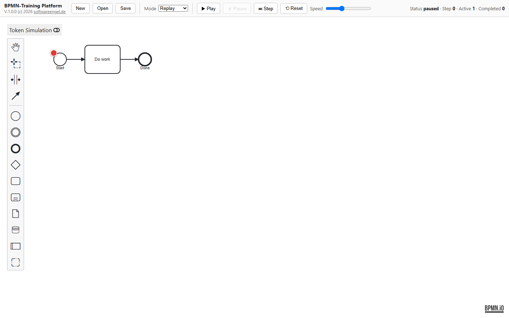
*Der Editor mit dem Ausgangsdiagramm: Startereignis, Aufgabe, Endereignis.*

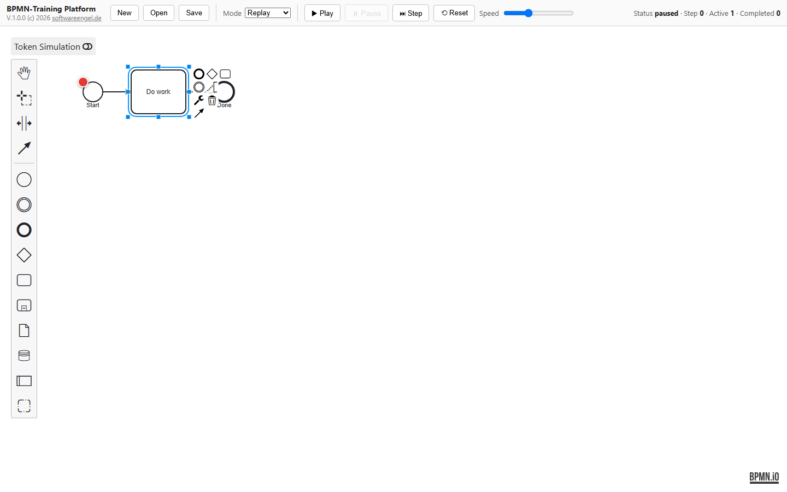
*Das Kontextmenü einer ausgewählten Aufgabe: Elemente anhängen, verbinden, den Typ ändern oder löschen.*

### Video: Bewährte Vorgehensweisen beim Modellieren

<video src="../_asset/videos/editing-best-practice.webm" controls width="100%" poster="../_asset/screenshots/02-editor-context-pad.png"></video>

▶ [editing-best-practice.webm](../_asset/videos/editing-best-practice.webm) (ca. 1:45 Min., deutsche Untertitel)

Das Video erstellt Schritt für Schritt einen kleinen Bestellprozess und zeigt neun bewährte Vorgehensweisen:

1. Das Startereignis als Zustand benennen: „Bestellung eingegangen“.
2. Aufgaben nach dem Muster Objekt + Verb benennen: „Bestellung prüfen“.
3. Das Gateway als Frage formulieren: „Ware verfügbar?“.
4. Jeden ausgehenden Zweig beschriften (ja / nein).
5. Jeden Pfad in einem benannten Endzustand abschließen.
6. Aufgaben vergrößern, damit auch längere Bezeichnungen lesbar bleiben.
7. Zuständigkeiten durch einen Pool und Lanes sichtbar machen. In der Simulation werden Lanes zu Ressourcen.
8. Das Modell prüfen, indem im Replay jeder Pfad durchgespielt wird.
9. Das Modell als `.bpmn`-Datei speichern.

---

## 2. Beispielprozesse

Sechs Beispieldiagramme decken die grundlegenden Muster aus Einführungskursen ab. Die vier neuen Beispiele liegen unter [e2e/fixtures/examples](../e2e/fixtures/examples/).

| Muster | Screenshot |
| --- | --- |
| Lineare Abfolge ([01-linear.bpmn](../e2e/fixtures/examples/01-linear.bpmn)) | 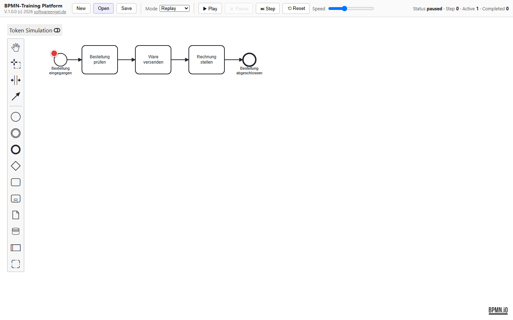 |
| Exklusive Entscheidung, XOR ([02-xor-decision.bpmn](../e2e/fixtures/examples/02-xor-decision.bpmn)) | 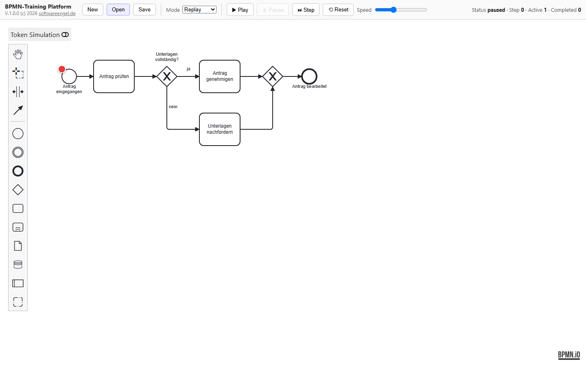 |
| Parallele Aufspaltung/Zusammenführung, AND ([03-parallel.bpmn](../e2e/fixtures/examples/03-parallel.bpmn)) | 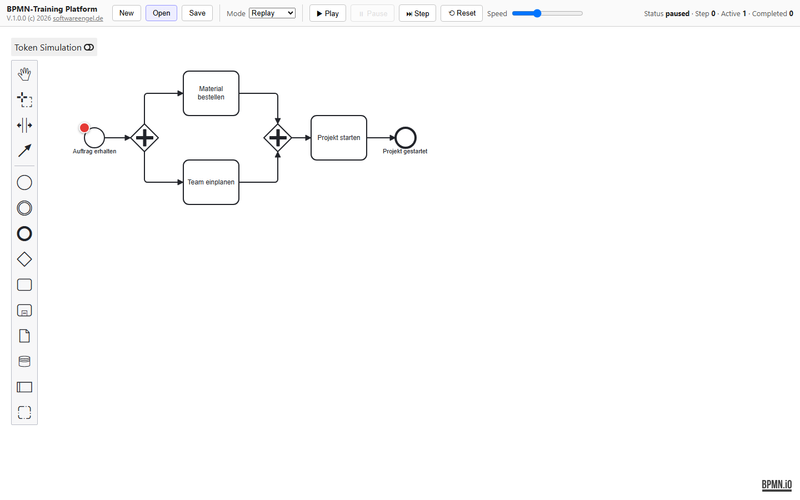 |
| Hochschulbewerbung mit Lanes ([04-lanes-university.bpmn](../e2e/fixtures/examples/04-lanes-university.bpmn)) | 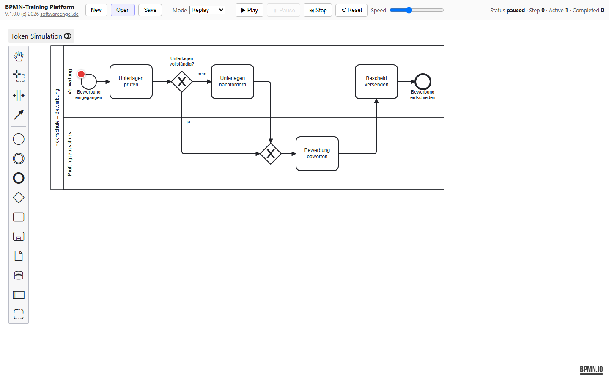 |
| Einfacher Prozess mit zwei Lanes ([lanes.bpmn](../e2e/fixtures/lanes.bpmn)) | 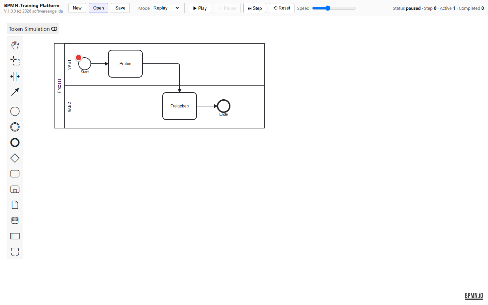 |
| Zusammenarbeit mit Anfrage und Antwort ([diag_req_resp.bpmn](../testdata/diag_req_resp.bpmn)) | 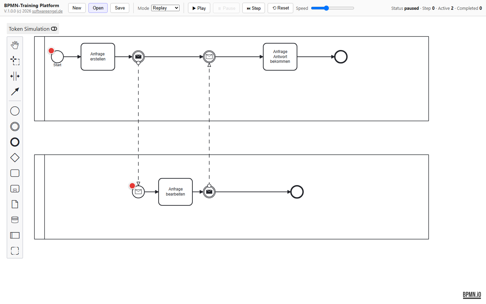 |

Das Beispiel zur Zusammenarbeit eignet sich gut, um Pools und Nachrichtenflüsse zu besprechen. Der Simulator führt Nachrichtenflüsse allerdings nicht aus: Jeder Pool arbeitet mit eigenen Token.

---

## 3. Prozesslogik verstehen: Token-Simulation

### Replay: Schritt für Schritt, mit eigenen Entscheidungen

Im Modus **Replay** durchläuft ein roter Token den Prozess. Mit **▶ Play** läuft er automatisch weiter; **⏭ Step** bewegt ihn jeweils um einen Schritt vorwärts.

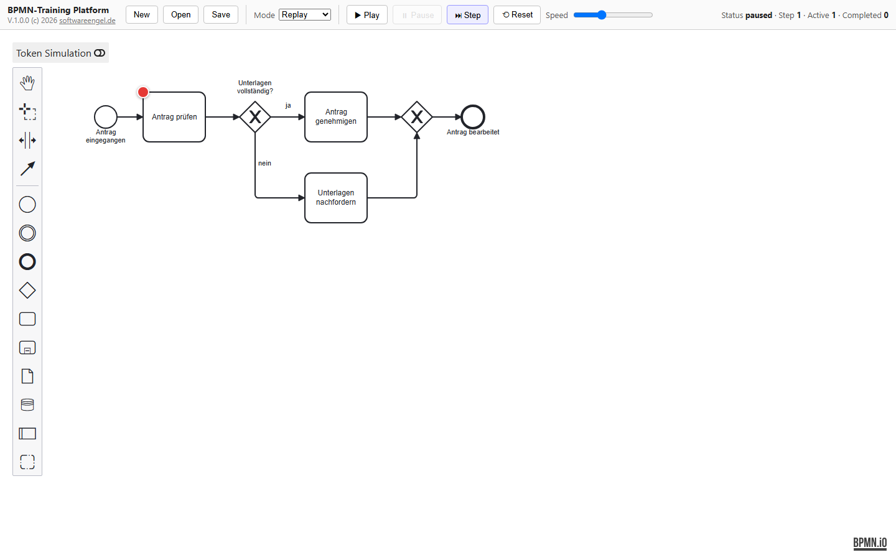
*Der rote Token nach dem ersten Schritt.*

An einem exklusiven Gateway hält das Replay an. Nummerierte Schaltflächen kennzeichnen die möglichen Pfade, und die Studierenden entscheiden selbst.

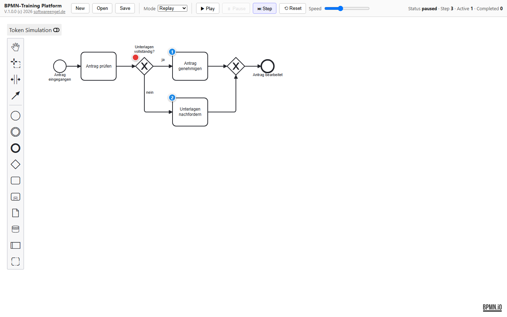
*Pfadauswahl bei „Unterlagen vollständig?“: 1 = ja, 2 = nein.*

An einem parallelen Gateway teilt sich der Token auf. Die Zusammenführung wartet, bis beide Token angekommen sind.

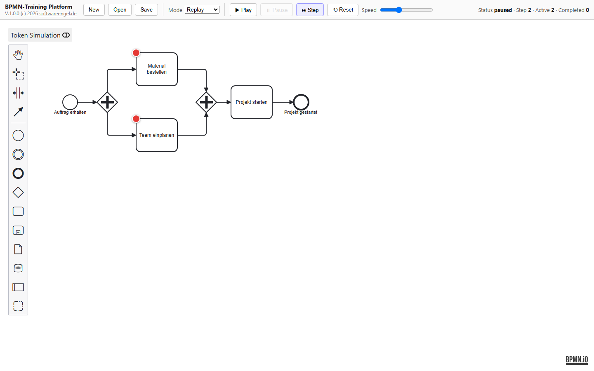
*Nach der AND-Aufspaltung laufen „Material bestellen“ und „Team einplanen“ parallel.*

### Animierte Token-Simulation (bpmn-js)

Der Schalter **Token Simulation** oben links aktiviert die animierte Simulation von bpmn-js. Startereignisse lassen sich auslösen, Gateway-Pfade im Voraus festlegen und sämtliche Schritte in einem Protokoll nachvollziehen.

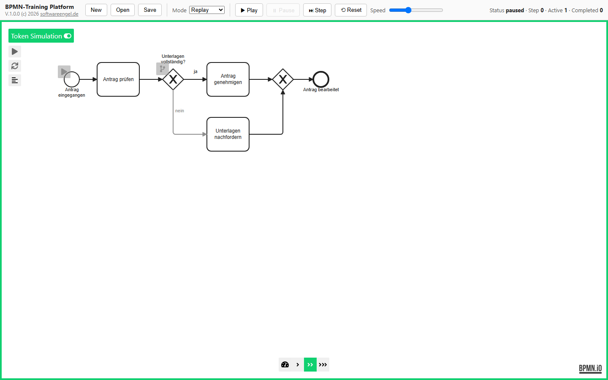
*Aktivierter Simulationsmodus: Auslöseschaltflächen am Startereignis und Pfadsteuerung am Gateway.*

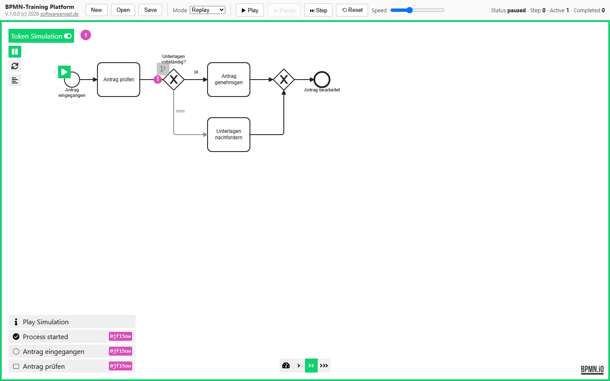
*Ein Token auf seinem Weg durch den Prozess; links unten ist das Ereignisprotokoll zu sehen.*

### Video: Token-Simulation

<video src="../_asset/videos/token-simulation.webm" controls width="100%" poster="../_asset/screenshots/10-replay-branch-choice.png"></video>

▶ [token-simulation.webm](../_asset/videos/token-simulation.webm) (ca. 1:50 Min., deutsche Untertitel)

Das Video zeigt:

- Das Replay am XOR-Beispiel: einmal mit ▶ Play (Pfad „ja“) und einmal mit ⏭ Step (Pfad „nein“).
- Die AND-Aufspaltung und AND-Zusammenführung im Parallelbeispiel.
- Die animierte bpmn-js-Simulation, bei der der Gateway-Pfad zunächst auf „nein“ und anschließend wieder auf „ja“ gesetzt wird.
- Die Funktion „Ein Fall“ aus der Simulationsansicht, die einen zufälligen Fall entsprechend den eingestellten Wahrscheinlichkeiten durchspielt.

---

## 4. Berechnen: die Szenariosimulation

Im Modus **Stochastic** simuliert bpmnsim viele Fälle gleichzeitig. Jede Aufgabe hat eine Dauer und Kosten, Gateways besitzen Wahrscheinlichkeiten, und Lanes werden zu Ressourcenpools mit einem Wochenarbeitskalender (Montag bis Freitag). Ist eine Rolle ausgelastet, müssen Fälle in einer Warteschlange warten.

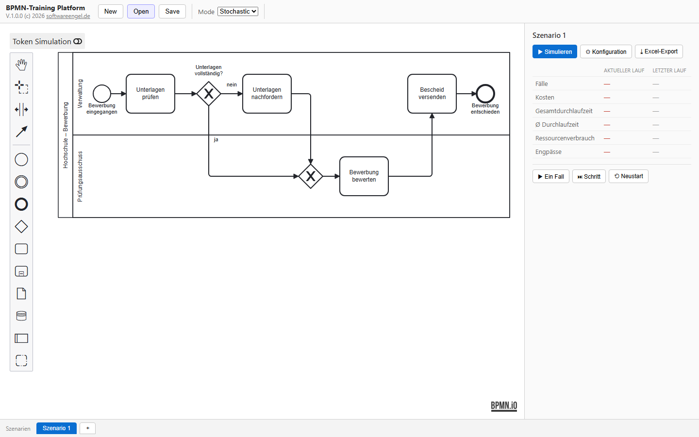
*Die Simulationsansicht: rechts die Seitenleiste mit Ergebnissen, unten die Szenario-Reiter.*

### Konfiguration: Szenario 1 (Ausgangsszenario)

Die Konfiguration umfasst vier Reiter: Kosten, Dauer, Häufigkeit und Ressourcen.

| Kosten | Dauer |
| --- | --- |
| 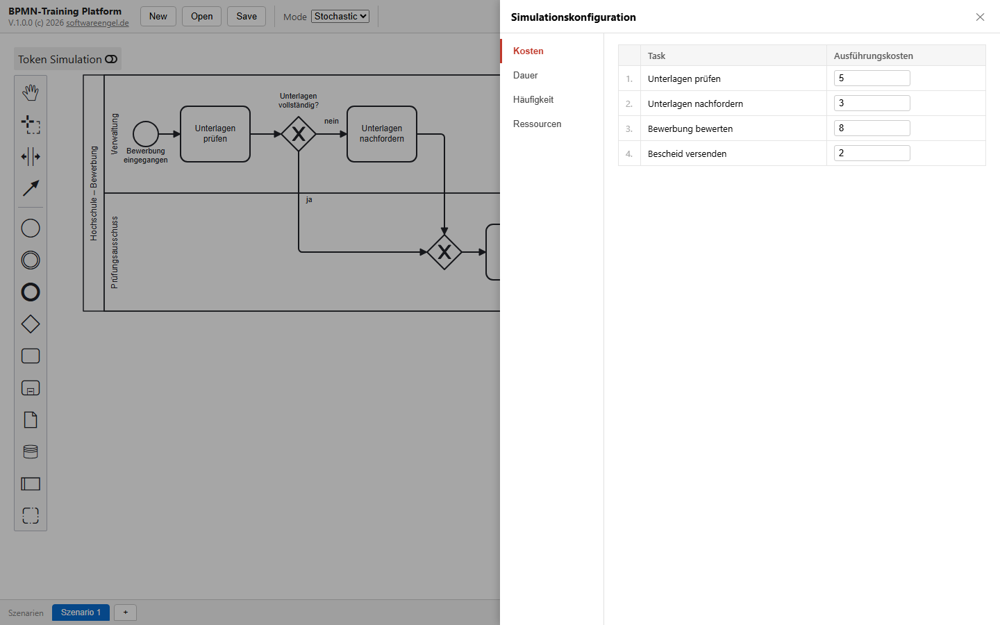 | 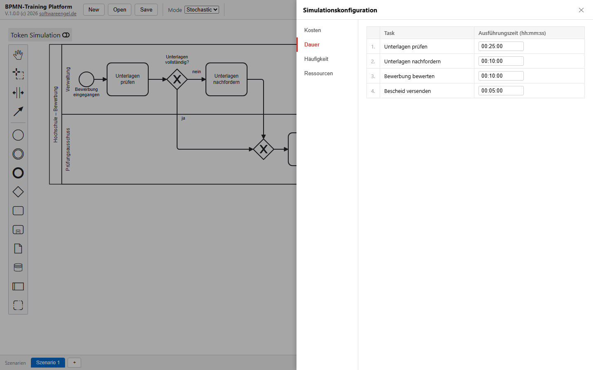 |
| **Häufigkeit** | **Ressourcen** |
| 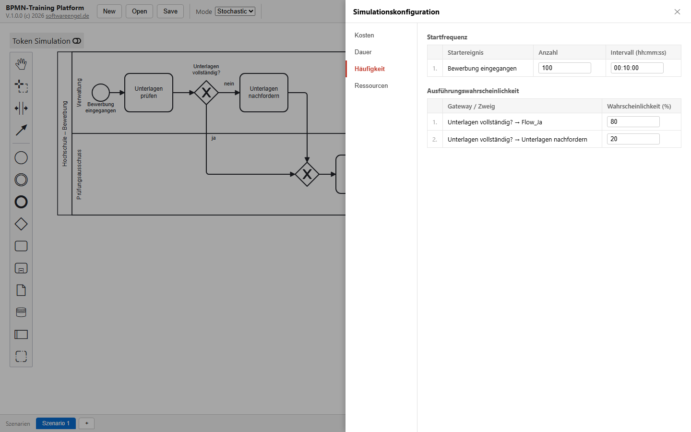 | 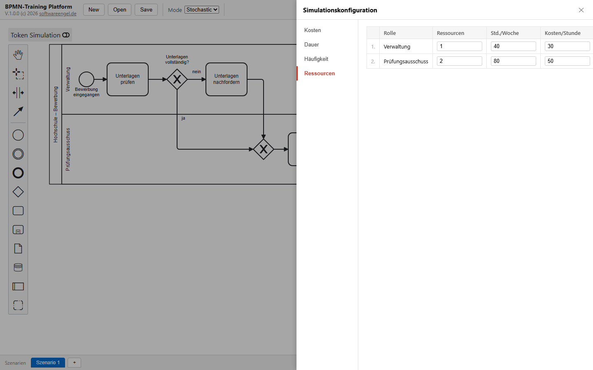 |

Szenario 2 wird über **+** als Kopie von Szenario 1 angelegt. Nur die beiden unten fett hervorgehobenen Werte ändern sich.

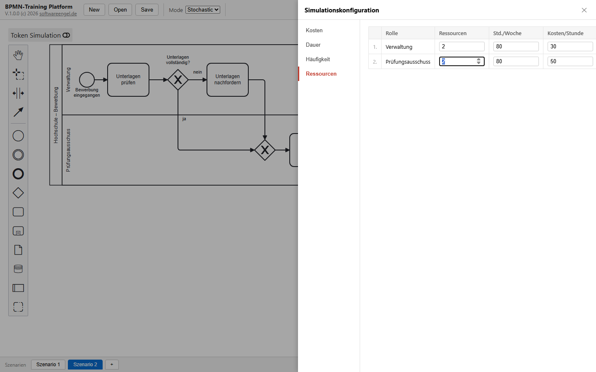
*Szenario 2: Verwaltung mit 2 Personen und 80 Stunden pro Woche.*

| Parameter | Szenario 1 | Szenario 2 |
| --- | --- | --- |
| Fälle / Ankunftsintervall | 100, alle 10 Min. | 100, alle 10 Min. |
| „Unterlagen vollständig?“ | 80 % ja / 20 % nein | 80 % ja / 20 % nein |
| Unterlagen prüfen | 25 Min., 5 € | **15 Min.**, 5 € |
| Unterlagen nachfordern | 10 Min., 3 € | 10 Min., 3 € |
| Bewerbung bewerten | 10 Min., 8 € | 10 Min., 8 € |
| Bescheid versenden | 5 Min., 2 € | 5 Min., 2 € |
| Verwaltung (Rolle) | 1 Person, 40 Std./Woche, 30 €/Std. | **2 Personen, 80 Std./Woche**, 30 €/Std. |
| Prüfungsausschuss (Rolle) | 2 Personen, 80 Std./Woche, 50 €/Std. | 2 Personen, 80 Std./Woche, 50 €/Std. |

Die Wochenstunden gelten **insgesamt für die Rolle**, nicht pro Person.

### Ergebnisse

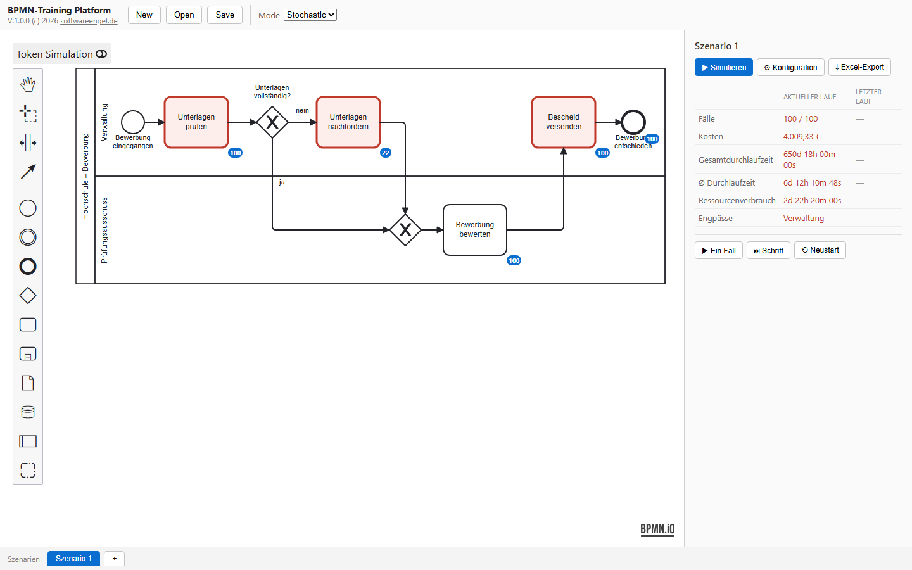
*Szenario 1: Die Aufgaben der Verwaltung sind als Engpass rot markiert. Die Kennzahlen an den Aufgaben zeigen, wie oft sie ausgeführt wurden.*

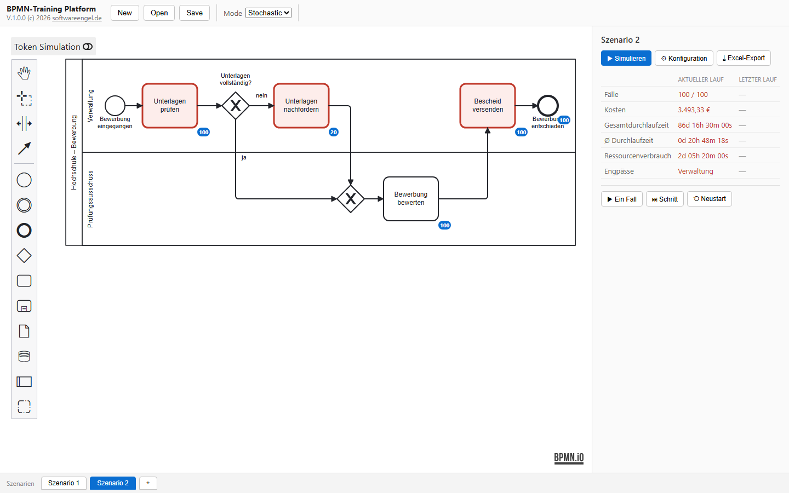
*Szenario 2: dasselbe Modell mit mehr Kapazität und einer schnelleren Prüfung.*

Die Werte aus diesen Screenshots:

| Kennzahl | Szenario 1 | Szenario 2 |
| --- | --- | --- |
| Fälle (abgeschlossen / gestartet) | 100 / 100 | 100 / 100 |
| Kosten | 4.009,33 € | 3.493,33 € |
| Gesamtdurchlaufzeit (Summe über alle Fälle) | 650 T. 18 Std. 00 Min. | 86 T. 16 Std. 30 Min. |
| Durchschnittliche Durchlaufzeit | 6 T. 12 Std. 10 Min. | 0 T. 20 Std. 48 Min. |
| Ressourcenverbrauch | 2 T. 22 Std. 20 Min. | 2 T. 05 Std. 20 Min. |
| Engpass | Verwaltung | Verwaltung |

**Interpretation für das Seminar:**

- Die durchschnittliche Durchlaufzeit sinkt von mehr als sechs Tagen auf unter einen Tag, weil sich die Bewerbungen nicht mehr vor einer einzelnen Person stauen.
- Auch die Kosten sinken, vor allem weil die schnellere Prüfung weniger bezahlte Arbeitsstunden erfordert.
- Die Verwaltung bleibt der Engpass, allerdings auf deutlich niedrigerem Niveau. Das nächste Experiment liegt nahe: Was passiert, wenn nur die Prüfung schneller wird oder nur die Kapazität steigt?

Jeder Simulationslauf verwendet einen neuen Zufalls-Seed; deshalb unterscheiden sich die Werte von Lauf zu Lauf geringfügig. Bei diesem Lauf nahmen 22 Bewerbungen (Szenario 1) beziehungsweise 20 Bewerbungen (Szenario 2) den Pfad „nein“. Der Test, auf dem die Screenshots beruhen, prüft lediglich, ob Szenario 2 sowohl eine kürzere durchschnittliche Durchlaufzeit **als auch** niedrigere Kosten als Szenario 1 aufweist.

### Video: Berechnungssimulation, Szenario 1 im Vergleich zu Szenario 2

<video src="../_asset/videos/calculation-simulation.webm" controls width="100%" poster="../_asset/screenshots/19-szenario1-results.png"></video>

▶ [calculation-simulation.webm](../_asset/videos/calculation-simulation.webm) (ca. 1:50 Min., deutsche Untertitel)

Das Video:

1. Öffnet den Hochschulbewerbungsprozess.
2. Trägt alle Werte für Szenario 1 Reiter für Reiter ein.
3. Führt die Simulation aus und erläutert den Engpass.
4. Erstellt Szenario 2 und verändert die Prüfdauer sowie die Kapazität der Verwaltung.
5. Führt Szenario 2 aus und wechselt zwischen den beiden Szenario-Reitern.
6. Schließt mit dem Excel-Export ab.

Die Kennzahlen (KPIs) im Video stammen aus eigenen Simulationsläufen und können daher leicht von den Werten in den Screenshots abweichen.

---

## 5. Einsatz im Seminar

Eine 90-minütige Seminarsitzung kann genau dieser Abfolge folgen:

| Phase | Aktivität | Medien |
| --- | --- | --- |
| Modellieren | Die Studierenden modellieren den Bewerbungsprozess selbst. | Video zum Modellieren, Screenshots 01–08 |
| Logik | Mit dem Replay alle Pfade durchspielen; XOR und AND erklären. | Video zur Token-Simulation, Screenshots 09–13 |
| Ausgangsszenario | Szenario 1 konfigurieren und simulieren. | Screenshots 14–19 |
| Experiment | Jede Gruppe erprobt eine Änderung in Szenario 2. | Screenshots 20–21, Video zur Berechnungssimulation |
| Präsentation | Den Excel-Export vorstellen und die Empfehlung begründen. | Video zur Berechnungssimulation (Schluss) |

Das Lernziel besteht darin, auf Grundlage von Ergebnissen zu argumentieren, statt nur ein schöneres Diagramm zu zeichnen: **modellieren → vorhersagen → simulieren → vergleichen → begründen**.

## Wichtige Einschränkungen

- Der Simulator ist ein vereinfachtes Lehrmodell. Inklusive, ereignisbasierte und komplexe Gateways werden wie exklusive Entscheidungen behandelt; Nachrichtenflüsse werden nicht simuliert.
- Die Ankunft von Fällen erfolgt in festen Intervallen; die Arbeitskalender der Rollen verwenden vereinfachte Zeitfenster von Montag bis Freitag.
- Der `.xls`-Export besteht aus einer HTML-Tabelle, die sich mit Excel öffnen lässt.
- Das Remote-Logging (Loki) ist standardmäßig aktiviert und kann das vollständige Diagramm-XML enthalten. Für Lehrveranstaltungen sollte die Anwendung mit `VITE_LOKI_ENABLED=false` gebaut und mit synthetischen Daten verwendet werden.

Weitere Hintergründe zum Anwendungsfall und zur Projektvorstellung: [2026-11-13-192143-bpmn-trainer-university-use-case.md](./2026-11-13-192143-bpmn-trainer-university-use-case.md).

---

## Medien neu erzeugen

```bash
npm run media   # 21 Screenshots + 3 Videos → doc/media (ca. 6 Minuten)
```

Die Testspezifikationen liegen unter [e2e/media/](../e2e/media/); die Szenariowerte stehen in [scenarios.ts](../e2e/media/scenarios.ts).
