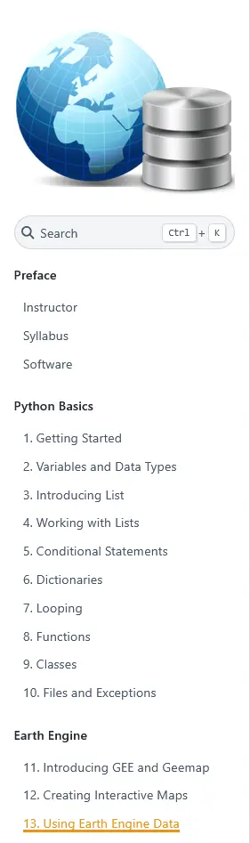

# Protomaps: Self-hosting map tiles has gotten cheap and easy
PMTiles is a tile format which works via HTTP Range requests and can be deployed as a single file to a storage bucket.
https://bruceroettgers.eu/blog/protomaps/

## Spatial Data Management

Welcome to the official website for the _Spatial Data Management_ course (GEOG-414) that I teach in Fall 2023 at the University of Tennessee, Knoxville.

https://geog-414.gishub.org/index.html

## geolibre

https://geolibre.app/

https://github.com/opengeos/GeoLibre

