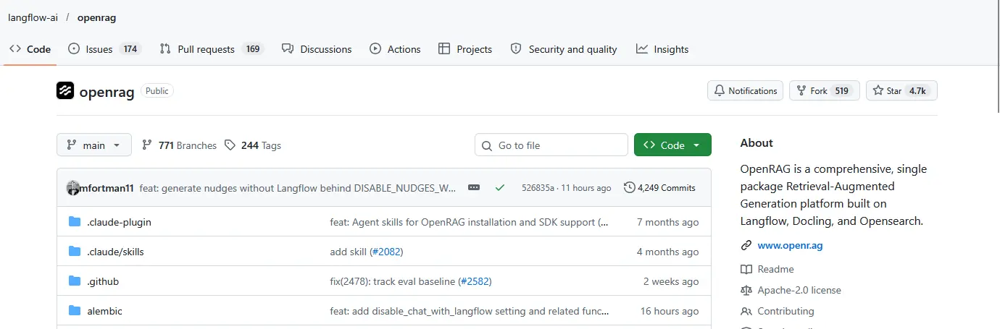

# DIY RAG 
## openrag 

https://docs.openr.ag/quickstart/
https://github.com/langflow-ai/openrag

## LLM Wiki

https://explainx.ai/blog/karpathy-llm-wiki-pattern-agent-memory-guide-2026

https://gist.github.com/karpathy/442a6bf555914893e9891c11519de94f

https://github.com/tobi/qmd
