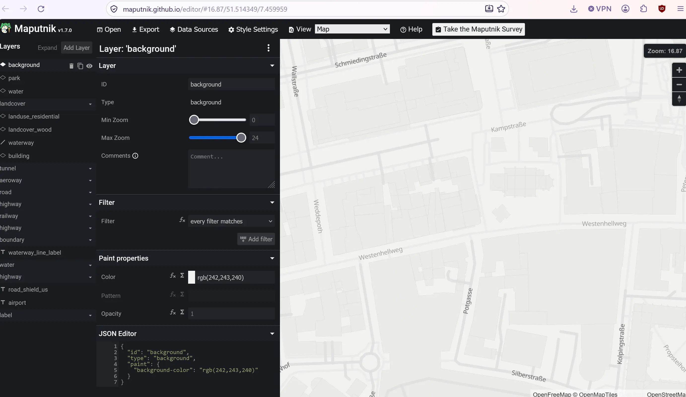

# Maplibre-Maputnik

A free and open visual editor for the [MapLibre GL styles](https://maplibre.org/maplibre-style-spec/) targeted at developers and map designers.
# Design a Style with Maputnik

[Maputnik](https://maputnik.github.io/) is a free and open-source visual editor for the [GL style specification](https://docs.maptiler.com/gl-style-specification/). You can either use the online version of Maputnik at [https://maplibre.org/maputnik/](https://maplibre.org/maputnik/) or [download the editor](https://github.com/maplibre/maputnik/releases) to use it locally.

## Links 

https://maputnik.github.io/editor/#16.87/51.514349/7.459959

https://github.com/maplibre/maputnik

https://github.com/maplibre/maputnik/wiki

https://maputnik.github.io/
