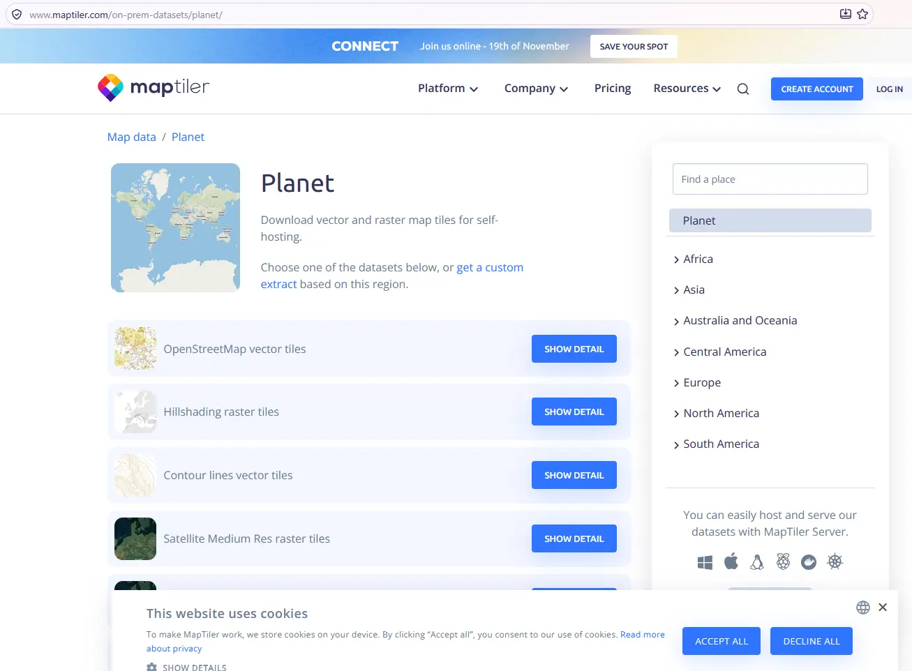
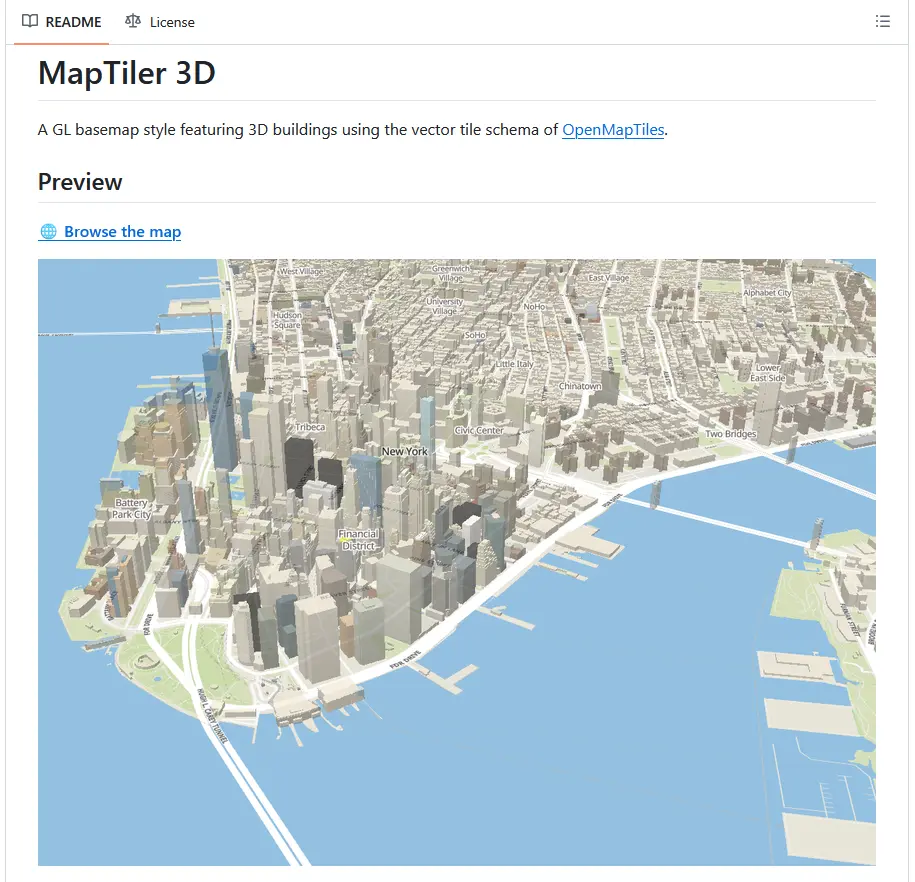

---
title:
tags:
date: 2026-11-23
toc: true
toc_sticky: true
---

# openmaptiles

OpenMapTiles is an extensible and open tile schema based on the OpenStreetMap. This project is used to generate vector tiles for online zoomable maps. OpenMapTiles is about creating a beautiful basemaps with general layers containing topographic information. More information [openmaptiles.org](https://openmaptiles.org/) and [maptiler.com/data/](https://www.maptiler.com/data/).

We encourage you to collaborate, reuse and adapt existing layers, or add your own layers. You may use our approach for your own vector tile project. Feel free to fork the repo and experiment. The repository is built on top of the [openmaptiles/openmaptiles-tools](https://github.com/openmaptiles/openmaptiles-tools) to simplify vector tile creation.

# Open-Source Stack for Building Maps with Vector Tiles

Includes the OpenMapTiles schema, ready-to-use map styles, and tools for generating vector tiles from OpenStreetMap.

## Links

https://openmaptiles.org/

https://github.com/openmaptiles
https://www.maptiler.com/on-prem-datasets/planet/

https://github.com/openmaptiles/openmaptiles

https://github.com/openmaptiles/maptiler-3d-gl-style

https://openmaptiles.org/about/
