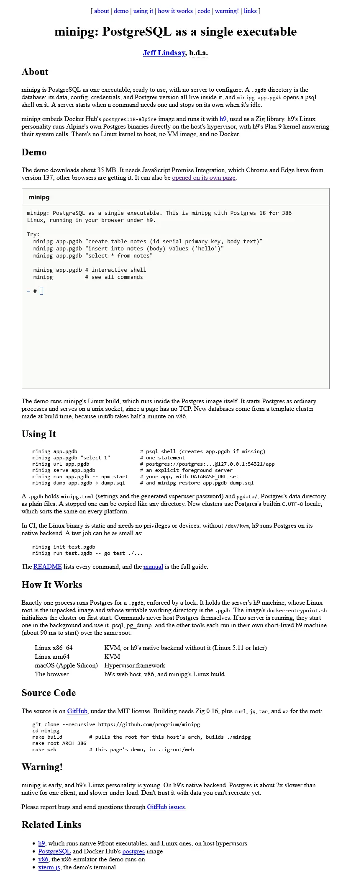

# minipg
minipg is PostgreSQL as one executable, ready to use, with no server to configure. A .pgdb directory is the database: its data, config, credentials, and Postgres version all live inside it, and minipg app.pgdb opens a psql shell on it. A server starts when a command needs one and stops on its own when it's idle.

minipg embeds Docker Hub's postgres:18-alpine image and runs it with [h9](https://progrium.github.io/hyper9/), used as a Zig library. h9's Linux personality runs Alpine's own Postgres binaries directly on the host's hypervisor, with h9's Plan 9 kernel answering their system calls. There's no Linux kernel to boot, no VM image, and no Docker.

## Links

<https://progrium.github.io/minipg/>
