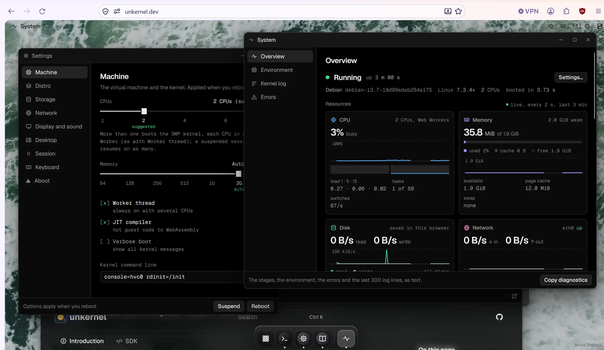
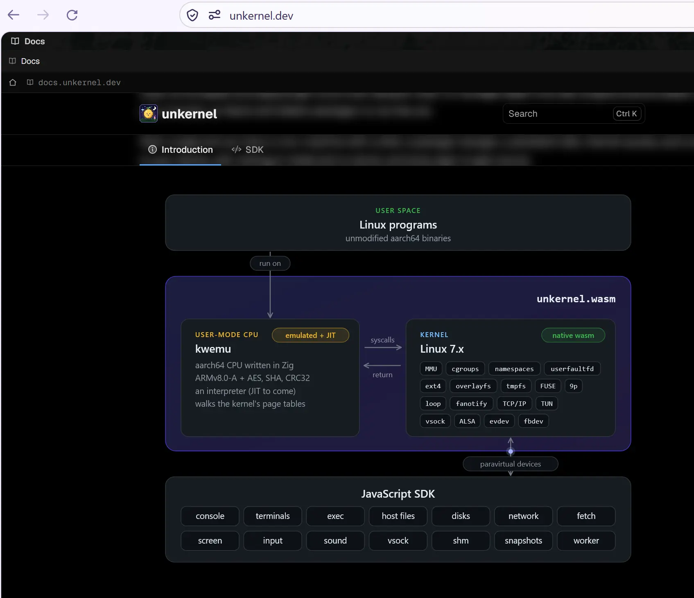
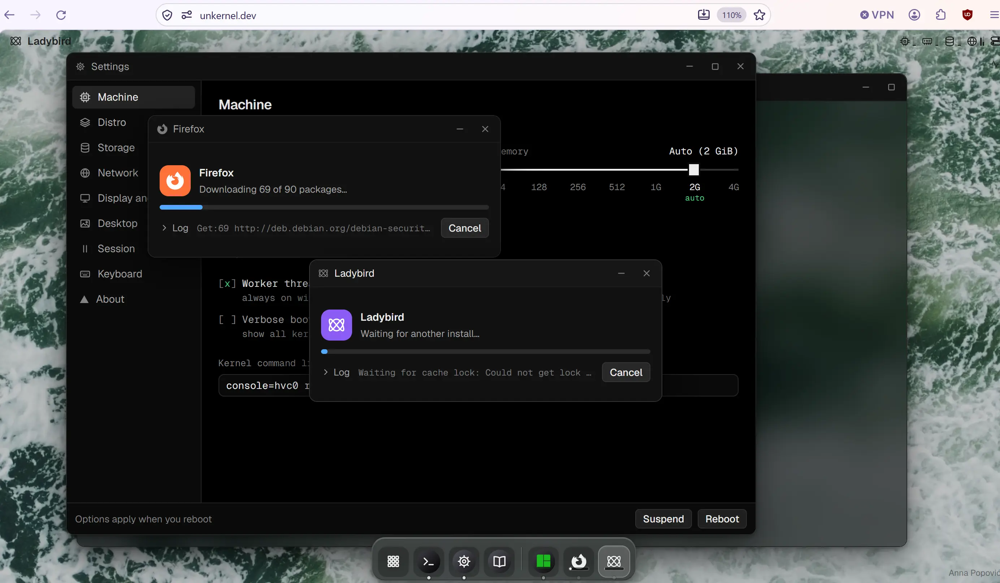

---
title:
tags:
date: 2026-11-28
toc: true
toc_sticky: true
---

# A real Linux kernel, compiled to WebAssembly. It boots to a shell in less than a second

## Install Browser in Linux in Browser 

## Links

https://github.com/pithings/unkernel

